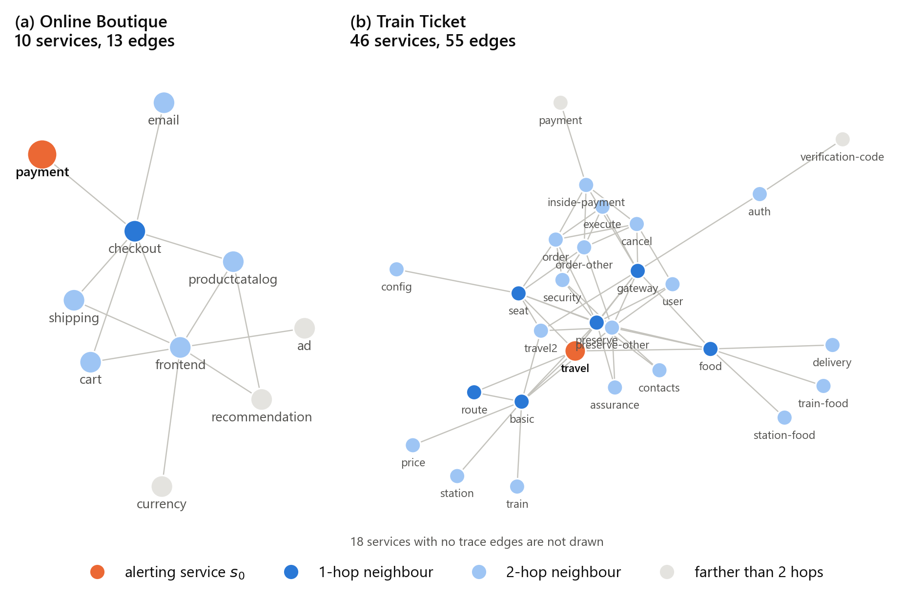
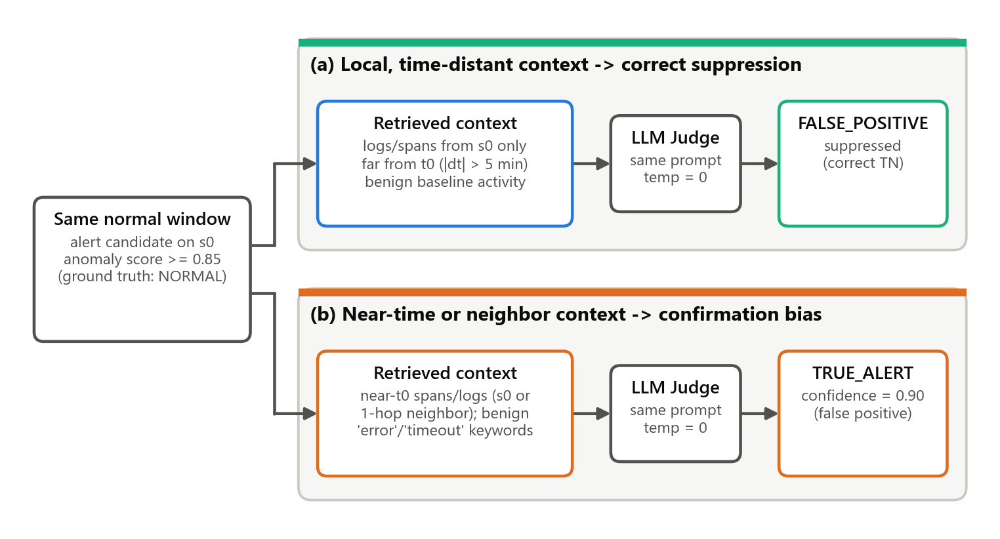

# Chương 2 — Kiến thức và công nghệ nền tảng

> **Ghi chú nội bộ (không chép vào bản nộp).** Nháp đồng bộ với bản LaTeX `thesis/chapters/ch2.tex`,
> `thesis/macros.tex`, `thesis/refs.bib` (cập nhật 2026-11-19 theo `outline-bao-cao-gd2.md` Chương 2 ≈ 15 trang,
> `suon-bao-cao-gd2.md` và `style-guide-luan-van.md` §3: mỗi khái niệm 4 bước định nghĩa → công thức → ví dụ trên
> Nezha → dùng ở đâu). Chương **không có kết quả thực nghiệm**. Số trong chương chỉ có ba loại:
> (1) mô tả bộ dữ liệu (`docs/label-audit.md`, QĐ-003, QĐ-004, `docs/graph-coverage.md`); (2) tham số thiết kế lấy từ
> mã và config (`services/detector/isolation_forest.py`, `services/retrieval/*.py`, `services/judge/prompt.py`,
> `eval/configs/ctav_final.yaml`, `rca_final.yaml`); (3) ví dụ minh hoạ có ghi rõ là giả định.
>
> Trích dẫn đánh số theo thứ tự xuất hiện **trong chương này** ([1]…[17]), khớp khóa BibTeX trong `thesis/refs.bib`.
> Mã hình, bảng (H2.4, H2.7, B2.1–B2.5) theo outline mục 5–6; LaTeX tự đánh số lại theo chương.

---

Chương này trình bày các khái niệm và công nghệ mà phần đề xuất (Chương 4) và phần thực nghiệm (Chương 5) dựa vào.
Nội dung đi theo đúng thứ tự xử lý của hệ thống. Mục 2.1 mô tả dữ liệu quan sát của hệ microservice và bộ dữ liệu
Nezha. Mục 2.2 nói về phát hiện bất thường và hiện tượng quá tải cảnh báo. Mục 2.3 trình bày các cách truy xuất bằng
chứng từ log và trace: BM25, đồ thị phụ thuộc service và cách hợp nhất chúng. Mục 2.4 giải thích cơ chế dùng mô hình
ngôn ngữ lớn làm bộ thẩm định và các rủi ro của nó, mục 2.5 giới thiệu bài toán phân tích nguyên nhân gốc. Mục 2.6 và
2.7 định nghĩa chỉ số, kiểm định thống kê và nguyên tắc đăng ký giả thuyết trước. Mục 2.8 giới thiệu các công nghệ
dùng để hiện thực hệ thống, và mục 2.9 tổng kết.

---

## 2.1 Dữ liệu quan sát trên hệ microservice

Mục này xác định đơn vị dữ liệu mà toàn bộ đề tài làm việc trên đó: ba loại tín hiệu quan sát, cách cắt chúng thành
cửa sổ, và bộ dữ liệu có nhãn dùng để đánh giá.

### 2.1.1 Metric, log, trace và cửa sổ trượt

Một hệ microservice gồm nhiều service nhỏ, mỗi service chạy trên một hoặc nhiều pod và gọi nhau qua mạng. Khả năng
quan sát (observability) của hệ dựa trên ba loại tín hiệu, tóm tắt ở Bảng 2.1. **Metric** là chuỗi thời gian số đo
định kỳ cho từng pod, như mức dùng CPU, bộ nhớ, lưu lượng mạng hay độ trễ phân vị. **Log** là các dòng văn bản do
service ghi ra, thường kèm mức nghiêm trọng (INFO, WARN, ERROR). **Trace** ghi lại đường đi của một request qua nhiều
service. Mỗi bước trên đường đi là một **span**, có định danh `SpanID`, định danh span cha `ParentID`, tên thao tác và
thời lượng. Quan hệ cha–con giữa các span cho biết service nào gọi service nào.

Bảng 2.1. Ba loại tín hiệu quan sát trên Nezha và vai trò của chúng trong đề tài.

| Tín hiệu | Dạng dữ liệu trên Nezha | Trường chính | Vai trò trong đề tài |
|---|---|---|---|
| Metric | CSV theo pod, một mẫu mỗi 60 s | 19 chỉ số: CPU, bộ nhớ, syscall, mạng vào/ra, độ trễ client/server P90/P95/P99, workload, tỉ lệ thành công, tài nguyên node | Đầu vào của bộ phát hiện bất thường |
| Log | CSV theo phút | thời điểm, pod, `TraceID`, `SpanID`, nội dung (kèm mức nghiêm trọng) | Bằng chứng văn bản cho judge |
| Trace | CSV theo phút | `TraceID`, `SpanID`, `ParentID`, pod, tên thao tác, thời điểm bắt đầu/kết thúc, thời lượng | Bằng chứng về độ trễ; nguồn dựng đồ thị phụ thuộc service |

Đề tài dùng metric để *phát hiện* và dùng log, trace làm *bằng chứng*. Cách chia vai này bám theo cách dữ liệu được
ghi: metric có ở mọi thời điểm, còn log và trace dày đặc và cần được chọn lọc trước khi đưa cho một mô hình đọc.

**Cửa sổ.** Đơn vị phân tích là **cửa sổ**: một mẫu metric của một pod, dài 60 s, vì file metric của Nezha lấy mẫu 60
s một lần. Mỗi cửa sổ có định danh tất định sinh từ service, pod và thời điểm bắt đầu. Một cửa sổ được gán nhãn
**có sự cố** nếu nó thuộc đúng pod bị tiêm lỗi và thời điểm bắt đầu nằm trong khoảng `[t_inject − 60 s, t_inject +
360 s]`; các cửa sổ còn lại là bình thường. Khoảng nhãn này phủ khoảng bảy cửa sổ cho mỗi lần tiêm lỗi: một phút trước
để bắt dấu hiệu sớm và sáu phút sau để bắt khoảng thời gian lỗi lan ra. Bộ phát hiện không nhìn từng cửa sổ một cách cô lập
mà giữ một bộ đệm trượt gồm vài mẫu gần nhất của cùng pod. Chi tiết bộ đệm ở §4.2.

Ví dụ trên Nezha: pod `adservice-5f6585d649-fnmft` của hệ OnlineBoutique có một dòng metric lúc 03:51 ngày
2022-08-22. Dòng đó là một cửa sổ, kéo dài tới 03:52. Log và trace của ngày đó được ghi thành từng file theo phút,
nên bằng chứng của cửa sổ này nằm rải trên nhiều file quanh mốc 03:51. Bằng chứng của một cửa sổ được tìm trong khoảng
±8 phút quanh cửa sổ (§2.3.1).

Đề tài dùng định nghĩa cửa sổ và quy tắc nhãn này ở mọi chương. Bộ phát hiện ở §4.2 chấm điểm từng cửa sổ, và mọi
chỉ số ở Chương 5 đếm trên cửa sổ.

### 2.1.2 Nezha và nhãn nguyên nhân gốc

Nezha [1] là bộ dữ liệu quan sát đa phương thức (metric + log + trace) thu từ hai hệ microservice mẫu,
**OnlineBoutique** và **TrainTicket**, trong đó lỗi được tiêm có chủ đích và có ghi lại pod bị tiêm. Đề tài dùng bốn
ngày dữ liệu: OnlineBoutique ngày 22 và 23/08/2022, TrainTicket ngày 29 và 30/01/2023. Có tổng cộng 101 lần tiêm lỗi
thuộc năm loại: `network_delay` (30 lần), `cpu_contention` (23), `exception` (20), `return` (18) và `cpu_consumed`
(10). Toàn bộ dữ liệu có 95.660 cửa sổ trên 103 pod, tương ứng 56 service. Trong số đó, 704 cửa sổ có sự cố, tức
khoảng 0,74%: cứ một cửa sổ có sự cố thì có khoảng 135 cửa sổ bình thường.

**Nhãn nguyên nhân gốc.** Mỗi lần tiêm lỗi được ghi kèm thời điểm, loại lỗi và pod bị tiêm. Nhãn vì vậy ở mức pod.
Cả 28 pod từng bị tiêm lỗi đều ánh xạ được về tên service chuẩn, nên mọi cửa sổ có sự cố đều có nhãn **service gốc**.
Nhãn này dùng cho phần đánh giá phân tích nguyên nhân gốc (§2.6.2). Nezha ghi mỗi mốc thời gian ở hai cột, và hai cột
không khớp nhau ở một phần dữ liệu. Đề tài dùng cột giờ hệ thống (wall-clock), là cột nhất quán trên cả bốn ngày.

**Chia dữ liệu chống rò rỉ.** Dữ liệu được chia thành ba phần (split) theo tỉ lệ 20/30/50: `dev` để phát triển và fit
bộ phát hiện, `val` để chọn cấu hình, `test` để kiểm định đúng một lần. Việc chia có hai ràng buộc. Thứ nhất, đơn vị
gán là **lần tiêm lỗi**, không phải cửa sổ. Bảy cửa sổ của cùng một lần tiêm mô tả cùng một sự kiện, nên nếu chia lẻ
chúng, cấu hình chọn trên `val` sẽ được chấm lại trên những sự kiện nó đã thấy. Thứ hai, có **vùng đệm 600 s**: cửa sổ
bình thường của cùng pod nằm gần một lần tiêm lỗi dưới 600 s bị loại khỏi cả ba split (597 cửa sổ), vì chúng có thể
mang dư âm của lỗi. Tỉ lệ mất cân bằng được giữ nguyên, không lấy mẫu bớt cửa sổ bình thường, vì precision phụ thuộc
trực tiếp vào tỉ lệ này. Kết quả là `dev` có 19.316 cửa sổ (149 có sự cố, 21 lần tiêm), `val` có 28.898 cửa sổ (209
có sự cố, 30 lần tiêm) và `test` có 46.849 cửa sổ (346 có sự cố, 50 lần tiêm).

**Cửa sổ có telemetry.** Nezha chỉ ghi log và trace quanh các lần tiêm lỗi. Mọi cửa sổ có sự cố đều có log hoặc trace
trong ±8 phút, nhưng chỉ khoảng một phần tư cửa sổ bình thường có. Với ba phần tư còn lại, một judge bắt buộc trích
bằng chứng sẽ "đúng" một cách tầm thường vì không có gì để trích. Đề tài vì vậy tính chỉ số chính trên tập **cửa sổ
có telemetry**, gồm các cửa sổ có ít nhất một file log hoặc trace trong ±8 phút. Tập này được xác định từ danh sách
file của bộ dữ liệu, không dùng nhãn. Chỉ số trên mọi cửa sổ vẫn được báo cáo làm số phụ.

Bộ dữ liệu, cách chia và tập cửa sổ có telemetry là nền của mọi phép đo ở Chương 5. Lý do chọn Nezha và giới hạn của
việc chỉ dùng một bộ dữ liệu được bàn ở §7.3.

---

## 2.2 Phát hiện bất thường và quá tải cảnh báo

Mục này giải thích vì sao một bộ phát hiện bất thường trên metric chưa đủ để cảnh báo người vận hành, và giới thiệu
Isolation Forest, bộ phát hiện mà đề tài sử dụng.

### 2.2.1 Bất thường, khoảng trống ngữ nghĩa và quá tải cảnh báo

**Bất thường** (anomaly) là điểm dữ liệu lệch khỏi hành vi thường gặp của hệ. Một bộ phát hiện bất thường gán cho mỗi
cửa sổ một **điểm bất thường** và so với một ngưỡng; cửa sổ vượt ngưỡng trở thành **candidate** cảnh báo. Điểm này chỉ
nói rằng số đo khác thường. Nó không nói số đo khác thường *vì sao*, cũng không nói có sự cố hay không. Một đợt tải
tăng hợp lệ, một tác vụ định kỳ hay một pod vừa khởi động lại đều có thể làm metric lệch. Khoảng cách giữa "số đo lệch"
và "có sự cố cần người xử lý" được gọi là **khoảng trống ngữ nghĩa**. Để lấp khoảng trống này, cần ngữ cảnh vận hành
mà metric không có, chẳng hạn log lỗi hay trace chậm.

Khi khoảng trống không được lấp, người vận hành nhận rất nhiều cảnh báo, phần lớn là báo động giả. Hiện tượng này gọi
là **quá tải cảnh báo** (alert fatigue): người vận hành dần bỏ qua cảnh báo, kể cả cảnh báo thật [2]. Trên Nezha, mất cân bằng 1 : 135 cho thấy vấn đề rõ
ràng. Giả sử một bộ phát hiện chỉ báo nhầm 1% cửa sổ bình thường của `val` (28.689 cửa sổ). Nó đã sinh khoảng 287 báo
động giả, nhiều hơn cả tổng số cửa sổ có sự cố của split này (209). Precision khi đó không thể vượt 209 / (209 + 287)
≈ 0,42, kể cả khi bộ phát hiện bắt trọn mọi sự cố.

Đề tài không thay bộ phát hiện. Đề tài thêm một khâu **thẩm định cảnh báo** đứng sau nó: mỗi candidate được đối
chiếu với bằng chứng từ log và trace trước khi chuyển cho người vận hành. Khâu này là CTAV (thẩm định cảnh báo hiệu
chỉnh theo bằng chứng đa phương thức), trình bày ở §4.3.

### 2.2.2 Isolation Forest

Isolation Forest [3] phát hiện bất thường bằng cách *cô lập* điểm dữ liệu thay vì mô hình hoá dữ liệu bình thường. Ý
tưởng là: điểm bất thường ít và khác biệt, nên dễ bị tách riêng bằng vài nhát cắt ngẫu nhiên. Thuật toán dựng nhiều cây
cô lập. Mỗi cây chọn ngẫu nhiên một đặc trưng và một giá trị cắt nằm giữa giá trị nhỏ nhất và lớn nhất của đặc trưng
đó, rồi chia đệ quy cho đến khi mỗi điểm nằm riêng một lá. Độ dài đường đi `h(x)` từ gốc tới lá chứa điểm `x` càng
ngắn thì `x` càng dễ cô lập, tức càng bất thường. Điểm bất thường chuẩn hoá của `x` trên tập huấn luyện cỡ `n` là:

```
s(x, n) = 2^( −E[h(x)] / c(n) ),    c(n) = 2·H(n − 1) − 2·(n − 1)/n,    H(i) ≈ ln(i) + 0,5772
```

trong đó `E[h(x)]` là độ dài đường đi trung bình qua các cây và `c(n)` là độ dài đường đi trung bình của một tìm kiếm
không thành công trên cây nhị phân, dùng để chuẩn hoá. `s` gần 1 nghĩa là rất bất thường; `s` quanh 0,5 hoặc thấp hơn
nghĩa là bình thường. Thuật toán không cần nhãn, chạy nhanh và ít tham số. Đó là lý do nó hợp với vai trò bộ lọc đầu
tiên trên luồng metric lớn.

Đề tài fit Isolation Forest trên các cửa sổ của `dev`, không dùng nhãn. Đặc trưng của một cửa sổ là các thống kê
(trung bình, độ lệch chuẩn, nhỏ nhất, lớn nhất, giá trị cuối, độ thay đổi, tỉ lệ thiếu) của từng metric trên bộ đệm
trượt của pod. Thay cho `s(x, n)`, điểm bất thường được quy về **thứ hạng phân vị** so với điểm của các cửa sổ huấn
luyện: điểm 0,85 nghĩa là cửa sổ bất thường hơn 85% cửa sổ của `dev`. Cách quy đổi này làm ngưỡng dễ diễn giải và
không phụ thuộc thang đo thô của mô hình.

Ví dụ: một pod `ts-travel-service` của TrainTicket bị tiêm `network_delay`. Độ trễ server P90 của pod tăng vọt trong
vài phút, nên trên bộ đệm trượt, giá trị lớn nhất và độ thay đổi của metric này lệch xa so với dữ liệu `dev`. Cửa sổ
của pod bị tách riêng sau ít nhát cắt, nhận điểm cao và vượt ngưỡng 0,85, nên trở thành candidate. Một đợt tăng tải
bình thường làm cùng metric lệch theo cách tương tự cũng có thể vượt ngưỡng. Đây chính là khoảng trống ngữ nghĩa ở
§2.2.1.

Isolation Forest là bộ phát hiện duy nhất của hệ. Ngưỡng 0,85, bộ đệm, cách xử lý metric thiếu và cổng Rescue cho cửa
sổ dưới ngưỡng được trình bày ở §4.2.

---

## 2.3 Truy xuất bằng chứng

Mục này trình bày cách chọn một số ít sự kiện log và trace làm bằng chứng cho một candidate: truy xuất theo từ vựng
(BM25), theo đồ thị phụ thuộc service, cách hợp nhất các tín hiệu đó, và khung chung RAG.

### 2.3.1 BM25 trên văn bản log và trace

**BM25** [4] là hàm xếp hạng tài liệu theo mức khớp từ vựng với truy vấn. Mỗi sự kiện log hoặc span được coi là một
tài liệu văn bản đã tách thành từ. Với truy vấn `Q = {q₁, …, q_m}` và tài liệu `D`:

```
BM25(D, Q) = Σᵢ IDF(qᵢ) · f(qᵢ, D)·(k₁ + 1) / ( f(qᵢ, D) + k₁·(1 − b + b·|D| / avgdl) )

IDF(q) = ln( 1 + (N − n(q) + 0,5) / (n(q) + 0,5) )
```

trong đó `f(q, D)` là số lần từ `q` xuất hiện trong `D`, `|D|` là độ dài tài liệu, `avgdl` là độ dài trung bình của
kho, `N` là số tài liệu và `n(q)` là số tài liệu chứa `q`. Tham số `k₁` điều khiển mức bão hoà theo tần suất từ, còn
`b` điều khiển mức phạt tài liệu dài. Đề tài dùng `k₁ = 1,5` và `b = 0,75`. Từ hiếm (IDF cao) như tên một service
hay một mã lỗi đóng góp nhiều hơn từ phổ biến như "request".

**Truy vấn sinh từ candidate.** Truy vấn ghép tên service, tên pod, các metric lệch nhiều nhất và giá trị của chúng.
Truy vấn **không** chứa loại lỗi đã tiêm. Đây là nhãn, và đưa nó vào truy vấn sẽ làm rò nhãn sang bằng chứng. Bằng
chứng chỉ được tìm trong khoảng ±8 phút quanh cửa sổ.

Ví dụ: candidate ở pod `paymentservice` có truy vấn gồm `paymentservice`, tên pod và các metric như
`PodServerLatencyP90(s)`. Một dòng log của `paymentservice` chứa đúng tên service và từ "error" sẽ xếp trên một dòng
log INFO của `frontend` chỉ chứa từ chung "request".

BM25 cho phép tìm bằng chứng mà không cần huấn luyện. Baseline BM25 của đề tài dùng điểm BM25 làm thành phần từ
vựng, kết hợp với độ gần thời gian, độ khớp service/pod và mức nghiêm trọng của sự kiện. Công thức đầy đủ ở §4.3.2.

### 2.3.2 Đồ thị phụ thuộc service

**Đồ thị phụ thuộc service** `G = (V, A)` có mỗi nút là một service. Có cạnh `u → v` khi trace cho thấy một span của
`u` là cha của một span của `v`, tức `u` gọi `v`. Đề tài dựng đồ thị từ mọi file trace của Nezha (307 file, khoảng
4,18 triệu span): với mỗi span có span cha thuộc service khác thì thêm một cạnh, trọng số là số lần xuất hiện. Cạnh
xuất hiện dưới 5 lần bị loại để giảm nhiễu. Đồ thị thu được có 56 service và 68 cạnh, gồm 20 thành phần liên thông;
thành phần lớn nhất có 28 service. Có 18 service TrainTicket không có span gọi qua service khác trong dữ liệu, nên nằm
cô lập. Khoảng cách `d_G(s, s')` là số cạnh trên đường ngắn nhất giữa hai service khi bỏ hướng cạnh. Hai service không
nối với nhau có khoảng cách vô cùng.

Hình 2.4 vẽ đồ thị của hai hệ. Người đọc nên nhìn vào vùng tô màu quanh service phát cảnh báo: nút gốc `s₀`, các nút
cách 1 hop và 2 hop. Đây là phạm vi mà truy xuất theo topology (§2.3.3) mở rộng tới.



Hình 2.4. Đồ thị phụ thuộc service dựng từ trace của Nezha: (a) OnlineBoutique, 10 service, 13 cạnh; (b) TrainTicket,
46 service, 55 cạnh. Màu cho thấy phạm vi mở rộng 1 hop và 2 hop từ một service phát cảnh báo s₀ (ví dụ
`paymentservice` và `ts-travel-service`). 18 service TrainTicket không xuất hiện trong cạnh nào của trace nên không
được vẽ.

Ví dụ trên OnlineBoutique: `paymentservice` chỉ có một láng giềng trực tiếp là `checkoutservice`, service gọi nó khi
thanh toán. Ở khoảng cách 2 có `frontend`, `cartservice`, `productcatalogservice`, `shippingservice` và
`emailservice`, tức những service mà `checkoutservice` gọi hoặc bị gọi bởi. Nếu `paymentservice` chậm, triệu chứng có
thể hiện ở span của `checkoutservice` và `frontend` trước khi hiện ở log của chính `paymentservice`.

Cần phân biệt **gần trên đồ thị** với **có quan hệ nhân quả**. Hai service kề nhau chỉ cho biết có lời gọi giữa chúng
trong dữ liệu. Nó không cho biết lỗi ở service này *gây ra* triệu chứng ở service kia. Đồ thị còn chỉ phản ánh những
đường gọi có trong trace đã ghi, nên một service ít được gọi có thể bị thiếu cạnh. Đề tài dùng đồ thị theo hai cách:
mở rộng ngữ cảnh truy xuất cho CTAV (§4.3.3) và gom cảnh báo, lan truyền ngược trong tác tử RCA (§4.4).

### 2.3.3 Hợp nhất đa phương thức (Fusion Score)

Truy xuất theo từ vựng chỉ tìm sự kiện có từ khớp truy vấn, nên dễ bỏ sót triệu chứng ở service lân cận. **Truy xuất
lai** gom bằng chứng từ nhiều kênh vào một **pool**, rồi xếp hạng lại bằng một điểm chung. Đề tài dùng **Fusion
Score** của khảo sát thực nghiệm trước của tác giả [5]. Với candidate ở service `s₀`, thời điểm tham chiếu `t₀` (giữa
cửa sổ), mỗi sự kiện `e` trong pool có service `s_e` và thời điểm `t_e`:

```
Score(e) = α · BM25_norm(e) + β · exp( −|t_e − t₀| / τ_F ) + γ · GraphSim(s_e, s₀),    α + β + γ = 1

GraphSim(s_e, s₀) = 1 / (1 + d_G(s_e, s₀))  nếu s_e tới được s₀;  0 nếu không
```

Ba thành phần ứng với ba câu hỏi: sự kiện có khớp nội dung không (`BM25_norm`, điểm BM25 chuẩn hoá min–max trên pool
về [0, 1]); sự kiện có gần thời điểm cảnh báo không (độ gần thời gian giảm theo hàm mũ với hằng số thời gian `τ_F`); và
sự kiện có ở gần `s₀` trên đồ thị không (`GraphSim` bằng 1 tại `s₀`, 0,5 ở 1 hop, khoảng 0,33 ở 2 hop). Ký hiệu `τ_F`
được dùng thay cho `τ` để không lẫn với ngưỡng của Rescue Score ở §4.2. Pool gồm các sự kiện khớp từ vựng tốt nhất và
các sự kiện gần thời điểm nhất của mọi service trong phạm vi 2 hop. Sau khi xếp hạng, `k` sự kiện điểm cao nhất được
giữ làm bằng chứng.

Ví dụ minh hoạ (giá trị giả định) với `τ_F = 300 s` và bộ trọng số `(α, β, γ) = (0,35; 0,25; 0,40)` dùng ở §4.3.3,
cho candidate ở `paymentservice`:

| Sự kiện | `BM25_norm` | `|t_e − t₀|` | Độ gần thời gian | `d_G` | `GraphSim` | `Score` |
|---|---:|---:|---:|---:|---:|---:|
| log ERROR của `paymentservice` | 1,00 | 60 s | 0,82 | 0 | 1,00 | 0,95 |
| span chậm của `checkoutservice` | 0,20 | 30 s | 0,90 | 1 | 0,50 | 0,50 |
| log INFO của `frontend` | 0,00 | 0 s | 1,00 | 2 | 0,33 | 0,38 |

Sự kiện thứ ba không khớp một từ nào của truy vấn, nhưng vẫn có điểm vì nó gần cả về thời gian lẫn trên đồ thị. Đây
là chỗ truy xuất lai thêm được ngữ cảnh mà BM25 bỏ sót. Cũng chính cơ chế này đưa vào bằng chứng nền vô hại khi cửa sổ
thực ra bình thường; §2.4.3 và Chương 4 bàn về hệ quả đó.

Các cách hợp nhất khác, như hợp nhất theo thứ hạng (reciprocal rank fusion) hay xếp hạng lại bằng mô hình học, không
được dùng. Fusion Score là thành phần C1 (truy xuất lai BM25–topology) của CTAV. Cách chọn trọng số, phạm vi mở rộng
và số bằng chứng `k` ở §4.3.3.

### 2.3.4 RAG trong giám sát vận hành

**Retrieval-Augmented Generation** (RAG) [6] là cách ghép một bộ truy xuất với một mô hình ngôn ngữ: thay vì để mô
hình trả lời chỉ từ tri thức đã học, hệ thống tìm tài liệu liên quan rồi đưa chúng vào ngữ cảnh của câu hỏi. Trong
giám sát vận hành, "tài liệu" là log và span quanh thời điểm cảnh báo, còn "câu hỏi" là cảnh báo này có phản ánh sự
cố thật hay không. RAG có hai lợi ích. Mô hình được nhìn thấy dữ liệu của chính hệ thống đang vận hành, thứ nó không
thể biết trước. Kết luận của nó cũng có thể dẫn về bằng chứng cụ thể.

RAG cũng có rủi ro: kết luận của mô hình phụ thuộc vào *cái được truy xuất*. Bằng chứng sai lệch hoặc gợi ý quá mức
có thể kéo kết luận theo. Ví dụ, nếu sáu dòng log đưa vào đều chứa từ "timeout" nhưng thuộc một đợt retry bình thường,
mô hình có thể kết luận có sự cố. Rủi ro này là trọng tâm của §2.4.3.

Một ý liên quan là **khôi phục ngữ cảnh**: dùng bằng chứng để xem xét lại cả những cửa sổ có điểm bất thường dưới
ngưỡng. Đề tài hiện thực ý này thành cổng Rescue (C5, Rescue Score) và chỉ dùng nó cho ablation (§4.2). Toàn bộ khâu
CTAV là một hệ RAG: truy xuất (§4.3.2, §4.3.3), judge (§4.3.6) và chính sách quyết định (§4.3.4).

---

## 2.4 LLM làm bộ thẩm định (LLM-as-a-Judge)

Mục này giải thích cách một mô hình ngôn ngữ lớn được dùng để thẩm định cảnh báo, cách kiểm soát chi phí khi gọi nó, và
các rủi ro về độ tin cậy mà phần đề xuất phải xử lý.

### 2.4.1 LLM, prompt và đầu ra có cấu trúc

**Mô hình ngôn ngữ lớn** (LLM) là mô hình học sâu được huấn luyện trên lượng lớn văn bản để sinh văn bản tiếp theo từ
một đầu vào gọi là **prompt**. LLM đọc được log và mô tả lỗi bằng ngôn ngữ tự nhiên mà không cần huấn luyện riêng, nên
thích hợp để đọc bằng chứng vận hành. Nó cũng có ba hạn chế khi dùng trong vận hành: độ trễ mỗi lần gọi lớn hơn nhiều
so với một bộ phát hiện; chi phí tính theo token; và đầu ra không hoàn toàn tất định, kể cả khi đặt `temperature = 0`.

Để dùng đầu ra của LLM trong một hệ thống tự động, đầu ra phải có **cấu trúc**: prompt yêu cầu mô hình chỉ trả về một
đối tượng JSON theo lược đồ cố định, và hệ thống kiểm tra lược đồ trước khi dùng. Prompt của đề tài gồm vai trò ("judge
thẩm định cảnh báo cho SRE"), thông tin candidate (service, pod, thời gian, điểm bất thường, metric lệch nhất), danh
sách bằng chứng đã truy xuất (mỗi sự kiện có định danh, thời điểm, nguồn, mức nghiêm trọng, nội dung cắt tối đa 240 ký
tự), danh sách định danh bằng chứng được phép trích, và các luật trả lời. Bảng 2.2 là lược đồ đầu ra.

Bảng 2.2. Lược đồ đầu ra JSON của judge.

| Trường | Giá trị | Ý nghĩa |
|---|---|---|
| `label` | `true_alert` \| `false_positive` \| `uncertain` | Kết luận về candidate |
| `severity` | `P1` \| `P2` \| `P3` \| `none` | Mức ưu tiên đề xuất |
| `confidence` | số trong [0, 1] | Độ tin cậy do mô hình tự khai |
| `evidence` | danh sách định danh bằng chứng | Bằng chứng mà kết luận dựa vào; chỉ được lấy từ danh sách cho phép |
| `reason` | một câu, tối đa 25 từ | Lý do ngắn |
| `recommended_action` | một câu, tối đa 20 từ | Hành động gợi ý |

Luật trả lời yêu cầu: chỉ dùng `true_alert` khi metric và bằng chứng cùng chỉ về một sự cố; dùng `false_positive` khi
bằng chứng giải thích được bất thường là vô hại; dùng `uncertain` khi bằng chứng yếu hoặc không liên quan; không được
bịa định danh bằng chứng. Ví dụ, với candidate ở `paymentservice` và log ERROR ở bảng của §2.3.3, một đầu ra hợp lệ có
`label = true_alert`, `confidence = 0,9` và `evidence` trỏ đúng định danh của dòng log đó.

Đề tài dùng một LLM duy nhất qua API, `gemini-2.5-flash`, cho mọi phương pháp, không fine-tuning và không dùng LLM
cục bộ. Prompt, cách đọc đầu ra và cache được trình bày ở §4.3.6.

### 2.4.2 Thẩm định theo tầng và kiểm soát ngân sách

**LLM-as-a-Judge** [7] là cách dùng một LLM để chấm hoặc phân loại đầu ra theo tiêu chí cho trước. Trong đề tài, judge
nhận một candidate cùng bằng chứng và trả về kết luận theo Bảng 2.2. Kết luận của judge chưa phải quyết định cuối cùng.
Một **chính sách quyết định** chuyển nó thành hành động: chuyển cảnh báo cho người vận hành, bỏ qua, hoặc đưa vào hàng
đợi xem tay (`manual_review`). Chính sách cơ bản gồm hai luật. Luật **ngưỡng tin cậy** chỉ chấp nhận `true_alert` khi
`confidence ≥ θ`. Luật **bắt buộc có bằng chứng** (`require_evidence`) hạ một `true_alert` không trích bằng chứng nào.
Cho phép hệ thống "không quyết định" và chuyển ca khó cho người là ý tưởng của phân loại có lựa chọn từ chối [8].

**Thẩm định theo tầng** đặt một bộ thẩm định rẻ trước một bộ đắt hơn. Ca dễ được quyết ở tầng rẻ, chỉ ca khó mới được
đẩy lên tầng sau. Ý tưởng này phổ biến khi cần cân bằng chi phí và chất lượng của LLM [9]. Đề tài đã thiết kế và kiểm một
biến thể là C4 (định tuyến hai tầng). C4 **đã loại**; thiết kế và lý do loại ở §4.3.5.

**Ngân sách.** Mỗi lần chạy có một ngân sách `B` lần gọi LLM. Candidate được xử lý theo thứ tự thời gian, đúng như khi
hệ chạy thật. Khi hết ngân sách, candidate còn lại đi vào `manual_review`. Đánh giá theo ngân sách cho biết chất lượng
thay đổi thế nào khi chỉ đủ tiền hoặc thời gian gọi một phần candidate. Đường F1 theo ngân sách được vẽ với
`B ∈ {120; 250; 500; 1.000; 2.000; 4.000; đủ}`, trong đó "đủ" là chấm mọi candidate. Ví dụ, với `B = 120`, chỉ 120
candidate đầu tiên theo thời gian của `test` được judge đọc; các candidate có sự cố xuất hiện muộn hơn sẽ không được
xác nhận dù bằng chứng tốt đến đâu.

**Cache.** Mỗi lần gọi LLM được lưu với khoá `sha256(prompt + model + temperature + max_tokens + repeat)`. Cùng một
prompt chỉ được gọi API một lần; mọi lần chạy lại, mọi phép quét tham số và phần demo đọc từ cache. Trường `repeat`
cho phép cố ý gọi lại cùng một prompt (repeat 1, 2) để đo độ dao động của judge. Ngân sách và cache được dùng ở mọi
thực nghiệm của Chương 5 và ở chế độ demo ngoại tuyến của Chương 6.

### 2.4.3 Thiên lệch xác nhận, hiệu chỉnh ngưỡng và nguồn gốc bằng chứng

**Thiên lệch xác nhận** (confirmation bias) là xu hướng diễn giải thông tin theo hướng xác nhận một giả định có sẵn. Ở
judge LLM, nó hiện ra khi prompt đã nói có một cảnh báo và bằng chứng *trông* liên quan về thời gian hay nội dung;
xu hướng đồng thuận theo ngữ cảnh gợi ý của LLM cũng đã được ghi nhận rộng rãi [10]. Khi đó judge dễ kết luận `true_alert`
ngay cả khi bằng chứng chỉ là hoạt động nền. Hình 2.7 minh hoạ hiện tượng: cùng một candidate trên cửa sổ bình thường,
hai bộ bằng chứng khác nhau dẫn tới hai kết luận trái ngược.



Hình 2.7. Thiên lệch xác nhận của judge: cùng một candidate trên cửa sổ bình thường, (a) bằng chứng cục bộ xa thời
điểm cảnh báo dẫn tới kết luận `false_positive`; (b) bằng chứng sát thời điểm cảnh báo hoặc từ service lân cận chứa từ
khoá lỗi nhưng là hoạt động nền dẫn tới `true_alert` với độ tin cậy cao. *Nguồn: tác giả vẽ, có hỗ trợ của công cụ AI.*

**Hiệu chỉnh.** Một bộ phân loại được gọi là **hiệu chỉnh tốt** nếu, trong các dự đoán có độ tin cậy 0,8, khoảng 80%
là đúng [11]. Độ tin cậy mà LLM tự khai bằng lời không đảm bảo tính chất này: nó thường tập trung ở vài giá trị tròn
(0,8; 0,85; 0,9) và có xu hướng cao hơn tỉ lệ đúng thật [12]. Vì vậy ngưỡng `θ` không thể lấy theo nghĩa đen
("0,8 là đủ chắc"). `θ` phải được chọn trên dữ liệu tinh chỉnh, tức `dev` hoặc `val`, theo tiêu chí đã định trước, và
không bao giờ chọn trên `test`.

**Nguồn gốc bằng chứng** (provenance) cho biết một bằng chứng đến từ đâu: từ chính service phát cảnh báo `s₀`, hay từ
một service lân cận được đưa vào nhờ mở rộng đồ thị. Hai nguồn này có giá trị khác nhau. Bằng chứng tại `s₀` trực tiếp
nói về service đang bị nghi. Bằng chứng ở lân cận chỉ gián tiếp liên quan và dễ là hoạt động nền. Từ đó có hai ý tưởng
thiết kế. Ý thứ nhất là đặt ngưỡng tin cậy khác nhau theo nguồn bằng chứng, chặt hơn khi kết luận dựa vào bằng chứng
lân cận; đây là khái niệm nền của C2 (gating theo nguồn bằng chứng). Ý thứ hai là **neo bằng chứng**: chỉ chấp nhận
`true_alert` khi judge trích được ít nhất một bằng chứng *bất thường* tại chính `s₀`, chẳng hạn một log mức ERROR/WARN
hoặc một span chậm hơn mức thường gặp của chính thao tác đó. Mức thường gặp được đo bằng phân vị của thời lượng span
trên dữ liệu `dev`. Đây là khái niệm nền của C3 (neo bằng chứng).

Ví dụ: một cửa sổ bình thường của `ts-travel-service` có candidate do tải tăng. Bằng chứng truy xuất gồm vài span của
`ts-basic-service` (lân cận 1 hop) sát thời điểm cảnh báo, với thời lượng bình thường, và một log INFO của chính
`ts-travel-service`. Judge có thể trả `true_alert` với `confidence = 0,9` vì bằng chứng "khớp thời điểm". Neo bằng
chứng sẽ hạ kết luận này, vì không có bằng chứng nào tại `s₀` là bất thường.

Thiên lệch xác nhận là cơ chế mà đề tài tìm ra để giải thích báo động giả của judge khi thêm ngữ cảnh. Bằng chứng ở
§5.6.3, vai trò của C2, C3 và ngưỡng `θ` ở §4.3.4.

---

## 2.5 Phân tích nguyên nhân gốc (RCA) trên microservice

Mục này trình bày bài toán sau khi cảnh báo đã được xác nhận: gom các cảnh báo cùng một sự cố và chỉ ra service gốc.

### 2.5.1 Bài toán RCA và gom incident

**Phân tích nguyên nhân gốc** (root cause analysis, RCA) là việc xác định thành phần gây ra sự cố, phân biệt với các
thành phần chỉ chịu ảnh hưởng. Trong hệ microservice, một lỗi ở một service thường **lan dây chuyền** (cascade): service
gọi nó chậm theo, rồi service gọi service đó cũng chậm. Một sự cố vì vậy sinh nhiều cảnh báo trên nhiều service. Luận
văn gọi service bị tiêm lỗi là **service gốc**, và gọi một nhóm cảnh báo cùng thuộc một sự cố là một **incident**.

**Gom incident** biến danh sách cảnh báo thành danh sách incident qua hai bước. Bước thời gian: sắp cảnh báo theo
thời điểm và cắt ở chỗ hai cảnh báo liên tiếp cách nhau quá một khoảng `T_group`; mỗi đoạn là một cụm thời gian. Bước
topology: trong mỗi cụm, lấy đồ thị con của đồ thị phụ thuộc (§2.3.2) gồm các service có cảnh báo, bỏ hướng cạnh; mỗi
thành phần liên thông của đồ thị con là một incident. Bước này thuần thuật toán, không gọi LLM.

Ví dụ trên OnlineBoutique: `paymentservice` bị tiêm lỗi; trong hai phút, `paymentservice`, `checkoutservice` và
`frontend` đều phát cảnh báo. Ba service này nối thành chuỗi trên đồ thị và các cảnh báo gần nhau về thời gian, nên
chúng gộp thành một incident. Người vận hành nhận một incident thay vì ba cảnh báo rời.

Tác tử RCA ở §4.4.1 dùng đúng định nghĩa này. Giá trị `T_group` và cách chọn nó trình bày ở đó.

### 2.5.2 Lan truyền ngược trên đồ thị gọi

Khi một service bị lỗi, triệu chứng thường xuất hiện ở các service **gọi** nó, tức ở phía ngược chiều cạnh `u → v`.
**Lan truyền ngược** lần theo hướng ngược lại với chiều lan của triệu chứng: từ mỗi service có cảnh báo, đi một hop
theo chiều gọi tới các service mà nó gọi trực tiếp. Mỗi service có cảnh báo bỏ một phiếu, chia đều cho các service nó
gọi mà cũng đang bất thường; nếu không có service nào như vậy, nó tự bỏ phiếu cho chính mình. Điểm của một service là
tỉ lệ phiếu nhận được, và các service trong incident được xếp hạng theo điểm này.

Ví dụ: trong incident ở §2.5.1, `frontend` gọi `checkoutservice`, `checkoutservice` gọi `paymentservice`, và cả ba đều
có cảnh báo. `frontend` bỏ phiếu cho `checkoutservice`; `checkoutservice` bỏ phiếu cho `paymentservice`;
`paymentservice` không gọi service bất thường nào nên bỏ phiếu cho chính nó. `paymentservice` nhận 2/3 số phiếu và
được xếp hạng 1.

Phương pháp có ba giới hạn. Thứ nhất, quan hệ gọi không đồng nghĩa với quan hệ nhân quả (§2.3.2). Thứ hai, một service
có nhiều replica có thể chỉ hỏng ở một pod. Thứ ba, cảnh báo bị thiếu hoặc báo nhầm làm sai chuỗi lan truyền. Lan
truyền ngược và quy tắc xếp hạng của tác tử RCA ở §4.4.2.

### 2.5.3 Báo cáo chẩn đoán có cấu trúc

Sau khi xếp hạng, mỗi incident được tóm tắt thành một **báo cáo chẩn đoán**. LLM được gọi đúng một lần cho mỗi
incident. Đầu vào gồm các cảnh báo, thứ hạng service và bằng chứng đã được trích; đầu ra là JSON theo lược đồ cố định.
Giống judge (§2.4.1), báo cáo phải trích bằng chứng từ danh sách cho phép, và một bộ kiểm tra lược đồ loại báo cáo
không hợp lệ thay vì sửa nó. Ví dụ, báo cáo cho incident ở trên nêu `paymentservice` là service gốc nghi ngờ, trích
dòng log lỗi của nó và span chậm của `checkoutservice` làm bằng chứng, rồi gợi ý một hành động kiểm tra. Lược đồ báo
cáo và bộ kiểm tra ở §4.4.3.

---

## 2.6 Tiêu chí và phương pháp đánh giá

Mục này định nghĩa các chỉ số và các kiểm định thống kê dùng trong Chương 5.

### 2.6.1 Precision, Recall, F1 và FPR

Một cửa sổ được tính là **dương tính thật** (TP) nếu hệ chuyển cảnh báo cho người vận hành và cửa sổ thật sự có sự cố;
**dương tính giả** (FP) nếu hệ cảnh báo trên cửa sổ bình thường; **âm tính giả** (FN) nếu cửa sổ có sự cố mà hệ không
cảnh báo; **âm tính thật** (TN) nếu cửa sổ bình thường và hệ không cảnh báo. Bảng 2.3 định nghĩa bốn chỉ số chính.

Bảng 2.3. Chỉ số đánh giá phân loại cảnh báo.

| Chỉ số | Công thức | Trả lời câu hỏi |
|---|---|---|
| Precision | TP / (TP + FP) | Trong các cảnh báo gửi đi, bao nhiêu là thật? |
| Recall | TP / (TP + FN) | Trong các cửa sổ có sự cố, bắt được bao nhiêu? |
| F1 | 2 · Precision · Recall / (Precision + Recall) | Cân bằng hai chỉ số trên |
| FPR | FP / (FP + TN) | Trong các cửa sổ bình thường, báo nhầm bao nhiêu? |

Hai lưu ý quan trọng. Thứ nhất, recall tính trên **mọi** cửa sổ có sự cố của split, kể cả cửa sổ mà bộ phát hiện không
sinh candidate. Nếu chỉ tính trên candidate, recall bị thổi phồng. Thứ hai, dữ liệu mất cân bằng mạnh (§2.1.2), nên
precision và F1 nhạy với FPR: như ví dụ ở §2.2.1, chỉ 1% báo nhầm trên `val` đã đủ kéo precision xuống dưới 0,42. FPR
vì vậy được báo cáo riêng, không chỉ ngầm trong F1. Chỉ số chính tính trên cửa sổ có telemetry; chỉ số trên mọi cửa
sổ là phụ. Bên cạnh chất lượng, đề tài báo cáo số lần gọi LLM, token và độ trễ.

### 2.6.2 Hit@k và Alert Reduction Ratio

Với RCA, mỗi incident có một danh sách service xếp hạng. **Hit@k** là tỉ lệ incident mà service gốc thật nằm trong `k`
vị trí đầu. Đề tài dùng Hit@1 và Hit@3 ở mức service; vì nhãn gốc ở mức pod nên cần ánh xạ pod về service (§2.1.2).
Incident chứa cảnh báo của nhiều lần tiêm lỗi khác nhau không có một service gốc duy nhất, nên bị loại khỏi Hit@k và
số lượng bị loại được báo cáo riêng. **Alert Reduction Ratio** (ARR) đo mức gom:

```
ARR = 1 − (số incident / số cảnh báo)
```

Ví dụ: ở §2.5, ba cảnh báo gộp thành một incident, ARR = 1 − 1/3 ≈ 0,67. Nếu danh sách xếp hạng là
[`paymentservice`, `checkoutservice`, `frontend`], incident đó tính Hit@1 = 1; nếu `paymentservice` đứng thứ hai thì
Hit@1 = 0 nhưng Hit@3 = 1. Baseline để so sánh là "service có điểm bất thường cao nhất trong incident". Ngoài ra, tỉ lệ
báo cáo JSON hợp lệ cũng được đo. Các chỉ số này dùng cho H5 ở §5.9.

### 2.6.3 Bootstrap CI và McNemar

Số cửa sổ có sự cố trong mỗi split chỉ vài trăm, nên chênh lệch nhỏ giữa hai phương pháp có thể chỉ là nhiễu. Đề tài
dùng hai công cụ để tách tín hiệu khỏi nhiễu.

**Khoảng tin cậy bootstrap** [13] ước lượng độ bất định của một chỉ số mà không cần giả định phân phối. Cách làm như
sau. Lấy mẫu lại có hoàn lại `N` cửa sổ từ `N` cửa sổ của tập đánh giá, rồi tính chỉ số trên mẫu đó. Lặp 1.000 lần,
với seed cố định 42. CI 95% là khoảng từ phân vị 2,5% đến phân vị 97,5% của 1.000 giá trị. Để so sánh hai phương pháp
A và B, dùng **bootstrap ghép cặp**: mỗi lần lấy mẫu chọn cùng một tập cửa sổ cho cả hai và tính hiệu `Δ = chỉ số(A) −
chỉ số(B)`. Nếu CI của `Δ` chứa 0, chưa đủ bằng chứng để khẳng định khác biệt.

**Kiểm định McNemar chính xác** [14] so sánh hai phương pháp phân loại trên cùng tập cửa sổ. Kiểm định chỉ dùng các
cửa sổ mà hai phương pháp **bất đồng**: `b` là số cửa sổ A đúng mà B sai, `c` là số cửa sổ A sai mà B đúng. Dưới giả
thuyết không có khác biệt, mỗi cửa sổ bất đồng nghiêng về A hay B với xác suất như nhau, nên:

```
n = b + c,    p = min( 1;  2 · Σ_{i=0}^{min(b, c)} C(n, i) · 0,5ⁿ )
```

Ví dụ minh hoạ (số giả định): nếu `b = 3` và `c = 12` thì `n = 15` và `p = 2 · (1 + 15 + 105 + 455) / 32.768 ≈
0,035`, nhỏ hơn mức ý nghĩa α = 0,05.

Đề tài kiểm định với α = 0,05 và kiểm định hai phía. H2 là giả thuyết chính; với các giả thuyết phụ, p được báo
thô, không hiệu chỉnh đa so sánh, và điều này được nêu như một giới hạn ở §7.3. Độ dao động của judge được đo riêng
bằng cách gọi lại cùng prompt (repeat 1, 2) trên một tập con cố định 200 cửa sổ; kết quả này được báo cáo nhưng không
dùng để quyết định giả thuyết. Mọi hiệu ở Chương 5 đều kèm CI bootstrap, và mọi so sánh ghép cặp đều kèm p McNemar.

---

## 2.7 Giả thuyết nghiên cứu và đăng ký trước

**Đăng ký trước** (pre-registration) là việc ghi lại giả thuyết, phép so sánh và tiêu chí chấp nhận *trước* khi nhìn
dữ liệu kiểm định. Mục đích là chặn hai lỗi phổ biến: chỉnh tham số theo kết quả trên tập kiểm định, và đổi tiêu chí
sau khi đã thấy số. Một bản đăng ký đầy đủ gồm ba phần: phát biểu giả thuyết, phép so sánh trên tập nào, và tiêu chí
định lượng để chấp nhận hay không chấp nhận.

Đề tài áp dụng kỷ luật này theo ba quy tắc. Mọi lựa chọn tham số chỉ dựa trên `dev` và `val`. `test` chỉ được chạy
một lần, sau khi bản đăng ký đã được lưu. Mọi sai lệch so với bản đăng ký khi chạy được ghi thành quyết định mới,
không sửa ngược. Bản đăng ký sáu giả thuyết H0–H5 được commit riêng ngày 14/11/2026, trước mọi lần chạy trên `test`.
H2 là giả thuyết chính, với ngưỡng chấp nhận sai lệch recall `δ = 0,05`. H1 là giả thuyết về cơ chế, đã được kiểm trên
một mẫu cố định của `val` và không chạy lại trên `test`. Bảng đầy đủ của H0–H5 chỉ đặt một lần, ở Bảng 5.1 (§5.1).

---

## 2.8 Công nghệ nền tảng

Mục này giới thiệu các công nghệ dùng để hiện thực hệ thống. Với mỗi công nghệ, mục nêu nó là gì, vai trò trong hệ và
lý do chọn; cách các công nghệ được lắp thành một hệ hoàn chỉnh ở §4.5. Bảng 2.4 tóm tắt.

Bảng 2.4. Công nghệ nền tảng: vai trò trong hệ và lý do chọn.

| Công nghệ | Phiên bản | Vai trò trong hệ | Lý do chọn |
|---|---|---|---|
| Python | ≥ 3.11 | Ngôn ngữ của mọi service, harness thực nghiệm và script | Hệ sinh thái khoa học dữ liệu; một ngôn ngữ cho cả thực nghiệm lẫn hệ thống |
| scikit-learn [15] | ≥ 1.4 | Isolation Forest của bộ phát hiện | Cài đặt chuẩn, có kiểm thử, tham số rõ ràng |
| Gemini API [16] (`gemini-2.5-flash`) | REST `v1beta` | Judge của CTAV và bộ tóm tắt của tác tử RCA | Một model API cố định cho mọi phương pháp; trả JSON; chi phí thấp cho hàng chục nghìn lần gọi |
| ClickHouse [17] | 24.3 | Lưu mọi kết luận của judge cùng bằng chứng, phục vụ truy vấn phân tích | Cơ sở dữ liệu cột, truy vấn tổng hợp nhanh trên hàng chục nghìn candidate |
| PostgreSQL | 16 | Lưu incident và báo cáo chẩn đoán | Dữ liệu quan hệ, có ràng buộc, cần tính toàn vẹn |
| FastAPI | ≥ 0.110 | API chỉ đọc cho dashboard | Kiểu dữ liệu tường minh qua Pydantic, tài liệu API tự sinh |
| React và Vite | React 19, Vite 8 | Dashboard bốn màn hình | Giao diện thành phần; build tĩnh, chạy ngoại tuyến |
| Docker Compose | — | Triển khai toàn hệ bằng một lệnh, hai profile `dev` và `full` | Tái lập môi trường trên máy khác, kể cả lúc demo |

Có hai điểm cần nói rõ. Thứ nhất, Gemini được dùng cho mọi phương pháp với cùng prompt và cùng `temperature = 0`, nên
khác biệt giữa các phương pháp không đến từ khác biệt mô hình. Mọi lần gọi đi qua cache (§2.4.2), nhờ đó thực nghiệm
tái lập được mà không cần gọi lại API. Thứ hai, hai cơ sở dữ liệu có vai trò khác nhau. ClickHouse giữ dữ liệu dạng
sự kiện, nhiều dòng và chủ yếu đọc để tổng hợp; PostgreSQL giữ đối tượng có quan hệ (incident chứa cảnh báo, báo cáo
gắn incident). Phiên bản Python và thư viện lấy từ `pyproject.toml`, phiên bản cơ sở dữ liệu từ `docker-compose.yml`,
phiên bản giao diện từ `services/web/package.json`.

---

## 2.9 Kết chương

Chương này đã trình bày các khái niệm và công nghệ mà hệ thống dựa vào, theo thứ tự xử lý. Dữ liệu là các cửa sổ 60 s
của bộ Nezha, chia chống rò rỉ theo lần tiêm lỗi và đánh giá trên cửa sổ có telemetry. Isolation Forest sinh candidate
nhưng không lấp được khoảng trống ngữ nghĩa giữa số đo lệch và sự cố thật. Truy xuất bằng chứng bằng BM25, đồ thị phụ
thuộc service và Fusion Score cấp ngữ cảnh cho một judge LLM có đầu ra cấu trúc. Judge này chịu thiên lệch xác nhận và
có độ tin cậy chưa hiệu chỉnh, nên cần một chính sách quyết định dựa trên nguồn gốc bằng chứng. Gom incident và lan
truyền ngược trên đồ thị đưa cảnh báo đã xác nhận về service gốc. Chỉ số phân loại, Hit@k, ARR, bootstrap CI, McNemar
và đăng ký trước tạo thành khung đánh giá. Bảng 2.5 đối chiếu từng khái niệm với thành phần và mục sử dụng nó. Mọi
thành phần ở Chương 4 và mọi phép đo ở Chương 5 đều có khái niệm nền trong chương này, nên nền tảng đã đủ để trình bày
phần đề xuất.

Bảng 2.5. Khái niệm và công nghệ của Chương 2, thành phần sử dụng, mục ở Chương 4–6 và giả thuyết kiểm.

| Khái niệm, công nghệ (mục) | Thành phần | Dùng ở | Giả thuyết |
|---|---|---|---|
| Cửa sổ, nhãn, split, cửa sổ có telemetry (2.1) | Harness thực nghiệm | §4.5, §5.2 | H0–H5 |
| Isolation Forest (2.2.2) | Bộ phát hiện | §4.2 | — |
| Khôi phục ngữ cảnh (2.3.4) | C5 Rescue Score (chỉ ablation) | §4.2, §5.6.5 | H3 |
| BM25 (2.3.1) | Baseline BM25 | §4.3.2 | H0, H2 |
| Đồ thị phụ thuộc, Fusion Score (2.3.2, 2.3.3) | C1 truy xuất lai BM25–topology | §4.3.3 | H0, H1, H2 |
| LLM-as-a-Judge, đầu ra JSON, cache (2.4.1, 2.4.2) | Judge của CTAV | §4.3.6 | H2, H4 |
| Thẩm định theo tầng (2.4.2) | C4 định tuyến hai tầng (đã loại) | §4.3.5 | H3 |
| Ngân sách gọi LLM (2.4.2) | Chính sách ngân sách | §4.3.6, §5.7.7, §5.8.3 | H4 |
| Thiên lệch xác nhận, hiệu chỉnh ngưỡng (2.4.3) | Ngưỡng `θ` | §4.3.4 | H1, H2 |
| Nguồn gốc bằng chứng (2.4.3) | C2 gating theo nguồn (đã loại), C3 neo bằng chứng | §4.3.4 | H3 |
| Gom incident, lan truyền ngược, báo cáo JSON (2.5) | Tác tử RCA | §4.4 | H5 |
| Precision, Recall, F1, FPR, Hit@k, ARR (2.6.1, 2.6.2) | Harness thực nghiệm | §5.4, §5.6–§5.9 | H0–H5 |
| Bootstrap CI, McNemar, đăng ký trước (2.6.3, 2.7) | Giao thức kiểm định | §5.1, §5.4 | H0–H5 |
| Công nghệ nền tảng (2.8) | Platform | §4.5, Chương 6 | — |

> **Ghi chú nội bộ.** Số mục ở cột "Dùng ở" lấy theo outline 2026-11-18 (§5.6.5 C5 trên `val`, §5.7.7 và §5.8.3 ngân sách, §5.9
> RCA); kiểm lại khi chốt Chương 4–5. Phần không đưa vào chương: mô hình học sâu cho chuỗi thời gian, LLM cục bộ và
> định tuyến cục bộ trước, kỹ thuật prompt chi tiết, tiền xử lý streaming.

---

## Tài liệu trích trong chương (IEEE, khớp `thesis/refs.bib`)

[1] G. Yu, P. Chen, Y. Li, H. Chen, X. Li, and Z. Zheng, "Nezha: Interpretable fine-grained root causes analysis for microservices on multi-modal observability data," in *Proc. 31st ACM Joint European Software Engineering Conf. and Symp. Foundations of Software Engineering (ESEC/FSE)*, 2023, pp. 553–565, doi: 10.1145/3611643.3616249. (`yu2023nezha`)

[2] N. Zhao *et al.*, "Understanding and handling alert storm for online service systems," in *Proc. ACM/IEEE 42nd Int. Conf. Software Engineering: Software Engineering in Practice (ICSE-SEIP)*, 2020, pp. 162–171, doi: 10.1145/3377813.3381363. (`zhao2020alertstorm`)

[3] F. T. Liu, K. M. Ting, and Z.-H. Zhou, "Isolation forest," in *Proc. 8th IEEE Int. Conf. Data Mining (ICDM)*, 2008, pp. 413–422, doi: 10.1109/ICDM.2008.17. (`liu2008iforest`)

[4] S. Robertson and H. Zaragoza, "The probabilistic relevance framework: BM25 and beyond," *Foundations and Trends in Information Retrieval*, vol. 3, no. 4, pp. 333–389, 2009, doi: 10.1561/1500000019. (`robertson2009bm25`)

[5] Bài báo ICAETM 2026 của tác giả ("Topology-Aware Evidence Retrieval for Cost-Aware LLM Alert Validation in Microservices"). `[CẦN ĐỐI CHIẾU: danh sách tác giả và trạng thái công bố thực tế theo Chương 9]` (`author2026icaetm`)

[6] P. Lewis *et al.*, "Retrieval-augmented generation for knowledge-intensive NLP tasks," in *Advances in Neural Information Processing Systems (NeurIPS)*, vol. 33, 2020, pp. 9459–9474. (`lewis2020rag`)

[7] L. Zheng *et al.*, "Judging LLM-as-a-judge with MT-Bench and Chatbot Arena," in *Advances in Neural Information Processing Systems (NeurIPS)*, vol. 36, 2023, pp. 46595–46623. (`zheng2023judging`)

[8] C. K. Chow, "On optimum recognition error and reject tradeoff," *IEEE Trans. Inf. Theory*, vol. 16, no. 1, pp. 41–46, 1970, doi: 10.1109/TIT.1970.1054406. (`chow1970reject`)

[9] L. Chen, M. Zaharia, and J. Zou, "FrugalGPT: How to use large language models while reducing cost and improving performance," *Transactions on Machine Learning Research (TMLR)*, 2024. (`chen2024frugalgpt`)

[10] M. Sharma *et al.*, "Towards understanding sycophancy in language models," in *Proc. 12th Int. Conf. Learning Representations (ICLR)*, 2024. (`sharma2024sycophancy`)

[11] C. Guo, G. Pleiss, Y. Sun, and K. Q. Weinberger, "On calibration of modern neural networks," in *Proc. 34th Int. Conf. Machine Learning (ICML)*, PMLR, vol. 70, 2017, pp. 1321–1330. (`guo2017calibration`)

[12] M. Xiong, Z. Hu, X. Lu, Y. Li, J. Fu, J. He, and B. Hooi, "Can LLMs express their uncertainty? An empirical evaluation of confidence elicitation in LLMs," in *Proc. 12th Int. Conf. Learning Representations (ICLR)*, 2024. (`xiong2024uncertainty`)

[13] B. Efron and R. J. Tibshirani, *An Introduction to the Bootstrap*. New York, NY, USA: Chapman & Hall, 1993. (`efron1993bootstrap`)

[14] Q. McNemar, "Note on the sampling error of the difference between correlated proportions or percentages," *Psychometrika*, vol. 12, no. 2, pp. 153–157, 1947, doi: 10.1007/BF02295996. (`mcnemar1947note`)

[15] F. Pedregosa *et al.*, "Scikit-learn: Machine learning in Python," *Journal of Machine Learning Research (JMLR)*, vol. 12, pp. 2825–2830, 2011. (`pedregosa2011sklearn`)

[16] Google, "Gemini API documentation," `https://ai.google.dev/gemini-api/docs` (truy cập tháng 11/2026). (`google2026gemini`)

[17] ClickHouse, Inc., "ClickHouse documentation," `https://clickhouse.com/docs` (truy cập tháng 11/2026). (`clickhouse2026docs`)
