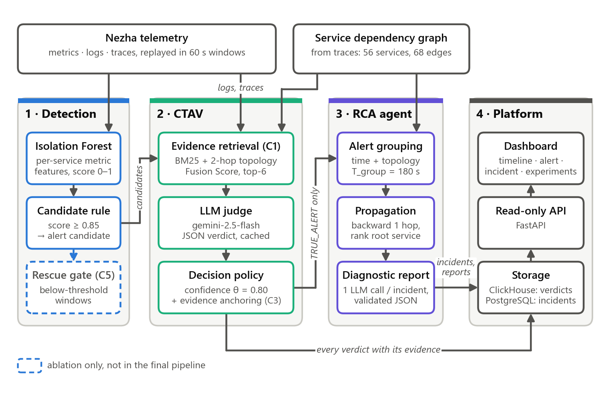
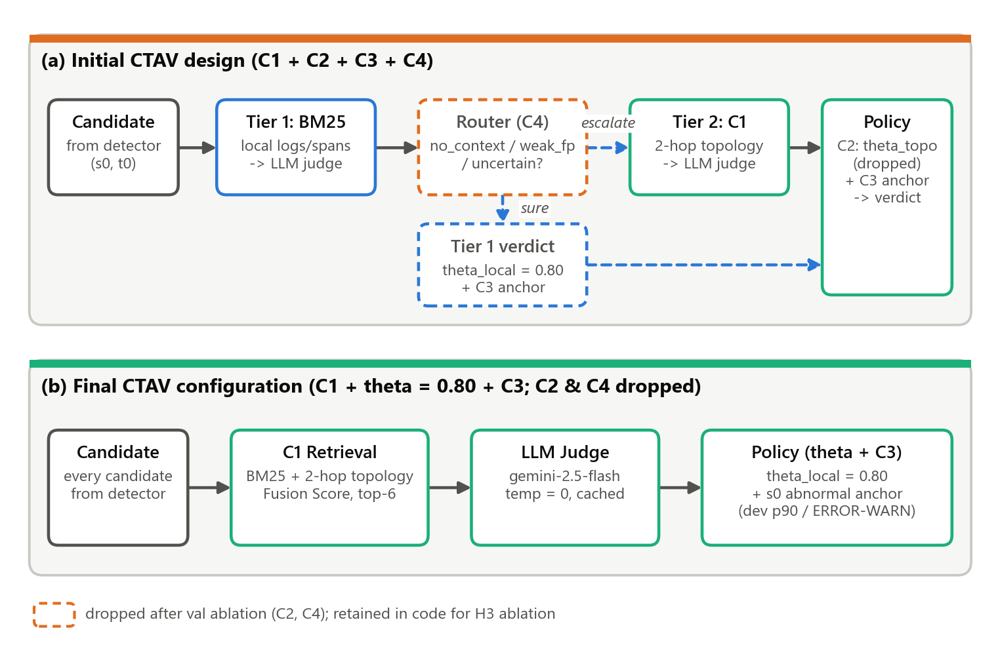
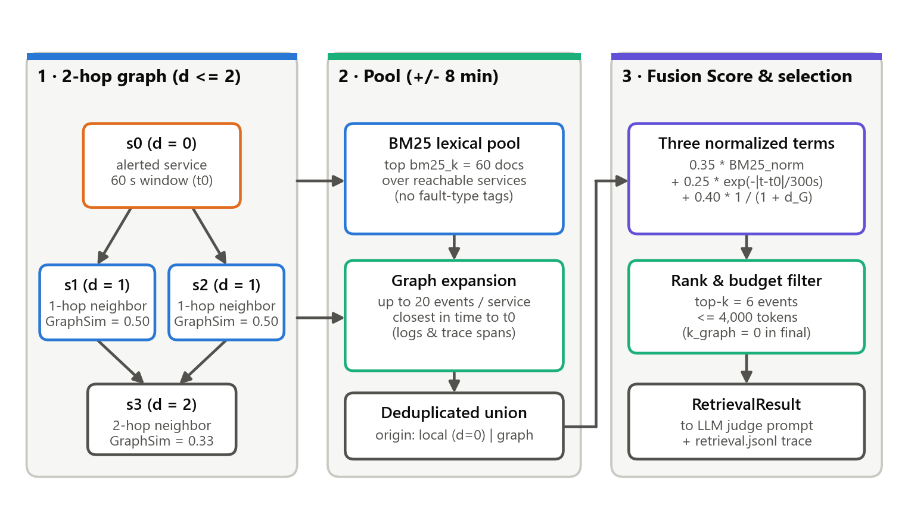
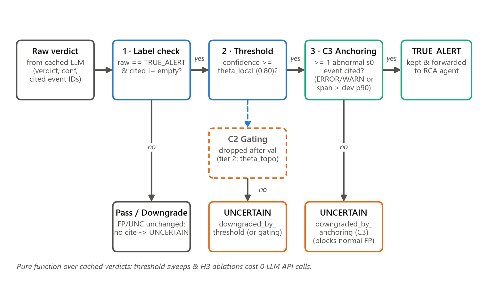
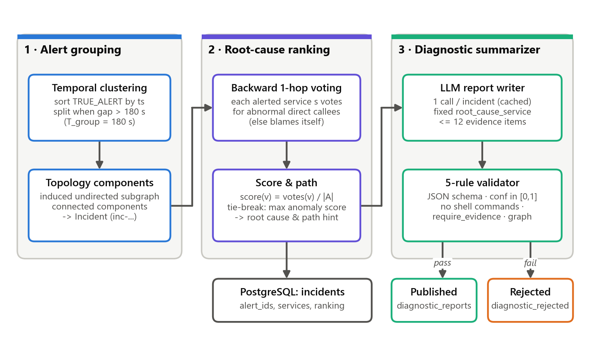

# Chương 4 — Đề xuất: CTAV và tác tử RCA

> **Bản đồng bộ local (Markdown) của [`thesis/chapters/ch4.tex`](../../thesis/chapters/ch4.tex).**
> Trích dẫn `[1]`–`[3]` bên dưới khớp với khóa BibTeX trong [`thesis/refs.bib`](../../thesis/refs.bib); 5 sơ đồ nằm trong [`docs/drafts/figures/ch4/`](figures/ch4/) và đã được sao chép sang [`thesis/figures/ch4/`](../../thesis/figures/ch4/) cho Overleaf.

Chương này trình bày thiết kế chi tiết của phương pháp thẩm định cảnh báo hiệu chỉnh có nhận biết topology (CTAV — *Calibrated Topology-Aware Alert Validation*), tác tử phân tích nguyên nhân gốc (RCA) và kiến trúc nền tảng hiện thực hóa hai thành phần này nhằm giải quyết bốn khoảng trống nghiên cứu từ Mục 3.3.2. Mục 4.1 mô tả kiến trúc tổng thể bốn khâu, phát biểu hình thức bài toán và phân tích năm thách thức thiết kế chính. Mục 4.2 trình bày bộ phát hiện bất thường Isolation Forest cùng cổng cứu cảnh báo **C5** (`Rescue Score`, chỉ đánh giá ở vai trò ablation). Mục 4.3 đi sâu vào không gian thiết kế của CTAV, phân biệt rành mạch hai thành phần lõi giữ lại trong cấu hình cuối là truy xuất lai BM25–topology (**C1**) và neo bằng chứng bất thường (**C3**) với hai thành phần đã kiểm chứng rồi loại trên tập `val` là ngưỡng bất đối xứng theo nguồn bằng chứng (**C2**) và định tuyến hai tầng thích nghi (**C4**). Mục 4.4 mô tả ba bước khép kín của tác tử RCA từ gom nhóm cảnh báo, lan truyền ngược 1 bước theo chiều gọi đến sinh báo cáo JSON có kiểm duyệt. Mục 4.5 trình bày cách lắp ráp mã nguồn, kho lưu trữ, API và harness thực nghiệm tái lập; cuối cùng, Mục 4.6 tổng kết cấu hình chốt trước khi chuyển sang kiểm định ở Chương 5.

---

## 4.1 Mô tả đề xuất

Mục này xác lập khung tổng thể của hệ thống đề xuất, định nghĩa hình thức đầu vào–đầu ra cùng các ký hiệu toán học dùng xuyên suốt chương, và đối chiếu trực tiếp năm thách thức kỹ thuật với các thành phần giải quyết tương ứng.

### 4.1.1 Tổng quan về đề xuất

Đề tài thiết kế một nền tảng AIOps khép kín gồm bốn khâu nối tiếp nhau: (1) phát hiện bất thường chuỗi thời gian trên metric, (2) thẩm định cảnh báo bằng CTAV dựa trên bằng chứng đa phương thức (metric, log, trace), (3) tác tử phân tích nguyên nhân gốc trên các cảnh báo đã xác nhận, và (4) tầng lưu trữ, API cùng bảng điều khiển phục vụ trực quan hóa. Như minh họa ở Hình 4.1, toàn bộ luồng thực nghiệm và luồng trình diễn đều chạy trên cùng một pipeline thống nhất; trong đó, đường xử lý chính đi từ phát lại cửa sổ telemetry 60 s qua bộ phát hiện đến CTAV và tác tử RCA, còn việc ghi bảng phân tích vào ClickHouse, bảng sự cố vào PostgreSQL và hiển thị trên dashboard được tách sang nhánh phi đường găng để không cản trở phép đo độ trễ của khâu suy luận.

*Hình 4.1: Kiến trúc tổng thể ở cấu hình chốt gồm bốn khâu: phát hiện bất thường, CTAV, tác tử RCA và platform. Telemetry Nezha được phát lại theo cửa sổ 60 s; đồ thị phụ thuộc service cấp ngữ cảnh topology cho truy xuất bằng chứng (C1) và cho việc gom cảnh báo. Chỉ cảnh báo `TRUE_ALERT` đi tiếp sang tác tử RCA; mọi phán quyết cùng bằng chứng được lưu vào ClickHouse để dashboard đọc lại. Khung nét đứt (C5) chỉ dùng cho ablation. Nguồn: tác giả vẽ, có hỗ trợ của công cụ AI.*

Để bảo đảm khả năng thay thế và kiểm định từng thành phần mà không phá vỡ luồng xử lý, kiến trúc định nghĩa bốn giao diện lõi (`Protocol`) cố định trong `packages/schemas/protocols.py`, tóm tắt ở Bảng 4.1. Mọi tham số đặc thù của thuật toán (như số bước nhảy đồ thị, hệ số suy giảm thời gian hay ngưỡng tin cậy) đều được nạp qua hàm khởi tạo từ tệp cấu hình YAML thay vì đưa vào chữ ký phương thức. Đối với mô hình ngôn ngữ lớn đóng vai trò bộ thẩm định, kiến trúc chọn một mô hình API cố định duy nhất là `gemini-2.5-flash` ở nhiệt độ 0, đi qua lớp cache bắt buộc và không dùng mô hình cục bộ dự phòng, nhằm loại bỏ sai lệch do đổi mô hình giữa các lượt chạy thực nghiệm và bảo đảm chế độ trình diễn ngoại tuyến hoàn toàn từ cache.

**Bảng 4.1.** *Bốn giao diện (`Protocol`) lõi và ánh xạ sang các mô-đun hiện thực.*

| Protocol | Phương thức chính | Đầu vào / Đầu ra | Mô-đun hiện thực |
| :--- | :--- | :--- | :--- |
| `SourceAdapter` | `stream()` | Nguồn dữ liệu → luồng `TelemetryWindow` 60 s theo watermark | `services/replayer/` |
| `Detector` | `score()`, `is_candidate()` | `TelemetryWindow` → điểm bất thường $[0, 1]$ và cờ ứng viên | `services/detector/isolation_forest.py` |
| `RetrievalStrategy` | `retrieve(candidate, budget)` | `AlertCandidate`, `RetrievalBudget` → `RetrievalResult` | `bm25_hybrid.py`, `hybrid_bm25_graph.py`, `no_retrieval.py` |
| `Judge` | `evaluate(candidate, context)` | `AlertCandidate`, `RetrievalResult` → `JudgedAlert` | `services/judge/llm_judge.py` |

### 4.1.2 Các vấn đề nghiên cứu

Xét một hệ microservice được biểu diễn bởi đồ thị phụ thuộc có hướng $G = (V, E)$, trong đó tập đỉnh $V$ là các service và cạnh có hướng $(u, v) \in E$ biểu thị service $u$ gọi service $v$ quan sát được từ cặp `SpanID`–`ParentID` trong trace. Dữ liệu quan sát đa phương thức được cắt thành các cửa sổ không chồng lấn $w$ có độ dài 60 s, mỗi cửa sổ gắn với một service $s_0 \in V$, pod tương ứng và mốc trung điểm $t_0$. Nhãn thực tế $y(w) \in \{\text{fault}, \text{normal}\}$ được gán theo thời gian thực (*wall-clock*) quanh thời điểm tiêm lỗi như định nghĩa ở Mục 2.1.

**Bài toán nhánh A (Thẩm định cảnh báo dưới ngân sách LLM).** Từ luồng cửa sổ telemetry, bộ phát hiện sinh tập cảnh báo ứng viên $c = (w, s_0, t_0, \text{score}_{\text{det}}, \text{source})$ với $\text{source} \in \{\text{metric}, \text{rescue}\}$. Với mỗi ứng viên $c$, chiến lược truy xuất chọn tập bằng chứng $E(w)$ gồm tối đa $k$ sự kiện log/trace trong ngân sách token định trước, rồi bộ thẩm định kết hợp chính sách quyết định ánh xạ $(w, E(w))$ sang nhãn phán quyết cuối:

$$\hat{y}(w) \in \{\texttt{TRUE\_ALERT},\; \texttt{FALSE\_POSITIVE},\; \texttt{UNCERTAIN}\}$$

kèm điểm tin cậy $p(w) \in [0, 1]$ và tập định danh bằng chứng trích dẫn $C(w) \subseteq E(w)$. Dưới ràng buộc tổng số lần gọi LLM không vượt quá ngân sách $B$, mục tiêu tối ưu của CTAV là giữ được mức tăng thu hồi (Recall) nhờ ngữ cảnh topology của C1 so với truy xuất cục bộ BM25 mà không làm tăng tỷ lệ báo động giả (FPR), tức đồng thời thỏa:

$$\Delta\text{F1}(\text{CTAV} - \text{BM25}) > 0, \quad \Delta\text{FPR}(\text{CTAV} - \text{BM25}) \le 0, \quad \Delta\text{Recall}(\text{CTAV} - \text{C1}) \ge -\delta$$

với biên chấp nhận giảm thu hồi $\delta = 0{,}05$ đã đăng ký trước cho giả thuyết chính H2 (Mục 5.1).

**Bài toán nhánh B (Phân tích nguyên nhân gốc).** Cho tập các cảnh báo đã được CTAV xác nhận $A_{\text{conf}} = \{c \mid \hat{y}(w_c) = \texttt{TRUE\_ALERT}\}$ và đồ thị phụ thuộc $G$, tác tử RCA cần thực hiện hai ánh xạ nối tiếp: (i) phân hoạch $A_{\text{conf}}$ thành các sự cố $I_1, I_2, \dots, I_m$ theo độ gần thời gian và tính liên thông topology để giảm tải cảnh báo (đo bằng *Alert Reduction Ratio*, ARR); và (ii) với mỗi sự cố $I$, xếp hạng danh sách service nghi vấn gốc $\hat{r}(I) = (v_1, v_2, \dots)$ (đo bằng Hit@1, Hit@3) rồi sinh báo cáo chẩn đoán JSON hợp lệ kèm bằng chứng trích dẫn. Hai bài toán này gắn trực tiếp với năm câu hỏi nghiên cứu ở Chương 1: RQ1 kiểm chứng hiện tượng đánh đổi của truy xuất topology và cơ chế thiên lệch xác nhận; RQ2 và RQ3 đánh giá hiệu quả tổng thể và đóng góp riêng lẻ của từng thành phần C1–C5 trong CTAV; RQ4 khảo sát độ bền của CTAV theo ngân sách lời gọi $B$; và RQ5 đánh giá khả năng định vị gốc cùng chất lượng báo cáo của tác tử RCA. Các ký hiệu chính dùng trong toàn bộ Chương 4 được hệ thống hóa trong Bảng 4.2.

**Bảng 4.2.** *Bảng ký hiệu toán học dùng trong phát biểu bài toán và thiết kế thuật toán.*

| Ký hiệu | Ý nghĩa | Giá trị / Miền |
| :--- | :--- | :--- |
| $w,\; s_0,\; t_0$ | Cửa sổ telemetry 60 s, service phát cảnh báo và mốc trung điểm của cửa sổ | $s_0 \in V$ |
| $G = (V, E),\; d_G(u, v)$ | Đồ thị phụ thuộc service từ trace và khoảng cách bước nhảy vô hướng | 56 nút, 68 cạnh |
| $E(w),\; C(w)$ | Tập bằng chứng truy xuất (tối đa $k = 6$) và tập bằng chứng judge trích dẫn | $C(w) \subseteq E(w)$ |
| $\alpha, \beta, \gamma,\; \tau_F$ | Trọng số và hằng số suy giảm thời gian của Fusion Score (C1) | 0,35; 0,25; 0,40; 300 s |
| $\theta_{\text{local}},\; \theta_{\text{topo}}$ | Ngưỡng tin cậy của chính sách quyết định (C2 dùng $\theta_{\text{topo}}$, đã loại) | 0,80 (0,85 cho C2) |
| $\eta_1, \eta_2, \eta_3,\; \tau$ | Trọng số ba thành phần và ngưỡng kích hoạt của Rescue Score (C5) | (0; 0,4; 0,6); $\tau = 0{,}8$ |
| $T_{\text{group}}$ | Cửa sổ cắt cụm thời gian liên kết đơn khi gom cảnh báo thành sự cố | 180 s |
| $B$ | Ngân sách tối đa số lần gọi API LLM trong một lượt chạy thẩm định | {120, …, đủ} |

### 4.1.3 Các thách thức và khó khăn

Hiện thực hóa mục tiêu nhánh A cùng nhánh RCA trên dữ liệu quan sát thực tế đối mặt với năm thách thức cốt lõi sau:

1. **Thách thức T1 — Kìm báo động giả mà không đánh mất độ phủ của topology.** Khi giảm mạnh số cảnh báo sai từ bộ thẩm định LLM, chính sách lọc chặt dễ kéo theo việc hạ nhầm các cửa sổ lỗi thật có bằng chứng yếu (như lỗi trễ mạng không ghi log lỗi). Thiết kế CTAV dùng cặp C1 + C3 để kiểm soát đánh đổi này; trên tập `val`, mức giảm recall của CTAV so với C1 thuần là một giới hạn đã biết và được phân tích định lượng ở Mục 5.6 và Mục 5.7.
2. **Thách thức T2 — Cơ chế thiên lệch thực tế khác giả thuyết trực giác ban đầu.** Nghiên cứu tiền đề trên tập mẫu nhỏ [1] gợi ý rằng báo động giả tăng chủ yếu do "nhiễu từ service lân cận". Tuy nhiên, phân tích thực nghiệm trên tập `val` (Mục 5.6.3) cho thấy hiện tượng tăng đồng thời recall và FPR có lặp lại, nhưng nguyên nhân trực tiếp không phải log từ láng giềng mà là *thiên lệch xác nhận trên bằng chứng cục bộ nằm sát thời điểm $t_0$* (đặc biệt là trace span bình thường). Sự thay đổi nhận thức có ghi lại này buộc chính sách quyết định phải chuyển từ giả định lọc theo khoảng cách đồ thị sang kiểm tra tính bất thường định lượng của bằng chứng thuộc chính $s_0$ (C3).
3. **Thách thức T3 — Giới hạn ngân sách gọi LLM và yêu cầu tái lập.** Chấm toàn bộ hàng nghìn cảnh báo ứng viên qua API vừa tốn chi phí vừa có thể dao động nếu gọi lặp lại trực tiếp. Hệ thống giải quyết bằng lớp cache bất biến khóa `sha256`, thiết kế chính sách quyết định như hàm thuần trên phán quyết đã lưu cache (cho phép quét ngưỡng và chạy ablation với 0 lần gọi mới) và kiểm định đường hiệu năng theo ngân sách $B$ ở Mục 5.8.3.
4. **Thách thức T4 — Định vị service gốc khi luồng cảnh báo đầu vào thưa.** Sau khi CTAV lọc mạnh báo động giả, số cảnh báo xác nhận gửi sang tác tử RCA ít và thường tập trung ở các service có độ phủ ngưỡng nền tốt; nếu lỗi tiêm ở service phía sau không phát cảnh báo, thuật toán khó thấy đủ mắt xích lan truyền. Tác tử RCA tách rạch ròi tầng thuật toán tất định (gom nhóm và lan truyền 1 bước) khỏi tầng tóm tắt LLM có kiểm duyệt để dễ phân tách nguyên nhân sai giữa tầng thẩm định và tầng định vị (Mục 5.9).
5. **Thách thức T5 — Kỷ luật đánh giá chống rò rỉ và chống tinh chỉnh quá mức.** Dữ liệu microservice có tương quan mạnh theo thời gian và theo từng lần tiêm lỗi; việc tinh chỉnh lặp lại trên cùng một tập kiểm tra dễ tạo số liệu lạc quan giả. Hệ thống áp dụng chia split theo nhóm `injection_id` kèm vùng đệm 600 s, đăng ký trước toàn bộ giả thuyết H0–H5 cùng cấu hình đóng băng và dấu vân tay phương pháp trước khi chạm tập `test` đúng một lần duy nhất (Mục 2.7 và Mục 5.7).

---

## 4.2 Isolation Forest và cổng Rescue (C5)

Mục này trình bày tầng đầu tiên của pipeline: bộ phát hiện bất thường chuỗi thời gian Isolation Forest tạo tập ứng viên cho CTAV, cùng cơ chế cổng cứu cảnh báo C5 (`Rescue Score`) dùng để kiểm chứng khả năng thu hồi các cửa sổ bị bộ phát hiện metric bỏ sót.

**Vấn đề giải quyết.** Trên tập dữ liệu Nezha gồm hàng chục nghìn cửa sổ 60 s với tỷ lệ mất cân bằng xấp xỉ 1:135 giữa cửa sổ lỗi và cửa sổ bình thường, gọi trực tiếp LLM trên mọi cửa sổ là bất khả thi về chi phí lẫn độ trễ. Tầng phát hiện cần một mô hình không giám sát chạy nhanh, chỉ huấn luyện trên tập `dev` để loại bỏ phần lớn cửa sổ bình thường mà vẫn đưa đủ cửa sổ bất thường vào hàng đợi thẩm định. Ngược lại, một số dạng lỗi ứng dụng (như ngoại lệ phần mềm hoặc lỗi trả về sớm) ít gây biến động mạnh trên metric hạ tầng, đặt ra câu hỏi liệu có thể cứu lại những cửa sổ dưới ngưỡng metric bằng dấu hiệu log và đồ thị phụ thuộc hay không.

**Thiết kế bộ phát hiện Isolation Forest.** Bộ phát hiện `IsolationForestDetector` (`services/detector/isolation_forest.py`) duy trì một bộ đệm cuộn (*rolling buffer*) kích thước `buffer_size = 2` riêng cho từng khóa pod (dự phòng theo tên service nếu thiếu pod), tương ứng khoảng 120 s lịch sử gần nhất. Trên mỗi cửa sổ, với từng metric trong tập đặc trưng của tập huấn luyện, mô-đun trích xuất bảy thống kê: trung bình (`mean`), độ lệch chuẩn (`std`), giá trị nhỏ nhất (`min`), lớn nhất (`max`), giá trị cuối (`last`), độ chênh (`delta`) và tỷ lệ thiếu mẫu (`missing_fraction`). Các metric vắng mặt trong một cửa sổ (ví dụ phân vị độ trễ `NaN` khi không có request) được điền bằng giá trị quan sát gần nhất của chính pod đó hoặc trung vị trên tập `dev` — tuyệt đối không điền 0,0 để tránh biểu diễn nhầm một cửa sổ nhàn rỗi thành độ trễ cực thấp. Điểm bất thường từ Isolation Forest [2] được chuẩn hóa theo phân vị trên tập huấn luyện về đoạn $[0, 1]$. Một cửa sổ chỉ trở thành ứng viên `AlertCandidate(source="metric")` khi bộ đệm của pod đã đầy (tránh báo động giả lúc khởi động lạnh) và thỏa:

$$\text{score}_{\text{IF}}(w) \ge 0{,}85$$

Ngoài điểm số, bộ phát hiện xuất ba đặc trưng có độ lệch chuẩn lớn nhất so với phân bố huấn luyện (`top_features`) để đưa vào ngữ cảnh của bộ thẩm định LLM.

**Thiết kế cổng cứu cảnh báo C5 (`Rescue Score`).** Với các cửa sổ không vượt ngưỡng Isolation Forest ($y_{\text{IF}}(w) = 0$), mô-đun `services/detector/rescue.py` tính điểm cứu dựa trên ba thành phần chuẩn hóa trong $[0, 1]$:

$$\text{RescueScore}(w \mid A) = \eta_1 \Lambda_{\text{log}}(w) + \eta_2 \Phi_{\text{topo}}(w, A) + \eta_3 \Delta_{\text{time}}(w, A)$$

với $\eta_1, \eta_2, \eta_3 \ge 0$ và $\eta_1 + \eta_2 + \eta_3 = 1$, trong đó:

$$\Lambda_{\text{log}}(w) = 1 - \exp\!\left(-\frac{N_{\text{err}}(w)}{k_{\text{log}}}\right), \quad \Phi_{\text{topo}}(w, A) = \max_{a \in A} \frac{1}{1 + d_G(s_w, s_a)}, \quad \Delta_{\text{time}}(w, A) = \max_{a \in A} \exp\!\left(-\frac{|t_w - t_a|}{\sigma}\right)$$

Ở đây, $N_{\text{err}}(w)$ là số dòng log lỗi của pod trong cửa sổ $w$ khớp mức `ERROR`/`FATAL`/`CRITICAL` hoặc mẫu HTTP 5xx, `exception`, `panic`, `traceback`. Tập $A$ là tập các cảnh báo đã được CTAV xác nhận (không bao giờ dùng nhãn thực tế) thỏa điều kiện nhân quả $t_w - T_{\text{active}} \le t_a \le t_w$, nghĩa là không sử dụng cảnh báo từ tương lai. Nếu $\text{RescueScore}(w \mid A) \ge \tau$, cửa sổ được đẩy vào hàng đợi thẩm định với nhãn `source="rescue"`.

**Tham số, cách chọn và vai trò hiện tại.** Toàn bộ tham số của bộ phát hiện và cổng C5 được tổng hợp trong Bảng 4.3. Với C5, hệ thống quét ngoại tuyến 21 tổ hợp $(\eta_1, \eta_2, \eta_3)$ bước 0,2 kết hợp các mức ngưỡng $\tau$ trên tập `val` (tổng 147 điểm cấu hình); điểm chọn là $\eta = (0;\, 0{,}4;\, 0{,}6)$ và $\tau = 0{,}8$, khiến công thức rút gọn về chỉ còn hai thành phần $\Phi_{\text{topo}}$ và $\Delta_{\text{time}}$ do mật độ log lỗi $\Lambda_{\text{log}}$ hầu như bằng 0 trên phần lớn cửa sổ bị bỏ sót. Tuy nhiên, khi đưa các cửa sổ được cứu đi qua CTAV trên tập `val`, C5 chỉ thu thêm 2 TP nhưng phát sinh thêm 16 FP ($\Delta\text{F1} = +0{,}001$, CI chứa 0). Vì vậy, **Isolation Forest là bộ phát hiện chính đang dùng**, còn **C5 chỉ giữ vai trò một điểm ablation độc lập**, không bật trong cấu hình CTAV cuối. Bằng chứng định lượng đầy đủ cho bộ phát hiện và C5 được trình bày ở Mục 5.6.5, Mục 5.7.2 và Mục 5.8.4.

**Bảng 4.3.** *Tham số cấu hình của bộ phát hiện Isolation Forest và cổng Rescue (C5).*

| Thành phần | Tham số | Giá trị | Ý nghĩa và nguồn cấu hình |
| :--- | :--- | :--- | :--- |
| Isolation Forest | `threshold` | 0,85 | Ngưỡng điểm chuẩn hóa $[0, 1]$ để sinh ứng viên (`h0_val_c1_k0.yaml`) |
| Isolation Forest | `buffer_size` | 2 | Độ dài bộ đệm cuộn mỗi pod ($\approx 120$ s lịch sử) |
| Isolation Forest | `n_estimators`, `contamination` | 100; 0,05 | Số cây phân tách và tỷ lệ nhiễu huấn luyện trên `dev` (`seed = 42`) |
| C5 (ablation) | $k_{\text{log}}$, $\sigma$, $T_{\text{active}}$ | 10; 300 s; 300 s | Hằng số mật độ log lỗi, suy giảm thời gian và cửa sổ cảnh báo hoạt động |
| C5 (ablation) | $(\eta_1, \eta_2, \eta_3)$, $\tau$ | (0; 0,4; 0,6); 0,8 | Trọng số và ngưỡng chọn từ lưới 147 điểm trên `val` (`m7_rescue_val.yaml`) |

---

## 4.3 CTAV — Thẩm định cảnh báo có nhận biết topology và hiệu chỉnh

Mục này trình bày hạt nhân phương pháp của đề tài: từ tổng quan kiến trúc CTAV và quá trình tinh gọn trên tập `val`, đến từng thành phần truy xuất, chính sách quyết định, định tuyến và bộ thẩm định LLM.

### 4.3.1 Tổng quan CTAV

Thiết kế ban đầu của CTAV gồm bốn cơ chế phối hợp: tầng 1 truy xuất cục bộ BM25, bộ định tuyến hai tầng thích nghi **C4** chỉ leo thang sang tầng 2 truy xuất topology **C1** khi tầng 1 chưa chắc chắn, ngưỡng tin cậy bất đối xứng theo nguồn bằng chứng **C2** ($\theta_{\text{topo}} > \theta_{\text{local}}$) và quy tắc neo bằng chứng bất thường **C3**. Hình 4.2 đối chiếu trực tiếp thiết kế ban đầu (a) với cấu hình chốt (b) sau kiểm định loại trừ trên tập `val`; người đọc cần chú ý các khối nét đứt bị lược bỏ ở cấu hình cuối nhưng vẫn giữ trong mã nguồn để phục vụ thí nghiệm loại trừ H3.

*Hình 4.2: So sánh kiến trúc CTAV giữa thiết kế ban đầu (a) gồm hai tầng định tuyến thích nghi C4 cùng chính sách C2 và C3, và cấu hình chốt (b) chỉ giữ C1, ngưỡng $\theta_{\text{local}} = 0{,}80$ và neo bằng chứng C3 sau kiểm định loại trừ trên tập `val`. Các khối nét đứt (C2, C4) đã bị loại nhưng vẫn giữ mã nguồn cho phân tích loại trừ H3. Nguồn: tác giả vẽ, có hỗ trợ của công cụ AI.*

Trên tập `val`, kiểm định tách biệt từng thành phần dẫn đến hai quyết định tinh gọn: loại bỏ C4 vì chạy thẳng C1 cho mọi ứng viên rẻ hơn hai tầng (3,28 USD so với 5,14 USD ước theo token) mà F1 không thấp hơn, và loại bỏ C2 vì bỏ C2 chỉ thêm 2 FP với khoảng tin cậy $\Delta\text{FPR}$ chạm 0. Cấu hình chốt của CTAV (`eval/configs/ctav_final.yaml`) vì thế trở nên gọn nhẹ: *mọi ứng viên → truy xuất C1 → judge `gemini-2.5-flash` → ngưỡng $\theta_{\text{local}} = 0{,}80$ → neo bằng chứng C3 (ngưỡng nền `dev` p90)*. Trên `val`, cấu hình chốt nâng F1 từ 0,103 (BM25) và 0,126 (C1 thuần) lên 0,201 đồng thời hạ FPR xuống 0,0069, nhưng recall giảm từ 0,263 của C1 xuống 0,139 — một giới hạn được ghi nhận rõ và kiểm định lại trên `test` ở Chương 5. Vai trò cố định của toàn bộ năm thành phần C1–C5 được tổng kết ở Bảng 4.4.

**Bảng 4.4.** *Vai trò hiện tại của từng thành phần trong không gian thiết kế CTAV và cổng cứu cảnh báo.*

| Ký hiệu | Chức năng | Vai trò hiện tại | Cơ sở quyết định trên `val` |
| :--- | :--- | :--- | :--- |
| **C1** | Truy xuất lai BM25–topology (Fusion Score) | **Đang dùng** | Tái lập lợi ích nhận diện của topology trên mọi ứng viên |
| **C2** | Ngưỡng bất đối xứng theo nguồn bằng chứng ($\theta_{\text{topo}} > \theta_{\text{local}}$) | **Đã loại** | Bỏ C2 chỉ thêm 2 FP ($\Delta\text{FPR}$ CI chạm 0) |
| **C3** | Neo bằng chứng bất thường của $s_0$ (ngưỡng nền `dev` p90) | **Đang dùng** (đóng góp chính) | Hạ mạnh FP của C1 (606 → 51), tăng F1 có ý nghĩa |
| **C4** | Định tuyến hai tầng thích nghi (BM25 → C1) | **Đã loại** | Chi phí cao hơn C1 chạy thẳng (5,14 vs 3,28 USD), F1 không tăng |
| **C5** | Cổng cứu cảnh báo `Rescue Score` | **Chỉ là ablation** | Thêm 2 TP / 16 FP ($\Delta\text{F1} = +0{,}001$, CI chứa 0) |

### 4.3.2 BM25 cục bộ và bộ thẩm định nền

**Vấn đề giải quyết.** Để chứng minh đóng góp thực chất của truy xuất topology và chính sách hiệu chỉnh, hệ thống cần hai mốc đối chứng chạy trên cùng một tập ứng viên, cùng mô hình judge và cùng ngân sách lời gọi $B$: truy xuất cục bộ theo từ khóa (`bm25_hybrid`) và thẩm định không truy xuất ngữ cảnh (`no_retrieval`).

**Thiết kế và tham số.** Chiến lược `bm25_hybrid` (`services/retrieval/bm25_hybrid.py`) xây dựng truy vấn từ tên service $s_0$, các đặc trưng bất thường hàng đầu `top_features` và từ khóa lỗi vận hành chuẩn hóa — tuyệt đối không đưa nhãn loại lỗi vào truy vấn (có unit test kiểm soát rò nhãn). Kho tìm kiếm chỉ lấy log và trace span của chính $s_0$ trong biên thời gian $\pm 8$ phút quanh cửa sổ 60 s, xếp hạng bằng công thức BM25 [3] và cắt lấy top $k = 6$ sự kiện trong giới hạn 4.000 token. Chiến lược `no_retrieval` trả về danh sách ngữ cảnh rỗng (tắt `require_evidence`) để tách riêng năng lực suy luận chỉ từ ảnh chụp metric của LLM ở cùng ngân sách $B$. Bảng 4.5 đối chiếu ba chiến lược truy xuất được hiện thực cùng cách ánh xạ các biến thể loại trừ từ tham số của C1.

**Bảng 4.5.** *So sánh ba chiến lược triển khai giao diện `RetrievalStrategy` trong hệ thống.*

| Chiến lược | Phạm vi kho bằng chứng | Hàm xếp hạng | Vai trò |
| :--- | :--- | :--- | :--- |
| `bm25_hybrid` | Log và trace span của riêng $s_0$ trong $\pm 8$ phút | Điểm từ khóa BM25 | Baseline cục bộ (H0, H2); tầng 1 của C4 |
| `hybrid_bm25_graph` (C1) | Mọi service có $d_G(s_i, s_0) \le 2$ trong $\pm 8$ phút | Fusion Score ($\alpha, \beta, \gamma, \tau_F$); $\beta = 1$ hoặc $\gamma = 1$ là ablation | Thành phần truy xuất chính của CTAV |
| `no_retrieval` | Không truy xuất ngữ cảnh ($E(w) = \emptyset$) | Không áp dụng | Baseline không RAG cho H4 |

**Vai trò và dẫn chiếu.** `bm25_hybrid` vừa đóng vai trò baseline khoa học trong các kiểm định H0 và H2, vừa đóng vai trò tầng 1 khi chạy biến thể loại trừ C4; `no_retrieval` phục vụ trực tiếp kiểm định giả thuyết ngân sách H4. Kết quả đối chứng của hai baseline này được trình bày ở Mục 5.6, Mục 5.7 và Mục 5.8.3.

### 4.3.3 Truy xuất nhận biết topology C1

**Vấn đề giải quyết.** Khi sự cố lan truyền qua nhiều microservice, bằng chứng trực tiếp trong cửa sổ của $s_0$ có thể thưa hoặc chỉ thể hiện độ trễ tăng, trong khi lỗi gốc xuất hiện rõ ở service được gọi hoặc ở các sự kiện diễn ra sát $t_0$ nhưng ít trùng khớp từ khóa với truy vấn metric. Thành phần **C1** (`HybridBm25GraphRetriever`, `services/retrieval/hybrid_bm25_graph.py`) mở rộng phạm vi truy xuất theo đồ thị phụ thuộc và kết hợp ba tín hiệu từ khóa, thời gian và khoảng cách đồ thị.

**Thiết kế.** Quá trình truy xuất của C1 được minh họa trên Hình 4.3, tách thành hai bước độc lập là dựng bể ứng viên (`build_pool`) và xếp hạng chọn lọc (`top_events`) nhằm cho phép đánh giá lại nhiều bộ trọng số trên cùng một bể mà không lặp lại bước truy vấn dữ liệu. Cụ thể:

1. *Mở rộng vùng lân cận 2 hop:* Từ $s_0$, tìm tập service có thể tới được trong bán kính $d_G(s_i, s_0) \le 2$ trên đồ thị phụ thuộc vô hướng (56 service, 68 cạnh), trong đó $d_G(s_0, s_0) = 0$. Kho dữ liệu được lọc trong khung thời gian $[t_{\text{start}} - 8\text{ phút},\; t_{\text{end}} + 8\text{ phút}]$ (`bm25_pool = window`; chế độ `global` không giới hạn thời gian chỉ giữ riêng cho bước kiểm chứng hồi quy G-paper).
2. *Hợp nhất hai nguồn ứng viên:* Lấy top `bm25_k = 60` sự kiện có điểm BM25 cao nhất trên kho vùng lân cận, hợp nhất và khử trùng lặp với tối đa 20 sự kiện gần trung điểm $t_0$ nhất của mỗi service trong bán kính 2 hop. Mỗi sự kiện gắn nhãn nguồn gốc `origin = local` nếu $d_G = 0$, ngược lại `graph`.
3. *Xếp hạng Fusion Score và cắt theo ngân sách:* Mỗi sự kiện $e_i = (s_i, t_i)$ trong bể ứng viên được chấm điểm hợp nhất:

$$\text{Score}(e_i, s_0, t_0) = \alpha \cdot \widehat{\text{BM25}}(e_i) + \beta \cdot \exp\!\left(-\frac{|t_i - t_0|}{\tau_F}\right) + \gamma \cdot \frac{1}{1 + d_G(s_i, s_0)}$$

với $\alpha + \beta + \gamma = 1$, $\widehat{\text{BM25}}(e_i)$ là điểm BM25 chuẩn hóa min–max trên toàn bể ứng viên (bằng 1 nếu điểm dương trên bể đồng nhất, bằng 0 nếu điểm bằng 0), và $\text{GraphSim} = 0$ nếu service không liên thông. Sau khi xếp hạng, hệ thống chọn top $k = 6$ sự kiện không vượt quá 4.000 token. Tùy chọn hạn ngạch `k_graph` (biến thể C1-quota) cho phép giữ tối thiểu $\min(k_{\text{graph}}, \text{số sự kiện sẵn có})$ sự kiện `origin = graph`; engine vector hóa `WindowIndex` tăng tốc truy vấn gấp khoảng 10 lần mà cho đầu ra trùng khớp tuyệt đối với bản tham chiếu Python thuần.

*Hình 4.3: Cơ chế truy xuất bằng chứng nhận biết topology C1: (1) xác định vùng lân cận vô hướng bán kính $d_G \le 2$ quanh $s_0$; (2) hợp nhất bể BM25 (`bm25_k = 60`) và mở rộng đồ thị (tối đa 20 sự kiện mỗi service gần $t_0$ nhất trong biên $\pm 8$ phút); (3) xếp hạng bằng Fusion Score ($\alpha = 0{,}35$, $\beta = 0{,}25$, $\gamma = 0{,}40$, $\tau_F = 300\,\text{s}$) và chọn top-6 trong ngân sách 4.000 token. Nguồn: tác giả vẽ, có hỗ trợ của công cụ AI.*

**Tham số, cách chọn và vai trò hiện tại.** Bảng 4.6 liệt kê toàn bộ tham số của C1. Khi khảo sát biến thể hạn ngạch `k_graph` $\in \{0, 1, 2, 3\}$ và 32 điểm lưới $(\alpha, \beta, \gamma)$ trên tập `val`, kết quả cho thấy ép thêm sự kiện lân cận không làm tăng khả năng bắt đúng service gốc và không cải thiện F1 so với cấu hình chuẩn ($\text{C1-quota} - \text{C1-paper}$ cho $\Delta\text{F1} = -0{,}001$). Do đó, cấu hình chốt giữ $\alpha = 0{,}35$, $\beta = 0{,}25$, $\gamma = 0{,}40$, $\tau_F = 300\,\text{s}$ và `k_graph = 0`. **C1 đang dùng** làm chiến lược truy xuất duy nhất của CTAV, với bằng chứng thực nghiệm trình bày ở Mục 5.6 và Mục 5.7.

**Bảng 4.6.** *Tham số cấu hình của chiến lược truy xuất nhận biết topology C1.*

| Tham số | Giá trị chốt | Vai trò và cơ sở chọn |
| :--- | :--- | :--- |
| $\alpha,\; \beta,\; \gamma$ | 0,35; 0,25; 0,40 | Trọng số BM25, thời gian và đồ thị; giữ bộ tham số tối ưu sau ablation 32 điểm trên `val` |
| $\tau_F$ | 300 s | Hằng số suy giảm độ gần thời gian quanh trung điểm cửa sổ $t_0$ |
| `graph_max_distance` | 2 | Bán kính mở rộng vô hướng tối đa trên đồ thị phụ thuộc service |
| `bm25_k`, `graph_per_service_limit` | 60; 20 | Số ứng viên từ kênh từ khóa và số sự kiện gần $t_0$ mỗi service lân cận |
| `time_margin_minutes` | 8 | Biên kho bằng chứng $\pm 8$ phút quanh cửa sổ 60 s (`bm25_pool = window`) |
| `top_k`, `max_tokens`, `k_graph` | 6; 4.000; 0 | Giới hạn ngữ cảnh gửi judge; `k_graph = 0` sau so sánh C1-quota trên `val` |

### 4.3.4 Chính sách quyết định: neo bằng chứng (C3) và ngưỡng bất đối xứng (C2, đã loại)

**Vấn đề giải quyết.** Khi đưa ngữ cảnh từ C1 vào *LLM-as-a-Judge*, mô hình ngôn ngữ có xu hướng xác nhận `TRUE_ALERT` với điểm tin cậy cao (0,85–0,90) ngay cả trên các cửa sổ bình thường chỉ vì thấy các trace span nằm sát mốc $t_0$ (khảo sát H1 trên `val`, Mục 5.6.3). Thay vì chỉ dựa vào nhãn thô hoặc câu nhắc prompt vốn khó kiểm soát độ ổn định, tầng chính sách quyết định (`services/judge/policy.py`) đặt các quy tắc định lượng tường minh sau bộ thẩm định để chặn báo động giả có hệ thống.

**Thiết kế chính sách quyết định.** Như minh họa trên Hình 4.4, chính sách là một *hàm thuần* nhận phán quyết thô `raw_verdict`, độ tin cậy `confidence` và tập thông tin bằng chứng đã trích dẫn `cited` của từng ứng viên đã lưu cache. Mọi phán quyết thô khác `TRUE_ALERT` (tức `FALSE_POSITIVE`, `UNCERTAIN` hoặc lỗi `manual_review`) đi thẳng không đổi; riêng `TRUE_ALERT` phải vượt qua tuần tự ba cổng:

1. *Cổng kiểm tra trích dẫn (`require_evidence`):* Tập `cited` (sau khi đã lọc bỏ mọi `event_id` không tồn tại trong ngữ cảnh) phải khác rỗng; nếu rỗng thì hạ xuống `UNCERTAIN` với cờ `downgraded_by_evidence_rule`.
2. *Cổng ngưỡng tin cậy (và nhánh C2 đã loại):* Nếu $\text{confidence} < \theta_{\text{local}}$ ($\theta_{\text{local}} = 0{,}80$), hạ xuống `UNCERTAIN` (`downgraded_by_threshold`). Trong thiết kế ban đầu có bật **C2**, các phán quyết xuất phát từ tầng topology ($\text{tier} = 2$) phải vượt ngưỡng cao hơn $\theta_{\text{topo}} = 0{,}85$; nếu $\theta_{\text{local}} \le \text{confidence} < \theta_{\text{topo}}$ thì hạ với cờ `downgraded_by_gating`.
3. *Cổng neo bằng chứng bất thường (**C3**):* Phán quyết `TRUE_ALERT` chỉ được giữ khi tồn tại ít nhất một sự kiện $e \in C(w)$ thỏa vị từ bất thường của chính service phát cảnh báo $s_0$:

$$\text{Abnormal}(e, s_0) \iff (s_e = s_0) \land \Big[\big(e \text{ là log} \land \text{level}(e) \in \{\texttt{ERROR}, \texttt{WARN}\}\big) \lor \big(e \text{ là span} \land \text{dur}(e) > q_{90}(s_0, \text{op}_e)\big)\Big]$$

trong đó $q_{90}(s_0, \text{op}_e)$ là phân vị thứ 90 của thời lượng `duration_ms` cho cặp $(s_0, \text{op}_e)$ tính từ mô-đun `services/judge/span_baseline.py`. Nếu không có sự kiện nào thỏa điều kiện trên, cảnh báo bị hạ xuống `UNCERTAIN` với cờ `downgraded_by_anchoring`.

*Hình 4.4: Sơ đồ luồng chính sách quyết định CTAV hoạt động như hàm thuần trên phán quyết thô đã lưu cache: kiểm tra nhãn và trích dẫn, đối chiếu ngưỡng tin cậy $\theta_{\text{local}} = 0{,}80$ (nhánh C2 nét đứt đã loại), rồi kiểm tra điều kiện neo bằng chứng C3 trên sự kiện bất thường của chính $s_0$. Nguồn: tác giả vẽ, có hỗ trợ của công cụ AI.*

**Xây dựng ngưỡng nền và lựa chọn thiết kế.** Để ngưỡng nền $q_{90}(s_0, \text{op}_e)$ không bị nhiễm độ trễ lỗi lan truyền từ các service khác cùng hệ thống, bộ chọn `SpanSelector` chỉ giữ các trace span thuộc cửa sổ bình thường trên tập `dev` và nằm hoàn toàn bên ngoài mọi khoảng thời gian tiêm lỗi của cùng hệ thống, đồng thời yêu cầu tối thiểu `MIN_SPANS = 30` span mỗi cặp $(s_0, \text{op}_e)$. Cặp nào không đủ 30 span (hoặc service không xuất hiện cửa sổ bình thường trong `dev`) sẽ không có ngưỡng nền ($q_{90} = \text{None}$) và không thể làm bằng chứng neo. Bảng 4.7 đối chiếu hai cách tính ngưỡng nền đã khảo sát trên `val`: ngưỡng cố định trên `dev` (chỉ phủ khoảng 32% span trích xuất nhưng nâng F1 lên 0,201) và ngưỡng trượt 60 phút không cần nhãn `RollingSpanBaseline` (phủ 93% span nhưng chỉ đạt F1 0,137 trên `val`). Theo quy tắc chọn đã khóa trước trên `val`, CTAV chốt ngưỡng nền `dev` $p_{90}$ và giữ biến thể ngưỡng trượt 60 phút làm phép kiểm tra độ nhạy bắt buộc ở Chương 5 nhằm đo rõ ảnh hưởng của nhóm service thiếu ngưỡng nền.

**Bảng 4.7.** *Tổng hợp các điều kiện hạ bậc của chính sách quyết định và so sánh hai nguồn ngưỡng nền cho C3.*

| Quy tắc / Biến thể | Điều kiện áp dụng | Hành động & ghi nhận | Trạng thái |
| :--- | :--- | :--- | :--- |
| `require_evidence` | `raw_verdict == TRUE_ALERT` nhưng không có ID trích dẫn hợp lệ | Hạ `UNCERTAIN` (`downgraded_by_evidence_rule`) | Đang dùng |
| Ngưỡng $\theta_{\text{local}}$ | $\text{confidence} < 0{,}80$ | Hạ `UNCERTAIN` (`downgraded_by_threshold`) | Đang dùng |
| Gating **C2** | Tầng topology ($\text{tier} = 2$) có $0{,}80 \le \text{confidence} < 0{,}85$ | Hạ `UNCERTAIN` (`downgraded_by_gating`) | **Đã loại** |
| Neo **C3** (`dev` $p_{90}$) | Không có log `ERROR`/`WARN` hay span của $s_0$ vượt $q_{90}$ tính từ `dev` sạch ($\ge 30$ span) | Hạ `UNCERTAIN` (`downgraded_by_anchoring`); giữ ID neo nếu đạt | **Đang dùng** (chính) |
| Neo **C3** (trượt 60 phút) | Như trên nhưng tính $q_{90}$ trên cửa sổ trượt $[t_{\text{start}} - g - 60\text{m},\; t_{\text{start}} - g)$ không cần nhãn | Phủ $\approx 93\%$ span nhưng cho F1 thấp hơn trên `val` | Ablation / độ nhạy |

**Vai trò hiện tại và dẫn chiếu.** **C3 đang dùng** và là đóng góp quyết định hiệu quả kìm báo động giả của CTAV; **C2 đã loại** sau kiểm định H3 trên `val`. Nhờ lưu song song phán quyết thô và phán quyết sau chính sách, mọi lần quét ngưỡng hay phân tích loại trừ đều tiêu tốn 0 lần gọi API mới. Bằng chứng chi tiết nằm tại Mục 5.6.4, Mục 5.7.5–5.7.6 và Mục 5.8.1–5.8.2.

### 4.3.5 Định tuyến hai tầng thích nghi (C4, đã loại)

**Vấn đề giải quyết.** Thành phần **C4** (`services/judge/routing.py`) được thiết kế ban đầu nhằm giảm chi phí gọi LLM của ngữ cảnh topology: chỉ chạy truy xuất cục bộ BM25 ở tầng 1 cho mọi ứng viên, và chỉ leo thang sang tầng 2 (C1) đối với những ứng viên mà tầng 1 chưa đủ cơ sở kết luận.

**Thiết kế và tham số.** Hàm `route()` chạy tầng 1 (BM25 → judge → chính sách quyết định), tốn 1 lần gọi LLM, sau đó kiểm tra ba điều kiện leo thang theo thứ tự ưu tiên: (i) `no_context` khi tầng 1 không truy xuất được sự kiện nào; (ii) `uncertain` khi phán quyết tầng 1 sau chính sách là `UNCERTAIN` (kể cả ca bị C3 hạ); và (iii) `weak_fp` khi phán quyết là `FALSE_POSITIVE` với độ tin cậy nhỏ hơn `fp_confidence = 0,95`. Khi thỏa một trong ba điều kiện, tầng 2 chỉ được gọi nếu ngữ cảnh C1 không rỗng và ngân sách còn lại ít nhất 2 lượt gọi (gồm lượt đã dùng ở tầng 1); nếu không, phán quyết tầng 1 được giữ nguyên.

**Lý do loại, vai trò và dẫn chiếu.** Trên tập `val`, kiểm định loại trừ cho thấy toàn bộ phần thu hồi tăng thêm của C1 rơi vào những ca mà tầng 1 BM25 trả `FALSE_POSITIVE`, khiến bộ định tuyến phải gọi LLM hai lần trên tỷ lệ lớn ứng viên; hệ quả là cấu hình hai tầng tốn ước tính 5,14 USD so với 3,28 USD khi gọi thẳng C1 cho mọi ứng viên, trong khi F1 còn giảm nhẹ (0,188 so với 0,201). Do đó **C4 đã loại** khỏi cấu hình chốt của CTAV, mã nguồn chỉ giữ nguyên để chạy nhánh loại trừ H3 ở Mục 5.6.4 và Mục 5.8.1.

### 4.3.6 Bộ thẩm định LLM: prompt, đầu ra có cấu trúc và cache

**Vấn đề giải quyết.** Để kết quả thực nghiệm của *LLM-as-a-Judge* có thể kiểm chứng độc lập, không bị nhiễu do thay đổi cách diễn đạt câu nhắc, không rò rỉ dữ liệu ngoại lai và chạy lặp lại được hoàn toàn ngoại tuyến, toàn bộ khâu soạn prompt, gọi API và lưu bộ nhớ đệm cần được khóa chặt theo hợp đồng thống nhất.

**Thiết kế.** Mô-đun `services/judge/prompt.py` đóng gói đầu vào thành chuỗi JSON nén xác định gồm hai phần: `alert_candidate` (định danh ứng viên, cửa sổ thời gian, pod, service, điểm bất thường làm tròn 4 chữ số, ảnh chụp metric `metric_snapshot`, ba `top_features` và danh sách đóng `allowed_evidence_ids`) cùng danh sách `related_logs_events` (mỗi sự kiện cắt tối đa 240 ký tự thông điệp). Một điều chỉnh quan trọng phát hiện trong quá trình kiểm tra dữ liệu là cột `PodSuccessRate(%)` luôn mang giá trị 0 do cách ghi đo trên Nezha nên bị loại qua tham số `drop_metrics` để tránh đánh lừa mô hình rằng mọi dịch vụ đều có tỷ lệ thành công bằng không.

Mô hình thẩm định duy nhất là `gemini-2.5-flash` gọi ở nhiệt độ 0 và tắt vùng suy luận ẩn (`thinkingBudget = 0`) để giữ tính tất định tối đa; mọi phản hồi đều kiểm tra trường `modelVersion`; nếu phiên bản mô hình bị thay đổi phía nhà cung cấp thì lượt chạy tự động dừng. Mô hình bị ràng buộc trả đúng sáu khóa JSON (`label`, `severity`, `confidence`, `evidence`, `reason`, `recommended_action`). Các lỗi gọi mạng tạm thời được thử lại có trần tối đa 5 lần kèm giới hạn tốc độ gọi (`RateLimiter`); quá số lần thử lại, ứng viên được gắn trạng thái `manual_review` (không tính là cảnh báo).

Mọi lời gọi đều đi qua lớp cache JSONL chỉ ghi nối tiếp (`services/judge/cache.py`) với khóa băm bất biến:

$$\text{key} = \text{sha256}\big(\text{provider} \mid \text{model} \mid \text{prompt} \mid \texttt{"max="}\langle M \rangle\texttt{"|t=0"}[\texttt{"|repeat="}r]\big)$$

trong đó hậu tố `|repeat=r` chỉ gắn khi $r > 0$ để đo độ ổn định lặp lại của mô hình trên cùng một prompt (còn $r = 0$ tương thích tuyệt đối với tệp cache bài báo tiền đề [1]). Tóm tắt cấu hình bộ thẩm định và cache được nêu trong Bảng 4.8; ví dụ nguyên văn một prompt và phản hồi JSON được trình bày ở Phụ lục B. Bằng chứng về độ ổn định lặp lại và chi phí nằm ở Mục 5.5.2 và Mục 5.8.5.

**Bảng 4.8.** *Cấu hình bộ thẩm định LLM, chính sách lỗi và cơ chế khóa cache.*

| Hạng mục | Giá trị cấu hình | Mục đích thiết kế |
| :--- | :--- | :--- |
| Mô hình & nhiệt độ | `gemini-2.5-flash`, $T = 0$, `thinkingBudget = 0` | Giảm phương sai suy luận; khóa một mô hình API duy nhất |
| Kiểm soát phiên bản | Kiểm `modelVersion` mọi phản hồi | Dừng lượt chạy ngay nếu nhà cung cấp đổi bản mô hình |
| Loại nhiễu metric | `drop_metrics = ["PodSuccessRate(%)"]` | Loại cột hằng bằng 0 gây báo động giả hàng loạt |
| Xử lý lỗi | Retry tối đa 5 lần; `RateLimiter` 200 gọi/phút | Quá ngưỡng → `manual_review` (không tính là `TRUE_ALERT`) |
| Cache JSONL | Khóa `sha256` bất biến; chỉ ghi nối tiếp | Tái lập 100%, chạy demo và replay chính sách với 0 USD |
| Đo phương sai | `repeat` $\in \{0, 1, 2\}$ trên tập con | Đo tỷ lệ lật phán quyết của judge (Mục 5.8.5) |

---

## 4.4 Tác tử phân tích nguyên nhân gốc (RCA)

Mục này trình bày nhánh thứ hai của nền tảng: tác tử RCA chuyển đổi tập cảnh báo `TRUE_ALERT` đã được CTAV thẩm định thành các sự cố gọn gàng, xếp hạng service nghi vấn gốc và sinh báo cáo chẩn đoán có cấu trúc. Quy trình ba bước của tác tử được minh họa ở Hình 4.5; điểm thiết kế quan trọng là hai bước đầu (gom nhóm và xếp hạng gốc) hoàn toàn tất định, không gọi LLM, còn bước thứ ba dùng đúng một lần gọi LLM cho mỗi sự cố để giải thích và tổng hợp khuyến nghị dưới bộ kiểm duyệt năm quy tắc.

*Hình 4.5: Quy trình ba bước của tác tử RCA trên các cảnh báo `TRUE_ALERT` từ CTAV: (1) gom nhóm theo cửa sổ thời gian ($T_{\text{group}} = 180\,\text{s}$) và thành phần liên thông đồ thị vô hướng thành `Incident`; (2) bỏ phiếu lan truyền ngược 1 bước theo chiều gọi (`backward_one_hop`) để xếp hạng service gốc; (3) sinh báo cáo chẩn đoán JSON qua cache và kiểm duyệt năm quy tắc trước khi lưu `diagnostic_reports` hoặc `diagnostic_rejected`. Nguồn: tác giả vẽ, có hỗ trợ của công cụ AI.*

### 4.4.1 Gom cảnh báo thành sự cố

**Vấn đề giải quyết.** Một lỗi tiêm đơn lẻ thường kích hoạt nhiều cảnh báo liên tiếp trên cùng một service hoặc trên các service gọi nhau trong vài phút. Đưa từng cảnh báo rời rạc sang bước định vị gốc vừa gây trùng lặp chẩn đoán vừa làm tăng tải nhận thức cho kỹ sư vận hành.

**Thiết kế.** Thuật toán gom nhóm trong `services/rca_agent/grouping.py` chạy hoàn toàn không dùng LLM theo hai bước:

1. *Phân cụm thời gian liên kết đơn:* Sắp xếp các cảnh báo `TRUE_ALERT` tăng dần theo cặp $(t_a, \texttt{alert\_id})$ và tách cụm mới mỗi khi khoảng cách giữa hai cảnh báo kề nhau vượt quá ngưỡng $T_{\text{group}}$.
2. *Tách thành phần liên thông theo topology:* Trong mỗi cụm thời gian, trích đồ thị con vô hướng của đồ thị phụ thuộc $G$ cảm sinh bởi tập service có cảnh báo trong cụm (cạnh gọi theo bất kỳ chiều nào đều liên kết hai service). Mỗi thành phần liên thông tạo thành một đối tượng `Incident` với mã định danh tất định `inc-<sha256[:16]>` tính từ `run_id` và danh sách `alert_ids`, lưu kèm lý do gom (`temporal_window_sec` và danh sách cạnh đồ thị đã dùng). Các cảnh báo của cùng một service trong cùng cụm thời gian luôn gộp chung một sự cố.

**Tham số, cách chọn và dẫn chiếu.** Trên tập `val`, hệ thống quét ba mức $T_{\text{group}} \in \{180, 300, 600\}\,\text{s}$ theo quy tắc lựa chọn định trước (tối thiểu số sự cố đa lỗi nhập nhằng `ambiguous` rồi đến ARR). Mức $T_{\text{group}} = 180\,\text{s}$ được chốt trong `eval/configs/rca_final.yaml` vì chỉ tạo 1 sự cố nhập nhằng so với 2 sự cố ở 300 s và 600 s (trong khi chênh lệch ARR trên cảnh báo trong lỗi giữa 300 s và 180 s có CI chứa 0). Bước gom nhóm đang dùng trong pipeline cuối và được đo bằng chỉ số ARR ở Mục 5.9.

### 4.4.2 Lan truyền ngược và xếp hạng service gốc

**Vấn đề giải quyết.** Khi một sự cố gồm nhiều service có cảnh báo liên thông nhau, service chịu ảnh hưởng ở tầng trước (như cổng giao tiếp hoặc dịch vụ tổng hợp) thường có điểm bất thường cao dù lỗi gốc nằm ở dịch vụ phía sau mà nó gọi tới. Cần một thuật toán xếp hạng service gốc tận dụng chiều gọi trong đồ thị phụ thuộc để vượt qua cách xếp hạng chỉ theo điểm bất thường cực đại.

**Thiết kế.** Do phạm vi nghiên cứu ưu tiên kiểm chứng rõ ràng phương pháp tất định, đề tài hiện thực mức 1 (`backward_one_hop` trong `services/rca_agent/propagation.py`) và chủ động cắt nhánh mức 2 (dùng LLM suy luận toàn chuỗi gọi). Thuật toán khai thác quy luật lỗi lan ngược chiều gọi: khi cạnh có hướng $a \to b \in E$ tồn tại và $b$ gặp sự cố, $a$ sẽ chậm hoặc báo lỗi theo. Gọi $A$ là tập các service có cảnh báo trong sự cố và $U \supseteq A$ là tập các service có dấu hiệu bất thường trong khoảng thời gian sự cố (với cấu hình dấu hiệu `sign = alert` thì $U = A$; biến thể `sign = candidate` mở rộng thêm các service có ứng viên detector). Mỗi service $s \in A$ xác định tập đích gọi trực tiếp bất thường $\mathcal{N}^+(s) \cap U$: nếu tập này khác rỗng, $s$ chia đều 1 phiếu bầu cho từng service trong tập đó; nếu rỗng, $s$ tự bầu 1 phiếu cho chính mình. Điểm nghi vấn gốc của mỗi service $v$ là:

$$\text{score}_{\text{RCA}}(v) = \frac{1}{|A|} \sum_{s \in A} \frac{\mathbb{I}[v \in T(s)]}{|T(s)|}, \qquad T(s) = \begin{cases} \mathcal{N}^+(s) \cap U & \text{nếu } \mathcal{N}^+(s) \cap U \neq \emptyset, \\ \{s\} & \text{ngược lại.} \end{cases}$$

Tính phiếu theo *mỗi service có cảnh báo* thay vì theo từng cảnh báo giúp thứ hạng không bị lệch nếu một service phát nhiều cảnh báo hơn các service khác. Danh sách kết quả được sắp giảm dần theo $\text{score}_{\text{RCA}}(v)$, phá hòa theo điểm bất thường cực đại của service trong khoảng sự cố rồi đến thứ tự tên service; các service trong $A$ chưa nhận phiếu vẫn được nối vào cuối danh sách để phép đo Hit@3 có thể đánh giá đầy đủ. Từ nút hạng 1, hàm `propagation_path` dựng đường lan truyền gợi ý đi từ service gốc ra các service gọi đã bầu cho nó.

**Tham số, cách chọn và dẫn chiếu.** Trên tập `val`, mở rộng dấu hiệu bất thường sang `sign = candidate` chỉ tăng +0,091 Hit@1 với CI chạm 0, nên cấu hình chốt giữ `sign = alert`. Thuật toán đang dùng trong pipeline cuối và được kiểm định đối chứng với baseline `rank_by_anomaly_score` (xếp hạng theo điểm bất thường cao nhất trong sự cố) theo giả thuyết H5 tại Mục 5.9.

### 4.4.3 Báo cáo chẩn đoán có cấu trúc JSON

**Vấn đề giải quyết.** Một danh sách xếp hạng tên service đơn thuần chưa đủ giúp kỹ sư trực nắm bắt loại sự cố, bằng chứng hậu thuẫn và hướng kiểm tra tiếp theo; tuy nhiên, để LLM tự do viết văn bản chẩn đoán dễ dẫn đến bịa định danh bằng chứng hoặc sinh lệnh can thiệp hệ thống nguy hiểm.

**Thiết kế và bộ kiểm duyệt.** Mô-đun `services/rca_agent/summarizer.py` gọi đúng một lần API `gemini-2.5-flash` cho mỗi sự cố (dùng chung lớp cache JSONL với bộ thẩm định, giới hạn tối đa 1.024 token đầu ra, truyền tối đa 12 sự kiện bằng chứng với mỗi đoạn trích tối đa 240 ký tự). Thiết kế tách chặt trách nhiệm: tên `root_cause_service` do hạng 1 của bước lan truyền ngược ấn định và mô hình không được phép thay đổi; LLM chỉ sinh năm trường có cấu trúc theo lược đồ ở Bảng 4.9. Để ngăn prompt thay đổi âm thầm giữa các lượt chạy, cấu hình khóa cứng mã băm dấu vân tay `prompt_fingerprint = 8c1d50e6ba757ee6`. Mọi câu trả lời JSON đi qua bộ kiểm duyệt năm bước tuần tự trước khi xuất bản vào bảng `diagnostic_reports`; nếu vi phạm bất kỳ quy tắc từ chối nào, bản ghi được ghi sang bảng `diagnostic_rejected` kèm lý do cụ thể thay vì bỏ qua âm thầm. Tỷ lệ JSON hợp lệ được định nghĩa là số báo cáo xuất bản chia cho tổng số lần gọi LLM.

**Bảng 4.9.** *Lược đồ đầu ra `DiagnosticReport` và năm quy tắc kiểm duyệt tự động.*

| Trường / Quy tắc | Kiểu dữ liệu & ràng buộc | Xử lý khi vi phạm |
| :--- | :--- | :--- |
| `fault_type` | Một trong `network_delay`, `cpu_contention`, `exception`, `unknown` | Từ chối (`invalid_json`) nếu ngoài danh mục |
| `confidence` | Số thực trong đoạn $[0, 1]$ | Từ chối (`confidence_out_of_range`) |
| `evidence` | Danh sách 1–4 mã `event_id` thuộc `allowed_evidence_ids` | Loại mã bịa đặt; nếu không còn mã hợp lệ → từ chối (`no_evidence`) |
| `propagation_path` | Chuỗi tên service từ gốc ra ngoài | Giữ đúng lược đồ chuỗi tên service trong prompt |
| `suggested_actions` | 1–3 câu tiếng Anh ($\le 25$ từ) kèm mức ưu tiên `high`/`medium`/`low` | Chặn mọi từ lệnh (`kubectl`, `sudo`, `docker`, `rm`...) và cú pháp shell (`&&`, `||`, `$(`) → từ chối (`executable_action`) |
| Kiểm đồ thị dịch vụ | Kiểm `root_cause_service` $\in V$ | Vẫn xuất bản nhưng gắn cờ cảnh báo `suspicious = True` |

**Vai trò hiện tại và dẫn chiếu.** Bộ tóm tắt và kiểm duyệt JSON đang dùng trong toàn bộ luồng RCA và dashboard sự cố; tỷ lệ JSON hợp lệ được báo cáo ở Mục 5.9 và đánh giá chất lượng nội dung chẩn đoán bằng người đánh giá mù nằm ở Chương 7.

---

## 4.5 Hiện thực hóa hệ thống và harness thực nghiệm

Các công nghệ thành phần đã được giới thiệu lý do lựa chọn ở Mục 2.8; mục này mô tả cách tổ chức mã nguồn, lắp ráp hạ tầng lưu trữ–giao diện và vận hành harness thực nghiệm để mọi kết quả ở Chương 5 và kịch bản trình diễn ở Chương 6 đều tái lập được.

**Tổ chức mã nguồn và lắp ráp dịch vụ.** Kho mã nguồn được chia thành ba lớp tách biệt phụ thuộc: (i) `packages/` chứa các mô hình dữ liệu Pydantic, bốn giao diện lõi, đồ thị phụ thuộc `ServiceGraph` và lớp tiện ích lưu trữ; (ii) `services/` chứa các dịch vụ chạy luồng gồm `replayer`, `detector`, `retrieval`, `judge`, `rca_agent`, máy chủ `api` (FastAPI chỉ đọc cung cấp 7 endpoint: `/health`, `/runs`, `/runs/{id}/metrics`, `/alerts`, `/alerts/{id}`, `/incidents`, `/incidents/{id}`) và ứng dụng `web` (React + TypeScript gồm bốn màn hình: Timeline, Alert Detail, Incident Detail và Experiment Comparison); (iii) `eval/` chứa toàn bộ cấu hình YAML, harness chạy thực nghiệm và thư mục kết quả bất biến. Toàn bộ hạ tầng triển khai gọn trong bốn container Docker Compose (`clickhouse`, `postgres`, `api`, `web`) theo hai hồ sơ `dev` và `full`, không dùng Kubernetes, cơ sở dữ liệu vector hay khung agent bên thứ ba để bảo đảm nhẹ và dễ kiểm soát.

**Lưu trữ hai nhánh và pipeline hợp nhất.** Mô-đun điều phối `services/rca_agent/pipeline.py` chạy trọn vẹn chuỗi CTAV → gom sự cố → xếp hạng gốc → tóm tắt từ cache (hỗ trợ biến môi trường `DEMO_OFFLINE=1` không cần kết nối Internet), rồi ghi hai nhánh lưu trữ chuyên biệt: ClickHouse lưu các bảng phân tích số lượng lớn (`fact_alert_evaluation` chứa toàn bộ phán quyết thô và sau chính sách, `fact_retrieval_trace` chứa danh sách bằng chứng và điểm thành phần Fusion Score), còn PostgreSQL lưu dữ liệu quan hệ (`run_registry`, `incidents`, `diagnostic_reports` và `diagnostic_rejected`). Một kiểm tra tự động (`check_parity`) xác nhận mọi lượt chạy của pipeline tạo đúng từng mã sự cố, thứ hạng mức 1 và mã băm nội dung JSON so với kết quả của harness thực nghiệm.

**Harness điều khiển bằng cấu hình và kỷ luật tái lập.** Toàn bộ thực nghiệm được gọi thống nhất qua giao diện dòng lệnh `py -m eval <lệnh> --config eval/configs/<tên>.yaml` với năm lệnh con (`run`, `ctav`, `compare`, `ablation`, `rca`); không có bất kỳ tham số thí nghiệm nào bị gán cứng trong mã nguồn. Mỗi lượt chạy gắn một `run_id` bất biến, cấm ghi đè thư mục kết quả cũ và tự động xuất đầy đủ bộ chứng cứ tái lập tóm tắt ở Bảng 4.10. Trước khi kiểm định giả thuyết trên `test`, pipeline phải vượt qua hai cổng kỹ thuật bắt buộc: cổng tái lập hành vi pipeline tham chiếu với bộ thẩm định giả lập (G-port, Mục 5.5.1) và cổng kiểm chứng hồi quy khớp tuyệt đối tập đối chiếu đã công bố từ cache (G-paper, Mục 5.5.2), sau đó mới mở cổng kiểm định một lần duy nhất trên `test` (G-test) với dấu vân tay phương pháp đã khóa.

**Bảng 4.10.** *Các thành phần hiện thực hóa chính, lệnh vận hành và bộ tệp đầu ra bảo đảm tái lập.*

| Lớp / Thành phần | Lệnh hoặc giao diện chính | Đầu ra bất biến & kiểm chứng |
| :--- | :--- | :--- |
| Harness thẩm định & loại trừ | `py -m eval run\|ctav\|compare\|ablation --config ...` | `metrics.json`, `per_window.csv`, `retrieval.jsonl`, `config.snapshot.yaml`, `git_commit.txt`, `runtime.json` |
| Harness RCA | `py -m eval rca --config eval/configs/rca_final.yaml` | Bảng kiểm định H5, `reports.jsonl`, dấu vân tay phương pháp, ghi PostgreSQL |
| Pipeline hợp nhất | `py -m services.rca_agent.pipeline --config ...` | Nạp đồng thời ClickHouse & PostgreSQL từ cache; kiểm parity 100% với harness |
| API & Dashboard | `docker compose --profile dev up -d` (7 endpoint chỉ đọc + 4 màn hình web) | Truy vấn trực tiếp ClickHouse/PostgreSQL; hỗ trợ chạy `DEMO_OFFLINE=1` |
| Kiểm thử tự động | `py -m pytest`, `py -m mypy packages services`, `py -m ruff check .` | Kiểm tra đơn vị cho Rescue, Fusion, policy, grouping, propagation, summarizer, API và parity |

---

## 4.6 Kết chương

Chương này đã trình bày hoàn chỉnh thiết kế và hiện thực hóa của nền tảng AIOps gồm bốn khâu từ phát hiện bất thường đến trực quan hóa sự cố. Trong nhánh thẩm định cảnh báo, cấu hình CTAV chốt sau quá trình kiểm chứng tách biệt trên tập `val` gồm bộ phát hiện Isolation Forest (ngưỡng 0,85), truy xuất lai BM25–topology **C1** ($\alpha = 0{,}35$, $\beta = 0{,}25$, $\gamma = 0{,}40$, $\tau_F = 300\,\text{s}$, bán kính 2 hop), bộ thẩm định `gemini-2.5-flash` qua cache bất biến, ngưỡng tin cậy $\theta_{\text{local}} = 0{,}80$ và quy tắc neo bằng chứng bất thường **C3** dựa trên ngưỡng nền `dev` $p_{90}$. Ba cơ chế khác trong không gian thiết kế đã được ghi nhận rõ vai trò thực tế: ngưỡng bất đối xứng **C2** và định tuyến hai tầng **C4** đã bị loại sau kiểm định loại trừ trên `val`, còn cổng cứu cảnh báo **C5** (`Rescue Score`) chỉ giữ làm phân tích loại trừ độc lập. Ở nhánh phân tích nguyên nhân gốc, tác tử RCA ghép nối ba bước gồm gom cảnh báo theo thời gian ($T_{\text{group}} = 180\,\text{s}$) và thành phần liên thông đồ thị, bỏ phiếu lan truyền ngược 1 bước theo chiều gọi (`sign = alert`), và sinh báo cáo JSON có kiểm duyệt năm quy tắc qua cùng lớp cache. Toàn bộ phương pháp đã được đóng gói vào harness điều khiển bằng cấu hình YAML cùng bộ lưu trữ ClickHouse/PostgreSQL để sẵn sàng cho bước kiểm định định lượng các giả thuyết H0–H5 trong Chương 5.

---

## Tài liệu tham khảo (khớp `thesis/refs.bib`)

- **[1]** (`author2026icaetm`) V. H. K. Nguyen and T. N. C. Vo, "Topology-Aware Evidence Retrieval for Cost-Aware LLM Alert Validation in Microservices," *Proc. ICAETM 2026* (cần đối chiếu danh sách tác giả và trạng thái công bố thực tế theo Chương 9).
- **[2]** (`liu2008iforest`) F. T. Liu, K. M. Ting, and Z.-H. Zhou, "Isolation Forest," in *Proc. IEEE ICDM*, 2008, pp. 413–422. DOI: `10.1109/ICDM.2008.17`.
- **[3]** (`robertson2009bm25`) S. Robertson and H. Zaragoza, "The Probabilistic Relevance Framework: BM25 and Beyond," *Foundations and Trends in Information Retrieval*, vol. 3, no. 4, pp. 333–389, 2009. DOI: `10.1561/1500000019`.
