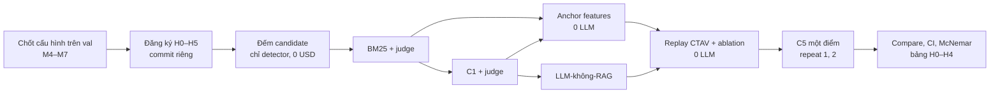
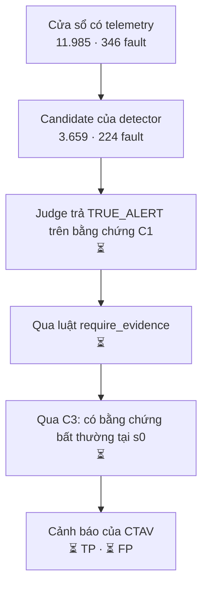

# Outline §5.7–§5.8: kết quả trên `test` (G-test, M8)

> Soạn 2026-11-14 để dựng báo cáo song song với lúc chạy. File này chỉ là **khung**: thứ tự mục, cách viết từng
> đoạn, bảng và hình cần có, và chỗ lấy từng con số. Phần văn đã viết xong cho ba mục đầu nằm ở
> `docs/drafts/ch5-ket-qua-test.md`.
>
> Ký hiệu: ✅ số đã chốt, điền được ngay · ⏳ chờ run của M8 · ✍️ chờ bạn chấm tay.
> Mọi số `val` trong file này đã chốt từ M4–M7. Số `test` chỉ điền khi thư mục kết quả tương ứng đã có.
> Bảng đánh mã T1–T15, hình F1–F7 để dễ tham chiếu; khi lắp vào Word thì dùng caption tự đánh số (Bảng 5.x, Hình 5.x).

## 1. Cách viết chung

**Mỗi mục kiểm định (H0, H2, H3, H4) viết theo đúng sáu bước, theo thứ tự này:**

1. **Câu hỏi và tiêu chí.** Một đoạn 2–3 câu: giả thuyết nói gì, tiêu chí chấp nhận đã đăng ký gồm những vế nào.
   Chép tiêu chí nguyên văn từ bản đăng ký (cuối `docs/experiment-log.md`), không diễn đạt lại cho "mềm" hơn.
2. **Bảng.** Một bảng số đo, một bảng tiêu chí (mỗi vế một dòng, có cột "đạt / không đạt").
3. **Câu kết luận.** Một câu in đậm, chỉ dùng ba cách nói: "được chấp nhận", "không được chấp nhận", "đạt một phần"
   (riêng H2, theo đúng quy ước đăng ký).
4. **Diễn giải bằng số đếm.** 2–4 câu dùng TP, FP cụ thể ("bắt thêm 62 fault, sinh thêm 866 cảnh báo sai"), không
   chỉ nêu Δ.
5. **Đối chiếu `val`.** Một câu: hiện tượng trên `val` có lặp lại không, biên độ lớn hay nhỏ hơn.
6. **Giới hạn.** Một câu nếu có điều kiện đọc kết quả (ví dụ độ lệch detector, service không có ngưỡng `dev`).

**Quy ước trình bày:**

- Chỉ số chính là cửa sổ có telemetry. Số trên mọi cửa sổ đưa vào bảng phụ hoặc phụ lục, không trộn vào bảng chính.
- Mỗi caption ghi đủ: split, tập cửa sổ, số cửa sổ, số fault. Ví dụ: "(`test`, cửa sổ có telemetry: 11.985 cửa sổ, 346 fault)".
- Số thập phân dùng dấu phẩy; khoảng tin cậy viết `+0,179 [+0,138; +0,226]`; p nhỏ viết `p < 0,001`.
- Recall, precision, F1 lấy 3 chữ số; FPR lấy 4 chữ số (FPR của CTAV nằm ở hàng phần nghìn).
- Kết quả xấu viết đúng như nó là. H2 phải có kết luận dù kết quả thế nào.
- Hình sinh từ script, không vẽ tay số liệu. Sơ đồ quy trình (F1, F5) vẽ bằng công cụ sơ đồ.
- Dưới mỗi bảng ghi một dòng nguồn (run_id), để người đọc tra lại được.

## 2. Thứ tự mục và độ dài

| Mục | Nội dung | Bảng | Hình | Độ dài | Trạng thái |
|---|---|---|---|---|---|
| 5.7.1 | Giao thức G-test và các lần chạy | T1 | F1 | ½ trang | ✅ (T1 còn 3 dòng ⏳) |
| 5.7.2 | Detector trên `test`, độ lệch giữa các split | T2 | F2 | 1 trang | ✅ |
| 5.7.3 | Bức tranh chung: mọi phương pháp trên `test` | T3 | F3 | 1 trang | ✅ một phần (BM25, C1, detector-only) |
| 5.7.4 | H0: topology chưa hiệu chỉnh | T4 | — | ¾ trang | ✅ |
| 5.7.5 | H2: CTAV so với BM25 (giả thuyết chính) | T5 | F4 | 1½ trang | ⏳ |
| 5.7.6 | H3: đóng góp của từng thành phần | T6 | — | ¾ trang | ⏳ |
| 5.7.7 | H4: ngân sách nhỏ | T7 | — | ½ trang | ⏳ |
| 5.7.8 | Tổng hợp kết quả kiểm định | T8 | — | ½ trang | ⏳ |
| 5.8.1 | Ablation thành phần, `val` cạnh `test` | T9 | F5 | 1 trang | ⏳ |
| 5.8.2 | Ngưỡng `dev` và recall của CTAV (Phát hiện 11) | T10 | F6 | 1 trang | ⏳ |
| 5.8.3 | Đường F1 theo ngân sách | T11 | F7 | ¾ trang | ⏳ |
| 5.8.4 | C5 (Rescue) một điểm | T12 | — | ½ trang | ⏳ |
| 5.8.5 | Độ ổn định của judge và chi phí | T13, T14 | — | ¾ trang | ⏳ |
| 5.8.6 | Context precision chấm tay | T15 | — | ½ trang | ✍️ |

Lý do xếp như vậy: người đọc cần biết `test` được chạy thế nào (5.7.1) và mẫu số đã khác `val` ra sao (5.7.2) trước
khi nhìn bất kỳ con số so sánh nào. Bảng tổng quan (5.7.3) đi trước các giả thuyết để từng mục H chỉ cần trích đúng
cặp so sánh của nó. Phần kiểm định theo tiêu chí (5.7) tách khỏi phần giải thích vì sao (5.8): §5.7 trả lời "đạt hay
không", §5.8 trả lời "thành phần nào gây ra".

---

## 3. Chi tiết từng mục

### 5.7.1 Giao thức G-test và các lần chạy ✅

**Viết gì (2 đoạn):**
- Đoạn 1: `test` chỉ chạy một lần, sau khi đăng ký giả thuyết và commit riêng; không tham số nào được chỉnh; mỗi cấu
  hình `test` là bản sao của cấu hình `val`. Nêu phương pháp đóng băng trong một câu.
- Đoạn 2: phạm vi chấm (toàn bộ candidate), cách tính CI và McNemar, H2 là giả thuyết chính.

**Hình F1. Quy trình G-test.** Sơ đồ khối theo trục thời gian, vẽ bằng công cụ sơ đồ. Nhấn mạnh mũi mốc "đăng ký và
commit" nằm trước mọi bước chạm `test`.

**Bảng T1. Các lần chạy trên `test`.** Cột: Run · Nội dung · Lần gọi LLM · Lần gọi API mới · Lỗi judge · USD theo token.

| Run | Lần gọi LLM | API mới | Lỗi | USD |
|---|---:|---:|---:|---:|
| `m8_test_detector_count_v1` | 0 | 0 | — | 0 ✅ |
| `h0_test_bm25_v1` | 13.699 | 13.699 | 0 | 8,87 ✅ |
| `h0_test_c1_k0_v1` | 13.699 | 3.299 | 0 | 4,71 ✅ |
| `h0_test_norag_v1` | ⏳ | ⏳ | ⏳ | ⏳ |
| `ctav_final_test_v1` (replay) | ⏳ | 0 | — | 0 |
| `m8_rescue_test_c1_v1` | ⏳ | ⏳ | ⏳ | ⏳ |
| 4 run `repeat` | ⏳ | ⏳ | ⏳ | ⏳ |

Lấy số từ `runtime.json` (`llm_calls`, `api_calls`, `judge_errors`) và `metrics.json` (`all.operations.estimated_cost_usd`) của từng run.

### 5.7.2 Detector trên `test` và độ lệch giữa các split ✅

**Viết gì (3 đoạn):** (1) quan sát: 29,2% cửa sổ `test` là candidate so với 19,6% trên `val`, không tham số nào đổi;
(2) nguyên nhân: thành phần service của split, không phải một ngày bất thường; (3) ba hệ quả cho việc đọc kết quả phía
sau (detector-only, đường ngân sách, chi phí). Văn đã có ở `ch5-ket-qua-test.md` §5.7.2.

**Bảng T2. Detector đã đóng băng trên ba split.** Đã điền đủ ở `ch5-ket-qua-test.md` Bảng 5.14b (nguồn: QĐ-036,
`eval/results/m8_detector_shift_test_v1/`).

**Hình F2. Tỉ lệ candidate theo split và theo hệ thống.** Biểu đồ cột nhóm.
- Trục x: `dev`, `val`, `test`. Mỗi nhóm ba cột: toàn split, Online Boutique (ngày 2022-08), TrainTicket (ngày 2023-01).
- Trục y: tỉ lệ candidate (%). Kẻ đường ngang 15% (mức theo cách dựng trên `dev`).
- Số: 15,0 / 28,2 / 10,4 · 19,6 / 42,8 / 16,1 · 29,2 / 66,8 / 18,8.
- Nguồn: `m8_detector_shift_test_v1/shift.json`, trường `splits.<split>.by_day`.

Bảng tỉ lệ candidate theo từng service (Bảng S2 trong `tables.md`, 53 dòng) đưa vào phụ lục, không đưa vào chương.

### 5.7.3 Bức tranh chung trên `test` (✅ một phần)

**Viết gì (2 đoạn):** (1) đọc bảng theo hai trục recall và FPR, nêu vị trí của từng phương pháp; (2) so với `val`: thứ
tự các phương pháp có giữ không. Không kết luận giả thuyết ở mục này.

**Bảng T3. Các phương pháp trên `test` (cửa sổ có telemetry: 11.985 cửa sổ, 346 fault), cạnh `val` (7.636; 209).**

| Phương pháp | `test`: TP | FP | Precision | Recall [CI95] | F1 [CI95] | FPR [CI95] | `val`: Recall | F1 | FPR |
|---|---:|---:|---:|---|---|---|---:|---:|---:|
| Detector-only | 224 | 3.435 | 0,061 | 0,647 ⏳CI | 0,112 ⏳CI | 0,2951 ⏳CI | 0,522 | 0,111 | 0,2208 |
| LLM-không-RAG | ⏳ | ⏳ | ⏳ | ⏳ | ⏳ | ⏳ | 0,086 | 0,092 | 0,0224 |
| BM25 | 34 | 369 | 0,084 | 0,098 ⏳CI | 0,091 ⏳CI | 0,0317 ⏳CI | 0,163 | 0,103 | 0,0561 |
| C1 | 96 | 1.235 | 0,072 | 0,277 ⏳CI | 0,115 ⏳CI | 0,1061 ⏳CI | 0,263 | 0,126 | 0,0816 |
| **CTAV** | ⏳ | ⏳ | ⏳ | ⏳ | ⏳ | ⏳ | 0,139 | 0,201 | 0,0069 |

Lấy số `test` từ `eval/results/m8_test_tables_v1/tables.md`, "Bảng test-1 (cửa sổ có telemetry)". Bản "mọi cửa sổ" của
cùng bảng đưa vào phụ lục.

**Hình F3. Điểm vận hành trên mặt phẳng Recall–FPR.** Biểu đồ phân tán, đây là hình chính của chương.
- Trục x: FPR (thang log, vì FPR trải từ 0,007 đến 0,30). Trục y: recall.
- Năm điểm đặc cho `test`, năm điểm rỗng cùng màu cho `val`, nối mỗi cặp bằng nét mảnh để thấy độ dịch chuyển.
- Thanh sai số: CI 95% theo cả hai trục cho các điểm `test`.
- Ghi nhãn trực tiếp cạnh điểm, không dùng chú giải rời.
- Nguồn: T3.

### 5.7.4 H0: topology chưa hiệu chỉnh ✅

Văn và bảng đã viết xong ở `ch5-ket-qua-test.md` §5.7.3. Kết luận: H0 được chấp nhận, đạt cả bốn vế.

**Bảng T4. H0 theo tiêu chí đã đăng ký (C1 − BM25).** Cột: Vế · `test` · Kết quả · `val`. Bốn dòng tiêu chí và một
dòng ΔF1 báo kèm. Đã điền đủ (Bảng 5.14d).

Lưu ý khi viết: H0 kiểm hiện tượng, không kiểm cơ chế. Nhắc lại Phát hiện 7 trong một câu và nói rõ cơ chế không được
kiểm lại trên `test`.

### 5.7.5 H2: CTAV so với BM25 (giả thuyết chính) ⏳

**Viết gì (4 đoạn):**
1. Phát biểu H2 và ba vế (i), (ii), (iii); nhắc quy ước: vế (iii) không đạt thì ghi "H2 đạt một phần".
2. Bảng T5, rồi câu kết luận in đậm.
3. Diễn giải từng vế bằng TP, FP: CTAV loại bao nhiêu cảnh báo sai của BM25 và của C1, giữ được bao nhiêu fault.
4. So sánh phụ (CTAV so với C1, không-RAG, detector-only) và đối chiếu `val`. Trên `val` vế (iii) không đạt
   (ΔRecall −0,124), nên kết quả dự kiến đã ghi trước là "đạt một phần"; viết đúng kết quả `test`, dù trùng hay khác dự kiến.

**Bảng T5. H2 theo tiêu chí đã đăng ký (cửa sổ có telemetry).**

| Vế | So sánh | Số đo trên `test` | Kết quả | `val` |
|---|---|---|---|---|
| (i) CI ΔF1 cận dưới > 0 và McNemar p < 0,05 | CTAV − BM25 | ⏳ | ⏳ | +0,098 [+0,046; +0,149]; p < 0,001 |
| (ii) CI ΔFPR không có cận dưới > 0 | CTAV − BM25 | ⏳ | ⏳ | −0,0493 [−0,0545; −0,0439] |
| (iii) ΔRecall ≥ −0,05 (ước lượng điểm) | CTAV − C1 | ⏳ | ⏳ | −0,124 [−0,170; −0,079] (không đạt) |
| Phụ: ΔF1 | CTAV − C1 | ⏳ | — | +0,074 [+0,027; +0,124] |
| Phụ: ΔF1 | CTAV − không-RAG | ⏳ | — | +0,109 [+0,051; +0,174] |
| Phụ: ΔRecall | CTAV − BM25 | ⏳ | — | −0,024 [−0,071; +0,020] |
| **Kết luận H2** | | | ⏳ | đạt một phần (sơ bộ) |

Lấy số từ `m8_test_tables_v1/tables.md`: "Bảng test-3" (ba vế và kết luận), "Bảng test-2" (các hiệu phụ). Hiệu
CTAV − không-RAG lấy từ `ctav_final_test_v1/ctav.json`, trường `baselines.pairs`.

**Hình F4. Hiệu ghép cặp và khoảng tin cậy (forest plot).**
- Ba ô đặt cạnh nhau: ΔRecall, ΔFPR, ΔF1. Mỗi ô có các dòng: C1 − BM25, CTAV − BM25, CTAV − C1, không-RAG − BM25.
- Mỗi dòng là một điểm với thanh CI 95%; đường dọc tại 0; riêng ô ΔRecall thêm đường đứt tại −0,05 (ngưỡng δ).
- Điểm `test` đặc, điểm `val` rỗng ngay bên dưới.
- Người đọc thấy ngay vế nào cắt 0, vế nào vượt ngưỡng. Hình này thay được một bảng dài trong phần trình bày bảo vệ.
- Nguồn: "Bảng test-2" và bảng `val` tương ứng (`m8_test_side_val_compare_bm25ref_v1`, `m8_test_side_val_compare_c1ref_v1`).

### 5.7.6 H3: đóng góp của từng thành phần ⏳

**Viết gì (2 đoạn):** (1) phương pháp một-thay-đổi-một-lần quanh CTAV và tiêu chí của từng thành phần; (2) kết luận
từng thành phần trong một câu. Bảng số đầy đủ và phần giải thích để ở §5.8.1.

**Bảng T6. H3 theo tiêu chí đã đăng ký.**

| Thành phần | Tiêu chí | Số đo trên `test` | Kết quả | `val` |
|---|---|---|---|---|
| C3 (đang dùng) | bỏ C3 thì CI ΔPrecision cận trên < 0 | ⏳ | ⏳ | −0,279 [−0,382; −0,187] (đóng góp) |
| C2 (đã bỏ) | thêm C2: xác nhận bỏ nếu CI ΔFPR chứa 0 hoặc > 0 | ⏳ | ⏳ | −0,0003 [−0,0007; 0,0000] (xác nhận bỏ) |
| C4 (đã bỏ) | thêm C4: xác nhận bỏ nếu chi phí tăng và CI ΔF1 không có cận dưới > 0 | ⏳ | ⏳ | −0,013 [−0,030; +0,008]; 5,14 so với 3,28 USD (xác nhận bỏ) |
| C3-trượt | chỉ báo ΔF1, ΔFPR | ⏳ | — | ΔF1 −0,064; ΔFPR +0,0275 |
| C5 | chỉ báo ΔRecall, ΔFPR, số lần gọi thêm | ⏳ | — | +0,010; +0,0022; +52 |

Lấy số từ `m8_test_tables_v2/tables.md`, "Bảng test-3", các dòng "H3 — …" (bản v2 mới có dòng C5).

### 5.7.7 H4: ngân sách nhỏ ⏳

**Viết gì (1 đoạn + bảng):** tiêu chí là ước lượng điểm F1 ở 120 lần gọi. Nói rõ ngay giới hạn: 120 lần gọi chỉ là
0,9% số candidate của `test` và nằm ở phần đầu của ngày 2022-08-22, nên CI rất rộng. Đường cong đầy đủ ở §5.8.3.

**Bảng T7. F1 ở ngân sách 120 lần gọi.** Cột: Phương pháp · TP · FP · F1 [CI95] trên `test` · F1 trên `val`.
Dòng: CTAV, không-RAG, BM25, C1. Số `val`: 0,028 · 0,000 · 0,016 · 0,023.
Lấy số từ `ctav_final_test_v1/ctav.json`, trường `budget_curve`, phần tử có `budget` = 120.

### 5.7.8 Tổng hợp kết quả kiểm định ⏳

**Viết gì:** một đoạn 4–5 câu nối các kết luận, rồi bảng. Đây là bảng mà Chương 8 (Tổng kết, §8.1.3) sẽ trích lại.

**Bảng T8. Kết quả H0–H4 trên `test`.** Cột: Giả thuyết · So sánh · Kết luận trên `test` · Kết luận sơ bộ trên `val`.

| Giả thuyết | So sánh | `test` | `val` |
|---|---|---|---|
| H0 | C1 − BM25 | **chấp nhận** ✅ | chấp nhận |
| H2 (chính) | CTAV − BM25, CTAV − C1 | ⏳ | đạt một phần |
| H3 | từng thành phần | ⏳ | C3 đóng góp; C2, C4 xác nhận bỏ |
| H4 | CTAV và không-RAG ở 120 lần gọi | ⏳ | đạt |
| H1 | không chạy lại trên `test` | — | giữ một phần (M5) |
| H5 | RCA | chờ M9 | — |

---

### 5.8.1 Ablation thành phần, `val` cạnh `test` ⏳

**Viết gì (3 đoạn):** (1) bảng số của từng biến thể; (2) C3 là thành phần duy nhất làm đổi kết quả: nó hạ bao nhiêu
cảnh báo, trong đó bao nhiêu là đúng, bao nhiêu là sai; (3) vì sao C2 và C4 không giúp.

**Bảng T9. Các biến thể quanh CTAV.** Cột: Biến thể · TP · FP · Precision · Recall · F1 [CI95] · FPR · Lần gọi LLM ·
USD, lặp cho `test` và `val`.

| Biến thể | `val`: TP / FP | Recall | F1 | FPR | `test` |
|---|---|---:|---:|---:|---|
| CTAV | 29 / 51 | 0,139 | 0,201 | 0,0069 | ⏳ |
| bỏ C3 (= C1) | 55 / 606 | 0,263 | 0,126 | 0,0816 | ⏳ |
| + C2 (θ_topo 0,85) | 29 / 49 | 0,139 | 0,202 | 0,0066 | ⏳ |
| + C4 | 31 / 90 | 0,148 | 0,188 | 0,0121 | ⏳ |
| C3-trượt | 34 / 255 | 0,163 | 0,137 | 0,0343 | ⏳ |

Lấy số từ `m8_test_tables_v1/tables.md`, "Bảng test-4" và "Bảng test-5".

**Hình F5. Phễu quyết định của CTAV trên `test`.** Sơ đồ phễu (hoặc Sankey), mỗi tầng ghi số cửa sổ, tách fault và normal.

Số ở các tầng lấy từ `ctav_final_test_v1/ctav.json`, trường `main.counts` (`downgraded_by_evidence_rule`,
`downgraded_by_anchoring`) và từ T3. Hình này giải thích bằng mắt vì sao CTAV có ít FP và cũng vì sao mất recall.

### 5.8.2 Ngưỡng `dev` và recall của CTAV (Phát hiện 11 trên `test`) ⏳

**Viết gì (3 đoạn):** (1) C3 chỉ neo được span của service có ngưỡng p90 trên `dev`; `dev` chỉ phủ 14 service;
(2) bảng theo hai nhóm service; (3) phần recall CTAV mất so với C1 nằm ở nhóm nào, và đây là giới hạn của cách dựng
ngưỡng chứ không phải của ý tưởng neo bằng chứng. Nối với ablation C3-trượt ở T9.

**Bảng T10. C1 và CTAV theo việc service của cảnh báo có ngưỡng `dev` hay không.**

| | `val`: có ngưỡng | không có | `test`: có ngưỡng | không có |
|---|---:|---:|---:|---:|
| Service có fault | 8 | 10 | ⏳ | ⏳ |
| Fault | 104 | 105 | ⏳ | ⏳ |
| C1: TP | 32 | 23 | ⏳ | ⏳ |
| CTAV: TP | 29 | 0 | ⏳ | ⏳ |
| C1: FP | 290 | 316 | ⏳ | ⏳ |
| CTAV: FP | 51 | 0 | ⏳ | ⏳ |
| Recall C1 | 0,308 | 0,219 | ⏳ | ⏳ |
| Recall CTAV | 0,279 | 0,000 | ⏳ | ⏳ |

Số `test` lấy từ `eval/results/m8_finding11_test_v1/tables.md`, "Bảng F11-1". Số `val` ở trên là kết quả chạy thử script
trên `ctav_final_val_v1`, chưa ghi thành thư mục kết quả; cần chạy `scripts/m8_finding11.py` cho `val` (0 USD) trước
khi đưa vào luận văn. Bảng theo từng service (F11-2) đưa vào phụ lục.

**Hình F6. Recall của C1 và CTAV theo nhóm service.** Biểu đồ cột nhóm: hai nhóm (có ngưỡng `dev`, không có), mỗi nhóm
hai cột (C1, CTAV); hai ô cho `val` và `test`. Ghi số TP trên đầu cột.

### 5.8.3 Đường F1 theo ngân sách ⏳

**Viết gì (2 đoạn):** (1) đọc đường cong; (2) cảnh báo khi so `val` với `test`: mức "đủ" khác nhau (5.677 so với
13.699), và 4.000 lần gọi đầu của `test` nằm trọn trong ngày 2022-08-22.

**Bảng T11. F1 theo ngân sách lần gọi LLM trên `test`.** Cột: Phương pháp · 120 · 250 · 500 · 1.000 · 2.000 · 4.000 · đủ
(13.699). Dòng: CTAV, BM25, C1, không-RAG. Bản `val` đã có ở Bảng 5.16 của sườn.
Lấy số từ `m8_test_tables_v1/tables.md`, "Bảng test-6".

**Hình F7. F1 theo ngân sách.** Biểu đồ đường, hai ô cạnh nhau (`val`, `test`), cùng thang y.
- Trục x: số lần gọi LLM (thang log); điểm cuối là mức "đủ" của từng split.
- Bốn đường: CTAV, BM25, C1, không-RAG. CTAV nét đậm.
- Dải mờ CI 95% chỉ vẽ cho CTAV và không-RAG (hai đường của H4), để hình không rối.
- Kẻ đường dọc tại 120 (điểm kiểm H4).

### 5.8.4 C5 (Rescue) một điểm ⏳

**Viết gì (1 đoạn + bảng):** C5 không thuộc phương pháp chính; trên `test` chỉ đo một điểm đã chọn trên `val`
(η = (0; 0,4; 0,6), τ = 0,8), không quét. Nêu số cửa sổ được cứu, số TP và FP thêm.

**Bảng T12. CTAV và CTAV + C5.** Cột: · Cửa sổ được cứu · TP · FP · Recall · F1 [CI95] · FPR · Lần gọi thêm, cho
`test` và `val`. Số `val`: 52 cửa sổ; 29/51 thành 31/67; ΔF1 +0,001 [−0,014; +0,022]; ΔFPR +0,0022 [+0,0011; +0,0034].
Lấy số từ `eval/results/m8_rescue_test_v1/rescue.json`, trường `off`, `best_point`, `face_pairs`.

### 5.8.5 Độ ổn định của judge và chi phí ⏳

**Viết gì (2 đoạn):** (1) cùng một prompt hỏi lại hai lần thì bao nhiêu câu trả lời đổi; nói rõ số này chỉ để báo độ
lệch, không dùng để quyết định giả thuyết; (2) chi phí thực so với ước lượng, và lý do lệch (prompt có bằng chứng trên
`test` dài hơn `val`).

**Bảng T13. Độ lệch giữa `repeat` 0, 1, 2 trên 200 cửa sổ.** Cột: Phương pháp · Số cửa sổ · Tỉ lệ TRUE_ALERT thô ở
repeat 0 / 1 / 2 · Tỉ lệ cửa sổ đổi câu trả lời [CI95]. Dòng: BM25, C1.
Nguồn: bốn run `h0_test_{bm25,c1_k0}_rep{1,2}_v1` so với run chính; tập con `eval/samples/m8_repeat_test_v1.csv`.

**Bảng T14. Chi phí M8: ước lượng và thực tế.** Cột: Run · Lần gọi API mới (ước / thực) · USD theo token (ước / thực).

| Run | API mới: ước | thực | USD: ước | thực |
|---|---:|---:|---:|---:|
| BM25 | 13.699 | 13.699 ✅ | 7,8 | 8,87 ✅ |
| C1 | ≈ 2.700 | 3.299 ✅ | 3,0 | 4,71 ✅ |
| Không-RAG | ≈ 2.700 | ⏳ | 0,9 | ⏳ |
| `repeat` | 800 | ⏳ | 1,0 | ⏳ |
| C5 | vài trăm | ⏳ | 0,3 | ⏳ |
| **Tổng** | | ⏳ | 13,0 | ⏳ |

Ước lượng lấy từ QĐ-035. Thêm một dòng số tiền thực trả theo billing nếu bạn muốn báo (bạn là người có số này).

### 5.8.6 Context precision chấm tay ✍️

**Viết gì (1 đoạn + bảng):** cách lấy mẫu (50 cửa sổ có telemetry, 25 fault và 25 normal, seed 42), cách ẩn phương
pháp và nhãn khi chấm, thang chấm ba mức. Kết quả tách theo fault và normal.

**Bảng T15. Context precision.** Cột: Phương pháp · Số bằng chứng · Liên quan · Không liên quan · Không chắc ·
Precision, tách hai dòng con fault / normal. Dòng: BM25, C1.
Nguồn: `eval/manual/context_precision_test_v1.csv` sau khi bạn chấm, ghép với file `.key.csv`.

---

## 4. Danh mục hình và bảng

**Bảng**

| Mã | Tên | Mục | Số `test` | Nguồn |
|---|---|---|---|---|
| T1 | Các lần chạy trên `test` | 5.7.1 | ✅ 3 dòng, ⏳ 4 dòng | `runtime.json`, `metrics.json` từng run |
| T2 | Detector trên ba split | 5.7.2 | ✅ | `m8_detector_shift_test_v1` |
| T3 | Các phương pháp trên `test`, cạnh `val` | 5.7.3 | ✅ 3 dòng (chưa có CI), ⏳ 2 dòng | `m8_test_tables_v1`, Bảng test-1 |
| T4 | H0 theo tiêu chí | 5.7.4 | ✅ | đã có trong `ch5-ket-qua-test.md` |
| T5 | H2 theo tiêu chí | 5.7.5 | ⏳ | Bảng test-2, test-3 |
| T6 | H3 theo tiêu chí | 5.7.6 | ⏳ | `m8_test_tables_v2`, Bảng test-3 |
| T7 | F1 ở ngân sách 120 | 5.7.7 | ⏳ | `ctav.json`, `budget_curve` |
| T8 | Tổng hợp H0–H4 | 5.7.8 | ✅ H0, ⏳ còn lại | T4–T7 |
| T9 | Ablation quanh CTAV | 5.8.1 | ⏳ | Bảng test-4, test-5 |
| T10 | C1 và CTAV theo ngưỡng `dev` | 5.8.2 | ⏳ | `m8_finding11_test_v1` |
| T11 | F1 theo ngân sách | 5.8.3 | ⏳ | Bảng test-6 |
| T12 | CTAV và CTAV + C5 | 5.8.4 | ⏳ | `m8_rescue_test_v1` |
| T13 | Độ lệch `repeat` | 5.8.5 | ⏳ | 4 run `rep` |
| T14 | Chi phí ước và thực | 5.8.5 | ✅ 2 dòng, ⏳ còn lại | QĐ-035, `metrics.json` |
| T15 | Context precision | 5.8.6 | ✍️ | `eval/manual/` |

**Hình**

| Mã | Tên | Loại | Mục | Dựng được ngay? |
|---|---|---|---|---|
| F1 | Quy trình G-test | sơ đồ khối | 5.7.1 | ✅ |
| F2 | Tỉ lệ candidate theo split và hệ thống | cột nhóm | 5.7.2 | ✅ |
| F3 | Điểm vận hành Recall–FPR, `val` và `test` | phân tán | 5.7.3 | ✅ khung và 3 điểm `test`; ⏳ CTAV, không-RAG |
| F4 | Hiệu ghép cặp và CI | forest plot | 5.7.5 | ✅ dòng C1 − BM25 và mọi dòng `val`; ⏳ còn lại |
| F5 | Phễu quyết định của CTAV | phễu | 5.8.1 | ✅ khung và hai tầng đầu; ⏳ số các tầng sau |
| F6 | Recall C1 và CTAV theo nhóm service | cột nhóm | 5.8.2 | ✅ ô `val`; ⏳ ô `test` |
| F7 | F1 theo ngân sách | đường | 5.8.3 | ✅ ô `val`; ⏳ ô `test` |

Hình F2, F3, F4, F6, F7 nên sinh từ một script duy nhất đọc thẳng các file kết quả (chưa có; tên đề xuất
`scripts/m8_figures.py`), để khi số `test` về chỉ cần chạy lại.

## 5. Việc cập nhật ở các mục khác khi có số `test`

- **§5.1, Bảng 5.1:** cột "Trạng thái" đổi từ "⏳ M8" sang kết luận ở T8; ghi "ĐÃ ĐĂNG KÝ 2026-11-14", δ = 0,05.
- **§5.2, Bảng 5.2:** thêm dòng `test`: 46.849 cửa sổ, 11.985 có telemetry, 346 fault.
- **§5.3, Bảng 5.4:** thêm chi phí M8 (T14).
- **§5.10:** cập nhật đoạn "CTAV: giảm FP, không giữ recall" bằng số `test`; thêm một đoạn về độ lệch detector giữa
  các split; Bảng 5.19 thêm phát hiện mới nếu M8 ghi nhận.
- **Chương 8:** trích T8.

## 6. Kiểm trước khi coi mục là xong

- Mỗi con số `test` có run_id ngay dưới bảng.
- Mỗi vế tiêu chí có đúng một dòng trong bảng và một kết quả "đạt / không đạt".
- Không câu nào viết "tốt hơn" hay "vượt" khi CI của hiệu chứa 0.
- Số trong văn khớp số trong bảng (TP, FP, Δ).
- Caption nào cũng ghi split và tập cửa sổ.
