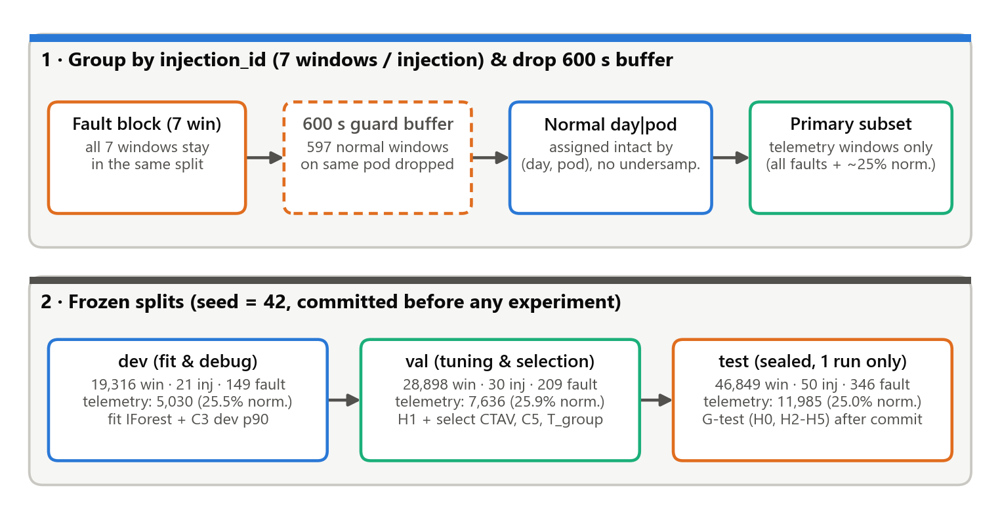
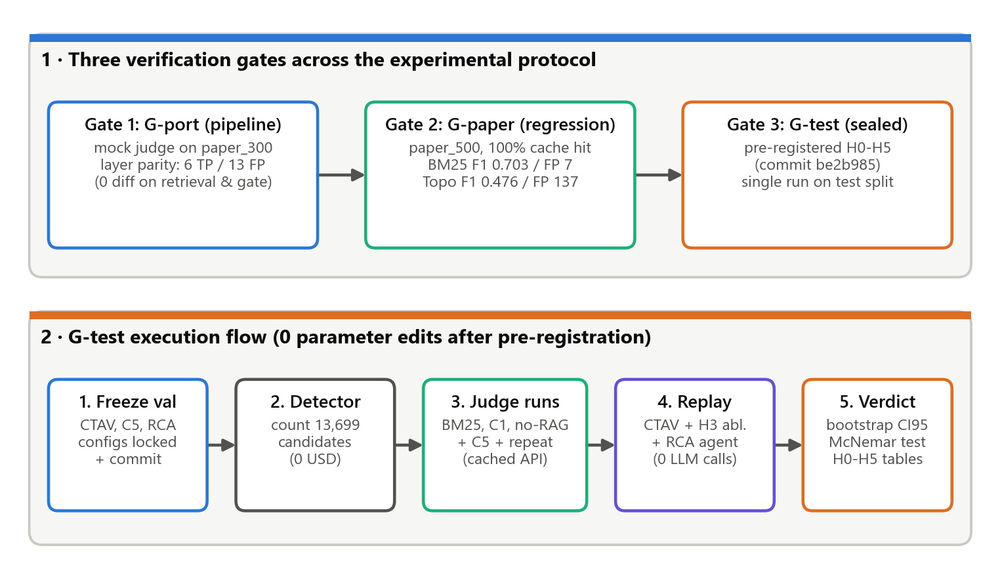
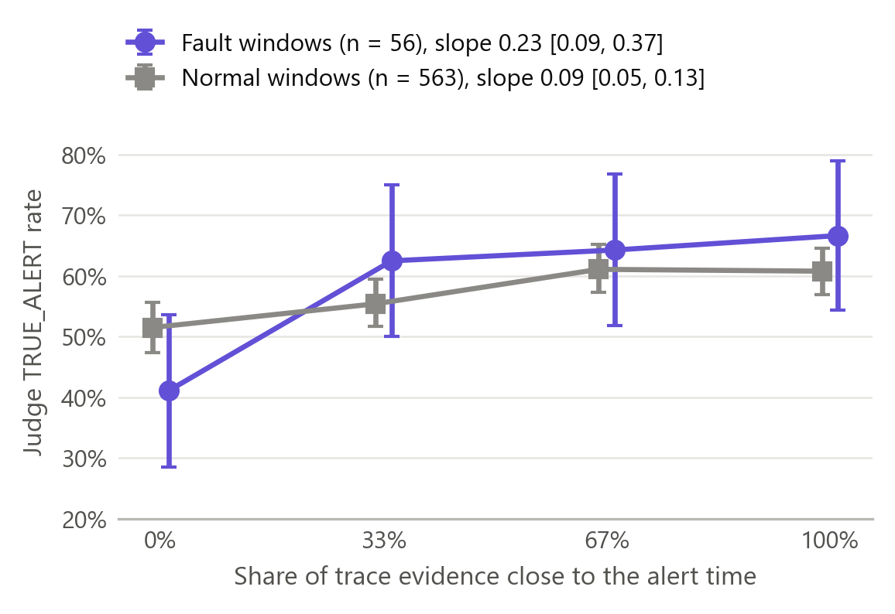
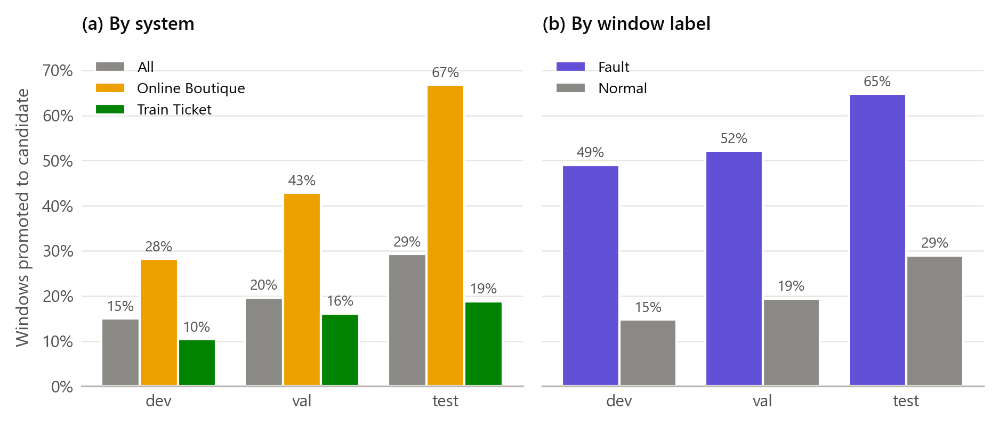
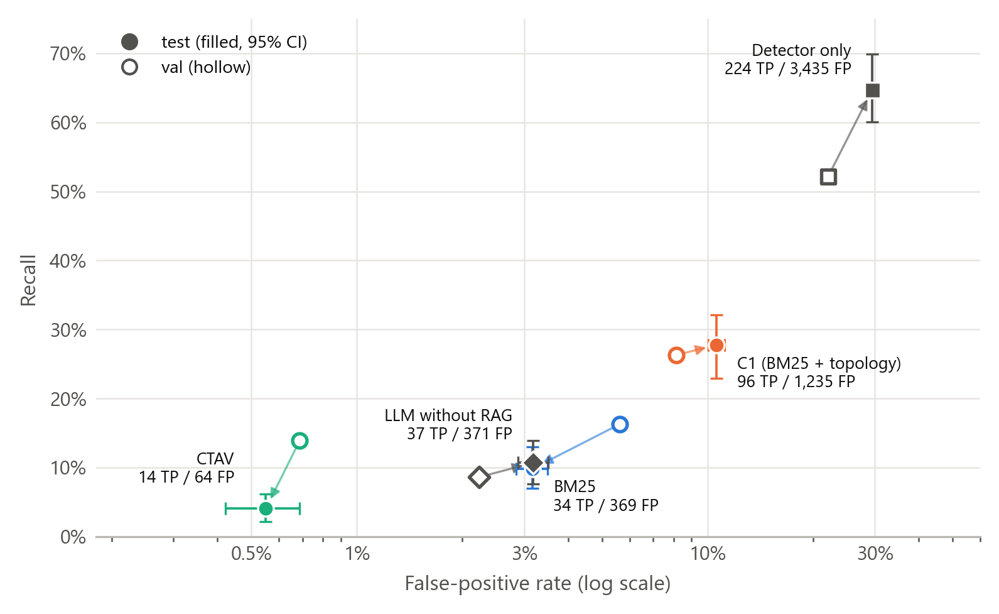
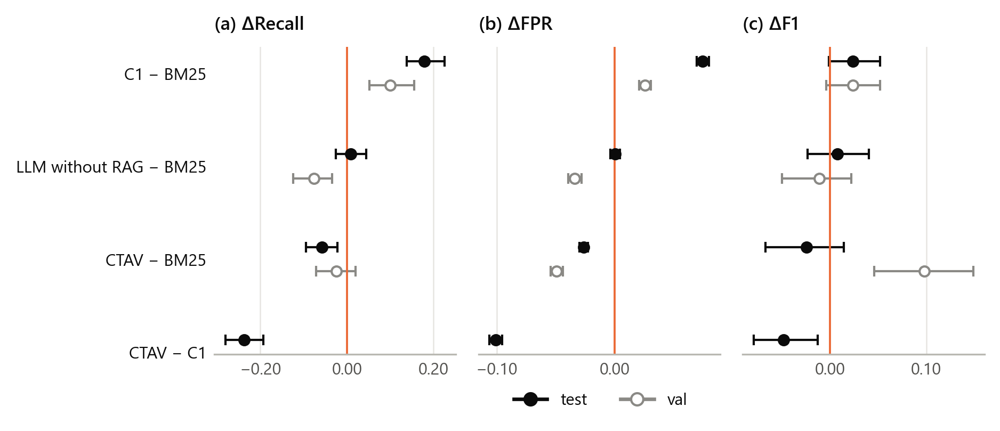
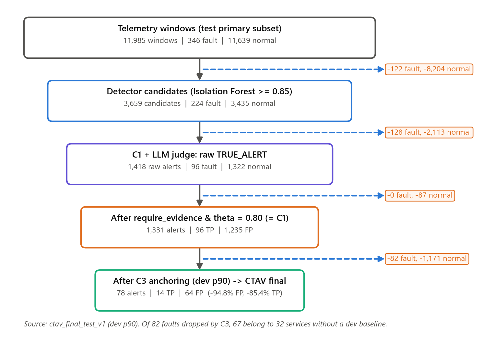
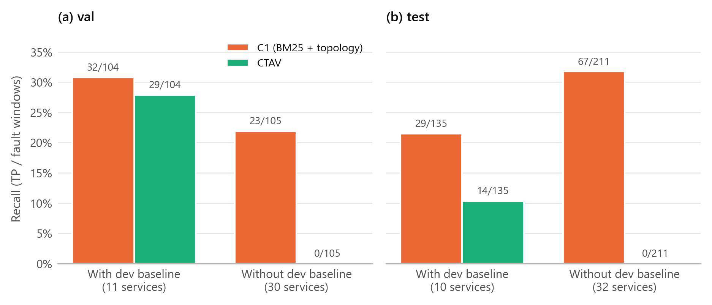
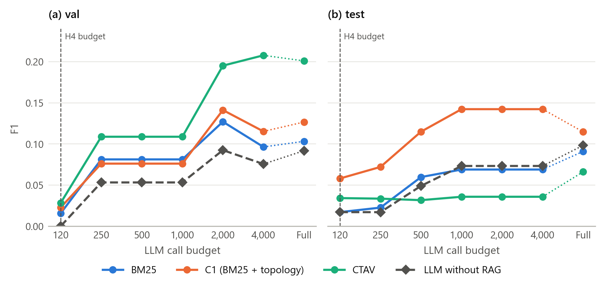

# Chương 5 — Thực nghiệm và đánh giá

> **Bản đồng bộ local (Markdown) của [`docs/drafts/Internship2_HK262/Sections/Ch5_ThucNghiemVaDanhGia.tex`](Internship2_HK262/Sections/Ch5_ThucNghiemVaDanhGia.tex) và [`thesis/chapters/ch5.tex`](../../thesis/chapters/ch5.tex).**
> Toàn bộ 9 hình minh họa Chương 5 nằm trong [`docs/drafts/figures/ch5/`](figures/ch5/).

Chương này kiểm chứng toàn diện đề xuất CTAV và tác tử RCA theo trình tự thực nghiệm ba lớp: kiểm tra tính đúng của pipeline cơ sở và khả năng tái lập hồi quy (Mục 5.5), tinh chỉnh và chọn cấu hình trên tập `val` (Mục 5.6), cuối cùng kiểm định một lần duy nhất trên tập `test` đã niêm phong cho cả nhánh thẩm định cảnh báo lẫn nhánh phân tích nguyên nhân gốc (Mục 5.7–5.9). Mở đầu chương, các mục 5.1–5.4 trình bày sáu giả thuyết đăng ký trước H0–H5, giao thức chia dữ liệu chống rò rỉ, thiết lập thực nghiệm và hệ thống thước đo. Mục 5.10 tổng hợp mười hai phát hiện thực nghiệm định hình các quyết định thiết kế, và Mục 5.11 tóm tắt kết luận kiểm định trước khi chuyển sang phần trình diễn nền tảng ở Chương 6.

---

## 5.1 Mục tiêu thực nghiệm và các giả thuyết H0–H5

Thực nghiệm của đề tài hướng tới hai mục tiêu định lượng: (A) kiểm chứng liệu CTAV có duy trì mức tăng thu hồi (recall) của truy xuất nhận biết topology mà không làm tăng tỷ lệ báo động giả (FPR) so với truy xuất từ khóa cục bộ BM25 trong cùng ngân sách gọi LLM hay không; và (B) kiểm chứng liệu tác tử RCA đứng sau CTAV có định vị được service gốc, giảm số cảnh báo qua gom sự cố và sinh báo cáo chẩn đoán hợp lệ hay không.

Toàn bộ sáu giả thuyết H0–H5 cùng tiêu chí chấp nhận và cấu hình đóng băng đã được đăng ký công khai tại commit riêng (`be2b985`) trước bất kỳ lượt chạy nào trên tập `test`. Quy ước thống kê: khoảng tin cậy 95% (CI95) bootstrap phân vị 1.000 mẫu (`seed = 42`) và kiểm định McNemar chính xác hai phía ở mức $\alpha = 0{,}05$. **H2** là giả thuyết chính; H0, H3, H4 là giả thuyết phụ, báo giá trị $p$ thô không hiệu chỉnh đa so sánh. Chỉ số chính tính trên *cửa sổ có telemetry*.

**Bảng 5.1.** *Hệ thống giả thuyết H0–H5 và tiêu chí chấp nhận đã đăng ký (`be2b985`).*

| Mã | Nội dung giả thuyết | Tiêu chí chấp nhận đã đăng ký | Phạm vi kiểm |
| :--- | :--- | :--- | :--- |
| **H0** | Topology chưa hiệu chỉnh (C1) tăng recall và tăng FPR so với BM25 | CI95 của $\Delta\text{Recall}$ và $\Delta\text{FPR}$ có cận dưới $> 0$; McNemar cửa sổ lỗi và bình thường $p < 0{,}05$ | `val` & `test` |
| **H1** | Cơ chế: `TRUE_ALERT` trên cửa sổ bình thường tăng theo độ gần thời gian và trace | Xu hướng đơn điệu dương kèm CI95 trên mẫu can thiệp cố định; không chạy lại trên `test` | Chỉ `val` |
| **H2** (chính) | CTAV tốt hơn BM25 và giữ phần lớn recall của C1 | (i) CI95 $\Delta\text{F1}(\text{CTAV}-\text{BM25})$ cận dưới $> 0$ và McNemar $p < 0{,}05$; (ii) CI95 $\Delta\text{FPR}(\text{CTAV}-\text{BM25})$ không có cận dưới $> 0$; (iii) ước lượng điểm $\Delta\text{Recall}(\text{CTAV}-\text{C1}) \ge -0{,}05$. Đạt (i)–(ii) nhưng trượt (iii) ⇒ "đạt một phần" | `val` (sơ bộ) & `test` |
| **H3** | Đóng góp từng thành phần quanh CTAV (một-thay-đổi-một-lần) | Bỏ C3 ⇒ CI95 $\Delta\text{Precision}$ cận trên $< 0$; thêm C2 xác nhận loại nếu CI95 $\Delta\text{FPR}$ chứa 0 hoặc $> 0$; thêm C4 xác nhận loại nếu chi phí tăng và CI95 $\Delta\text{F1}$ không có cận dưới $> 0$; báo mô tả C3-trượt và C5 một điểm | `val` & `test` |
| **H4** | Ở ngân sách 120 lần gọi, CTAV không kém LLM-không-RAG | Ước lượng điểm $\text{F1}(\text{CTAV}) \ge \text{F1}(\text{không-RAG})$ ở mốc 120 lần gọi; báo kèm đường ngân sách | `val` & `test` |
| **H5** | Tác tử RCA định vị service gốc và giảm cảnh báo | $\text{Hit@1} \ge 0{,}60$, $\text{Hit@3} \ge 0{,}80$, cận dưới CI95 $\Delta\text{Hit@1}(\text{RCA}-\text{baseline}) > 0$, Alert Reduction $\ge 30\%$ trên sự cố cascade | `val` & `test` |

---

## 5.2 Dữ liệu và giao thức chia split chống rò rỉ

Toàn bộ thí nghiệm dùng bộ dữ liệu microservice đa phương thức công khai Nezha [1] (OnlineBoutique và TrainTicket, 5 loại lỗi tiêm có chủ đích, đồ thị phụ thuộc 56 service và 68 cạnh có hướng, cửa sổ 60 s gán nhãn theo wall-clock). Ba split `dev`, `val`, `test` được khóa cứng (`seed = 42`): mỗi lần tiêm lỗi (7 cửa sổ) nằm trọn trong một split, loại vùng đệm 600 s (597 cửa sổ bình thường của cùng pod), phân bổ bình thường nguyên khối theo cặp `ngày|pod` và giữ nguyên tỷ lệ mất cân bằng tự nhiên $\approx 1:135$.

*Hình 5.1: Giao thức chia split chống rò rỉ trên Nezha (`dev`, `val`, `test`). Nguồn: tác giả vẽ, có hỗ trợ AI.*

**Bảng 5.2.** *Kích thước ba split `dev`, `val`, `test` và tỷ lệ cửa sổ có telemetry.*

| Split | Tổng cửa sổ | Cửa sổ lỗi | Lần tiêm lỗi | Lỗi có telemetry | Bình thường có telemetry |
| :--- | ---: | ---: | ---: | ---: | :--- |
| `dev` | 19.316 | 149 | 21 | 149 / 149 (100%) | 4.881 / 19.167 (25,5%) |
| `val` | 28.898 | 209 | 30 | 209 / 209 (100%) | 7.427 / 28.689 (25,9%) |
| `test` | 46.849 | 346 | 50 | 346 / 346 (100%) | 11.639 / 46.503 (25,0%) |

**Bảng 5.3.** *Độ phủ bằng chứng trên tập mẫu đối chiếu (98 cửa sổ lỗi, 391 cửa sổ bình thường — Phát hiện 1).*

| Điều kiện tồn tại bằng chứng | Cửa sổ lỗi (98) | Cửa sổ bình thường (391) |
| :--- | ---: | ---: |
| Kho đối chiếu lọc theo nhãn: top-6 khác rỗng | 89 (90,8%) | 21 (5,4%) |
| Kho Nezha đầy đủ: top-6 khác rỗng | 98 (100,0%) | 76 (19,4%) |
| Có tệp log hoặc trace trong biên $\pm 8$ phút | 98 (100,0%) | 106 (27,1%) |

---

## 5.3 Thiết lập thực nghiệm và chi phí

Mô hình thẩm định duy nhất: `gemini-2.5-flash` ở nhiệt độ 0, `thinkingBudget = 0`, bỏ cột hằng lỗi `PodSuccessRate(%)` (Phát hiện 5), đi qua cache JSONL khóa `sha256`. Isolation Forest (ngưỡng 0,85, `buffer_size = 2`) huấn luyện trên `dev`. C1 dùng $(\alpha, \beta, \gamma) = (0{,}35;\, 0{,}25;\, 0{,}40)$, $\tau_F = 300\,\text{s}$, 2-hop, top-6, 4.000 token. Replay CTAV và ablation H3 tốn 0 USD.

**Bảng 5.4.** *Chi phí gọi API LLM ước tính theo sổ cái token cho từng hạng mục thực nghiệm chính.*

| Hạng mục | Nội dung chạy chính | USD theo token | Ghi chú |
| :--- | :--- | ---: | :--- |
| Kiểm chứng G-port / G-paper | Khớp pipeline mock + tái lập 489 ca từ cache + smoke test | 0,29 | G-paper đạt 100% cache hit (0 USD) |
| Thực nghiệm H0 trên `val` | BM25, C1 ($k_{\text{graph}} \in \{0, 1\}$), LLM-không-RAG | ≈ 8,60 | Có tái sử dụng cache giữa các nhánh |
| Thí nghiệm cơ chế H1 trên `val` | 9 điều kiện can thiệp (6.988 lượt gọi thành công) | 9,48 | Mẫu cố định 1.749 candidate |
| Chọn cấu hình CTAV | Replay toàn bộ chính sách và ablation H3 trên `val` | 0,00 | Mô phỏng C1 mọi candidate ≈ 3,28 USD/run |
| Khảo sát C5 trên `val` | Chấm một lần 1.459 cửa sổ được cứu | 1,03 | Quét 147 điểm lưới ngoại tuyến |
| Kiểm định G-test trên `test` | BM25, C1, không-RAG, C5 một điểm, 4 run `repeat` | 15,85 | 21.094 lượt gọi API mới, 0 lỗi judge |
| Tác tử RCA (`val` & `test`) | Tóm tắt 26 (`val`) + 38 (`test`) + 114 (độ nhạy) sự cố | 0,28 | Tổng 178 lượt gọi, 0 báo cáo bị loại |

---

## 5.4 Thước đo đánh giá

- **Nhánh thẩm định:** TP, FP, Precision, Recall (tính trên *toàn bộ* cửa sổ lỗi của split), F1 (3 chữ số thập phân) và FPR (4 chữ số); `UNCERTAIN` và `manual_review` không tính là cảnh báo phát ra.
- **Thống kê & độ ổn định:** CI95 bootstrap 1.000 mẫu (`seed = 42`), McNemar chính xác hai phía ($\alpha = 0{,}05$) tách cửa sổ lỗi và bình thường; tỷ lệ lật phán quyết qua `repeat` $\in \{0, 1, 2\}$ trên 200 candidate.
- **Nhánh RCA:** Hit@1, Hit@3 trên sự cố đơn lỗi có nhãn (loại `ambiguous` và báo số lượng), đối chứng baseline anomaly score cao nhất; ARR, JSON valid rate và độ trễ hồi phát.

---

## 5.5 Kiểm chứng tính đúng của pipeline và tái lập hồi quy

*Hình 5.2: Ba cổng kiểm chứng thực nghiệm (G-port, G-paper, G-test) và quy trình năm bước của G-test sau commit `be2b985`. Nguồn: tác giả vẽ, có hỗ trợ AI.*

### 5.5.1 Kiểm chứng pipeline cơ sở (G-port)

Trên `paper_300` với bộ thẩm định giả lập (mock), ba tầng lõi (truy xuất BM25 `40/40`, judge mock `30/30`, cổng ngưỡng & ngân sách `6/13/10/271`) khớp tuyệt đối bản tham chiếu. Toàn pipeline mới lệch `+6` FP (`6/19/10/265`, Spearman `0,79`) do đặc trưng bộ đệm cuộn 60 s; 10/13 FP của bản tham chiếu xuất phát từ quy tắc "hết ngân sách tự đẩy cảnh báo".

### 5.5.2 Kiểm chứng hồi quy trên tập đối chiếu (G-paper)

Trên `paper_500` (`gemini-2.5-flash-lite`, tái lập 100% từ cache, 0 lượt gọi API mới), cả BM25 (`489/489` khớp, 58 TP / 7 FP, F1 `0,7030`) lẫn Topology (`489/489` khớp, 74 TP / 137 FP, F1 `0,4759`) trùng chính xác với số liệu đã công bố [2]. Giải phẫu G-paper đồng thời rút ra Phát hiện 2 (confidence sao chép `anomaly_score`), Phát hiện 3 (topology cũ ≈ BM25 không giới hạn thời gian) và Phát hiện 4 (C1 chuẩn không tự đưa bằng chứng lân cận vào top-6 khi không có hạn ngạch).

---

## 5.6 Tinh chỉnh và lựa chọn cấu hình trên tập `val`

### 5.6.1 Kiểm chứng sơ bộ H0 trên `val`

Trên `val` (7.636 cửa sổ có telemetry, 209 lỗi): C1-paper (`k_graph = 0`: 55 TP, 606 FP, Recall 0,263, F1 0,126, FPR 0,0816) tăng cả Recall ($+0{,}100$ $[+0{,}052;\, +0{,}155]$) lẫn FPR ($+0{,}0254$ $[+0{,}0204;\, +0{,}0306]$) so với BM25 (34 TP, 417 FP, Recall 0,163, F1 0,103, FPR 0,0561; McNemar $p < 0{,}001$ ở cả hai nhãn), còn `C1-quota` ($k_{\text{graph}} = 1$: 53 TP, 585 FP, F1 0,125) hầu như đồng nhất với C1-paper ($\Delta\text{F1} = -0{,}001$). Hiệu ứng xuất phát từ trace cục bộ sát $t_0$ hơn BM25 (trung vị $|\Delta t|$ 66–73 s vs 139–167 s, Phát hiện 7).

### 5.6.2 Tinh chỉnh truy xuất C1: `k_graph` và trọng số Fusion

Quét $k_{\text{graph}} \in \{0, 1, 2, 3\}$ (0 LLM) cho thấy trúng gốc giữ nguyên 109/109 trong khi tăng `k_graph` đưa lân cận vào 1.177 cửa sổ bình thường và giảm tỷ lệ chỗ cục bộ từ 0,997 xuống 0,499; ablation 32 tổ hợp $(\alpha, \beta, \gamma)$ khẳng định giữ bộ trọng số $(0{,}35;\, 0{,}25;\, 0{,}40)$ và $k_{\text{graph}} = 0$ (Phát hiện 6).

### 5.6.3 Kiểm chứng cơ chế thiên lệch xác nhận H1 trên `val`

*Hình 5.3: Thí nghiệm H1 trên tập `val` — tỷ lệ `TRUE_ALERT` tăng đơn điệu theo tỷ lệ trace sát $t_0$ ở cả hai nhãn.*

**H1 được giữ một phần trên tập `val` (không chạy lại trên `test`).** Thứ tự trình bày không có tác dụng, điểm hiển thị tác động nhỏ ($+0{,}020$, $p = 0{,}062$), còn độ gần thời gian (độ dốc $+0{,}094$ trên normal, $+0{,}230$ trên fault) và loại bằng chứng (`near_trace` $0{,}608$ trên normal vs `near_log` $0{,}181$ và `neighbor_trace` $0{,}277$) tác động mạnh lên cả hai nhãn — dẫn tới chuyển trục thiết kế sang neo bằng chứng bất thường C3.

### 5.6.4 Chọn cấu hình CTAV (C3) và loại bỏ C2, C4 trên `val`

Trên `val`, CTAV chốt (`C1 + \theta_{\text{local}} = 0{,}80 + C3` ngưỡng nền `dev` p90) đạt **29 TP / 51 FP, Precision 0,363, Recall 0,139, F1 0,201 `[0,138; 0,264]`, FPR 0,0069** (3,28 USD). Bỏ C3 làm F1 tụt $-0{,}074$ (606 FP); thêm C2 chỉ giảm 2 FP (CI $\Delta\text{FPR}$ chạm 0); thêm C4 tăng chi phí lên 5,14 USD mà F1 giảm còn 0,188 (Phát hiện 9). Ngưỡng `dev` chỉ phủ 31,8%–33,2% span (Phát hiện 8, 11), nên biến thể `C3-trượt` 60 phút (34 TP / 255 FP, F1 0,137 trên `val`) được giữ làm nhánh theo dõi bắt buộc ở H3.

### 5.6.5 Khảo sát cổng cứu cảnh báo C5 trên `val`

Quét 147 điểm lưới chọn $\eta = (0;\, 0{,}4;\, 0{,}6)$, $\tau = 0{,}8$ (1.459 cửa sổ được cứu, 1,03 USD). Trên `val`, CTAV + C5 tốn +52 lượt gọi nhưng chỉ thêm 2 TP / 16 FP (31 TP / 67 FP, F1 0,202 vs 0,201, $\Delta\text{F1} = +0{,}001$ `[-0,014; +0,022]`, $\Delta\text{FPR} = +0{,}0022$, $p = 0{,}0013$ — Phát hiện 12). C5 chỉ giữ vai trò ablation một điểm trên `test`.

---

## 5.7 Kết quả kiểm định trên tập `test` (G-test)

### 5.7.1 Giao thức G-test và tổng hợp các lượt chạy

Sau commit đăng ký `be2b985`, `test` (46.849 cửa sổ, 13.699 candidate) được chạy đúng một lần không đổi tham số: tổng cộng **21.094 lượt gọi API mới = 15,85 USD theo token**, **0 lỗi judge**.

### 5.7.2 Hành vi bộ phát hiện trên `test` và độ lệch giữa các split

*Hình 5.4: Tỷ lệ cửa sổ trở thành candidate trên `dev` (15,0%), `val` (19,6%) và `test` (29,2%).*

Tỷ lệ candidate tăng từ 15,0% (`dev`) → 19,6% (`val`) → 29,2% (`test`, 13.699 candidate) do thành phần service của split: OnlineBoutique chiếm 21,8% trên `test` với 66,8% là candidate (5 service "luôn bật" đóng góp 47% số candidate; riêng `frontend` vắng mặt ở `val`).

### 5.7.3 Bức tranh tổng quan các phương pháp trên `test`

*Hình 5.5: Điểm vận hành Recall–FPR trên cửa sổ có telemetry của `val` và `test`.*

**Bảng 5.5.** *Hiệu năng năm phương pháp trên `test` (11.985 cửa sổ có telemetry, 346 lỗi) cạnh `val`.*

| Phương pháp | TP | FP | Prec. | Recall [CI95] | F1 [CI95] | FPR [CI95] | `val` F1 |
| :--- | ---: | ---: | ---: | :--- | :--- | :--- | ---: |
| Detector-only | 224 | 3.435 | 0,061 | 0,647 [0,601; 0,699] | 0,112 [0,100; 0,126] | 0,2951 [0,2870; 0,3036] | 0,111 |
| LLM-không-RAG | 37 | 371 | 0,091 | 0,107 [0,077; 0,139] | 0,098 [0,071; 0,126] | 0,0319 [0,0288; 0,0351] | 0,092 |
| BM25 | 34 | 369 | 0,084 | 0,098 [0,070; 0,130] | 0,091 [0,064; 0,119] | 0,0317 [0,0285; 0,0350] | 0,103 |
| C1 (`k_graph = 0`) | 96 | 1.235 | 0,072 | 0,277 [0,230; 0,321] | 0,114 [0,093; 0,135] | 0,1061 [0,1007; 0,1118] | 0,126 |
| **CTAV** (`dev` p90) | **14** | **64** | **0,179** | **0,040 [0,022; 0,061]** | **0,066 [0,036; 0,100]** | **0,0055 [0,0042; 0,0069]** | 0,201 |
| *Đối chứng H3:* C3-trượt | 47 | 391 | 0,107 | 0,136 [0,101; 0,172] | 0,120 [0,090; 0,151] | 0,0336 [0,0304; 0,0369] | 0,137 |

### 5.7.4 Kiểm định H0: topology chưa hiệu chỉnh

**H0 được chấp nhận trên tập `test` (đạt 4/4 vế).** $\Delta\text{Recall}(\text{C1}-\text{BM25}) = +0{,}179$ `[+0,138; +0,226]` (+62 TP), $\Delta\text{FPR} = +0{,}0744$ `[+0,0694; +0,0798]` (+866 FP, FPR gấp 3,3 lần), McNemar lỗi & bình thường đều $p < 0{,}001$; $\Delta\text{F1} = +0{,}024$ `[-0,001; +0,052]`.

### 5.7.5 Kiểm định H2: CTAV so với BM25 và C1 (giả thuyết chính)

*Hình 5.6: Hiệu ghép cặp $\Delta\text{Recall}$, $\Delta\text{FPR}$ và $\Delta\text{F1}$ kèm CI95 bootstrap trên `test` và `val`.*

**H2 không được chấp nhận trên tập `test`.** CTAV đạt sâu vế (ii) FPR ($\Delta\text{FPR} = -0{,}0262$ `[-0,0297; -0,0229]`, giảm 5,8 lần FP so với BM25, nâng Precision từ 0,084 lên 0,179), nhưng không đạt vế (i) ($\Delta\text{F1} = -0{,}025$ `[-0,067; +0,014]`, CI chứa 0) và vế (iii) ($\Delta\text{Recall}(\text{CTAV}-\text{C1}) = -0{,}237 < -0{,}05$) do mất 82/96 TP của C1.

### 5.7.6 Kiểm định H3: đóng góp của từng thành phần

**H3 được chấp nhận trên tập `test` (đạt 3/3 tiêu chí).** Bỏ C3 kéo Precision giảm $-0{,}107$ `[-0,197; -0,030]` (64 → 1.235 FP); thêm C2 cho $\Delta\text{FPR} = +0{,}0000$ (0 phán quyết đổi, xác nhận loại); thêm C4 tốn 13,56 vs 8,16 USD với $\Delta\text{F1} = -0{,}001$ `[-0,001; +0,000]` (xác nhận loại). Mô tả: C3-trượt tăng $+33$ TP và $\Delta\text{F1} = +0{,}054$ `[+0,017; +0,091]`; C5 thêm $+0$ TP, $+1$ FP (+61 lần gọi).

### 5.7.7 Kiểm định H4: ngân sách nhỏ 120 lần gọi

**H4 được chấp nhận trên tập `test`.** Ở 120 lần gọi đầu tiên, CTAV đạt F1 **0,034 `[0,011; 0,064]`** (6 TP, 0 FP) ≥ LLM-không-RAG **0,017 `[0,000; 0,038]`** (3 TP, 3 FP); cần lưu ý 120 lần gọi chỉ chiếm 0,9% số candidate của `test` và CI chồng nhau rộng.

### 5.7.8 Bảng tổng hợp kết luận H0–H5

- **H0:** Được chấp nhận (4/4 vế).
- **H1:** Giữ một phần trên `val` (không chạy lại trên `test`).
- **H2 (chính):** Không được chấp nhận (đạt vế FPR; trượt vế F1 và Recall).
- **H3:** Được chấp nhận (C3 đóng góp; xác nhận loại C2, C4).
- **H4:** Được chấp nhận (ước lượng điểm `0,034 ≥ 0,017`; CI chồng nhau).
- **H5:** Không được chấp nhận (0/4 vế; chi tiết ở Mục 5.9).

---

## 5.8 Phân tích thành phần, cơ chế và đường cong trên `test`

### 5.8.1 Phễu quyết định và ablation thành phần

*Hình 5.7: Phễu quyết định của CTAV trên 11.985 cửa sổ có telemetry của `test`. Nguồn: tác giả vẽ, có hỗ trợ AI.*

Trong 1.331 cảnh báo của C1 (96 TP, 1.235 FP), tầng C3 (`dev` p90) hạ 1.253 ca (1.171 FP — cắt 94,8%, và 82 TP — mất 85,4%), để lại 78 cảnh báo (14 TP, 64 FP).

### 5.8.2 Độ phủ ngưỡng nền `dev` và sự sụt giảm recall (Phát hiện 11)

*Hình 5.8: Recall của C1 và CTAV tách theo nhóm service có / thiếu ngưỡng nền `dev` trên `val` và `test`.*

Trên `test`, **32/42 service** (88,1% cửa sổ telemetry, 61,0% số lỗi = 211/346) thiếu ngưỡng `dev`, khiến CTAV hạ sạch **67/67 TP của C1** ở nhóm này (mất ngay 0,194 recall toàn tập). Khi thay duy nhất nguồn ngưỡng bằng cửa sổ trượt 60 phút không cần nhãn (`C3-trượt`, độ phủ span tăng từ 16,1% lên 91,2%), hệ thống đạt **47 TP, 391 FP, F1 = 0,120** ($\Delta\text{F1} = +0{,}054$ `[+0,017; +0,091]`, $p < 0{,}001$), giữ nhiều hơn BM25 13 TP (+38%) và cắt 68,3% FP của C1 (FPR 0,0336 sát BM25 0,0317).

### 5.8.3 Đường F1 theo ngân sách gọi LLM

*Hình 5.9: Đường cong F1 theo ngân sách lượt gọi LLM trên `val` và `test`.*

CTAV đạt 0,034 (mốc 120), đi ngang 0,032–0,036 ở mốc 500–4.000 (vùng OnlineBoutique có nhiều service thiếu ngưỡng `dev` và khoảng không telemetry giữa mốc 1.001–4.000), rồi lên 0,066 ở mức đủ (13.699).

### 5.8.4 Đánh giá C5 (Rescue) một điểm trên `test`

Tại $\eta = (0;\, 0{,}4;\, 0{,}6)$, $\tau = 0{,}8$, C5 cứu 61 cửa sổ (3 lỗi, 58 bình thường; 0,09 USD), sinh **+0 TP, +1 FP** ($\Delta\text{F1} = 0{,}000$, McNemar $p = 1{,}000$), xác nhận lại Phát hiện 12.

### 5.8.5 Độ ổn định lặp lại của bộ thẩm định và chi phí

Qua `repeat = 0, 1, 2` trên 200 candidate của `test`, tỷ lệ đồng thuận 3/3 đạt **99,0%** (BM25, 2/200 normal lật) và **99,5%** (C1, 1/200 normal lật), 0 cửa sổ lỗi đổi nhãn. Tổng chi phí G-test là **15,85 USD** (21.094 lượt gọi API mới) so với ước tính 13,00 USD.

### 5.8.6 Đánh giá context precision bằng chấm tay

Đã xuất mẫu mù 50 cửa sổ (`eval/manual/context_precision_test_v1.csv`, 525 dòng bằng chứng, `seed = 42`), **chờ chấm tay** (V35) trước khi ghép `.key.csv` điền số.

---

## 5.9 Đánh giá tác tử RCA (H5)

Trên `val`, chọn $T_{\text{group}} = 180\,\text{s}$ và `sign = alert` (26 sự cố, Hit@1 = 0,636 = baseline, ARR chung 0,675, JSON valid 26/26). Trên `test`, chạy một lần cấu hình đóng băng (`b0c54fa68ef65535`) trên 78 cảnh báo CTAV (38 sự cố, 17 có nhãn, 3 mơ hồ, 18 không lỗi):

- **Hit@1:** $8/17 = 0{,}471$ `[0,235; 0,706]` (< 0,60 — không đạt).
- **Hit@3:** $8/17 = 0{,}471$ `[0,235; 0,706]` (< 0,80 — không đạt).
- **$\Delta\text{Hit@1}$ (RCA − baseline):** $0{,}000$ `[0,000; 0,000]` (không đạt).
- **ARR cascade:** không tính được vì 0/50 lần tiêm là cascade (không đạt; ARR chung = 0,513).

**H5 không được chấp nhận trên tập `test` (0/4 vế).** Nguyên nhân cốt lõi: 78 cảnh báo chỉ nằm ở 5 service có ngưỡng `dev`, nên 29/50 lần tiêm không có cảnh báo nào và cả 38 sự cố đều một service (9 ca trượt đều nổ ở `frontend` / `ts-travel-service` trong khi lỗi nằm ở callee phía sau không có cảnh báo). Dòng độ nhạy ngoài đăng ký (`c3_rolling_baseline`: 438 cảnh báo, 114 sự cố, 39 sự cố đa service) đạt **ARR cascade = 0,704 `[0,591; 0,777]`**, nhưng service gốc chỉ nằm trong tập service có cảnh báo ở 15/48 sự cố có nhãn (trần Hit@3 = 0,313; Hit@1 = 0,208). Tỷ lệ JSON hợp lệ đạt **100%** (`38/38` và `114/114`), song `fault_type` thiên về `cpu_contention` (35/38) — sẽ đánh giá chất lượng bằng người ở Chương 7.

---

## 5.10 Tổng hợp mười hai phát hiện thực nghiệm

12 phát hiện thực nghiệm (P1–P12) đã tổng hợp trong Bảng 5.15 của bản LaTeX, kết nối trực tiếp các nút thắt giao thức dữ liệu (P1–P4), độ nhạy của judge (P5–P7), hiệu quả tách biệt của C3 so với C2/C4/C5 (P9, P12) và tác động "im lặng có cấu trúc" của ngưỡng tĩnh `dev` lên H2 và H5 (P8, P10, P11).

---

## 5.11 Kết chương

Đề tài đã hoàn tất kiểm định ba lớp (G-port, G-paper, G-test) trên tập `test` niêm phong: **H0, H3, H4 được chấp nhận**; **H1 giữ một phần** trên `val`; **H2 và H5 không được chấp nhận** theo tiêu chí đóng băng vì ngưỡng tĩnh `dev` thiếu độ phủ trên 32/42 service của `test`, trong khi nhánh đối chứng `C3-trượt` 60 phút xác nhận nguyên lý neo bằng chứng (F1 = 0,120, $\Delta\text{F1} = +0{,}054$, ARR cascade = 0,704) và bộ kiểm duyệt JSON đạt 100% hợp lệ.

---

## Tài liệu tham khảo (khớp `main.tex` & `thesis/refs.bib`)

- **[1]** (`nezha` / `yu2023nezha`) G. Yu et al., "Nezha: Interpretable Fine-Grained Root Causes Analysis for Microservices on Multi-Modal Observability Data," *Proc. ACM ESEC/FSE*, 2023, pp. 553–565.
- **[2]** (`icaetm2026` / `author2026icaetm`) Nguyễn Văn Hoàng Khang và cộng sự, "Topology-Aware Evidence Retrieval for Cost-Aware LLM Alert Validation in Microservices," *Proc. ICAETM 2026*, 2026.
