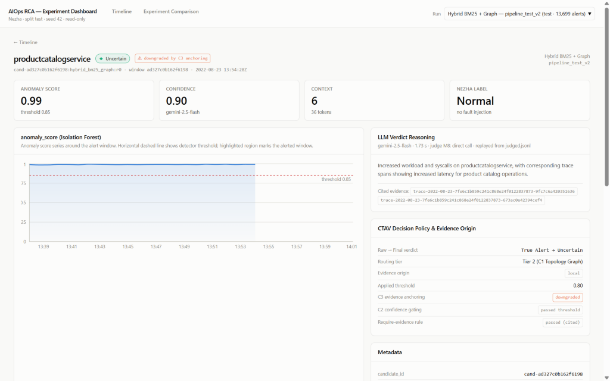
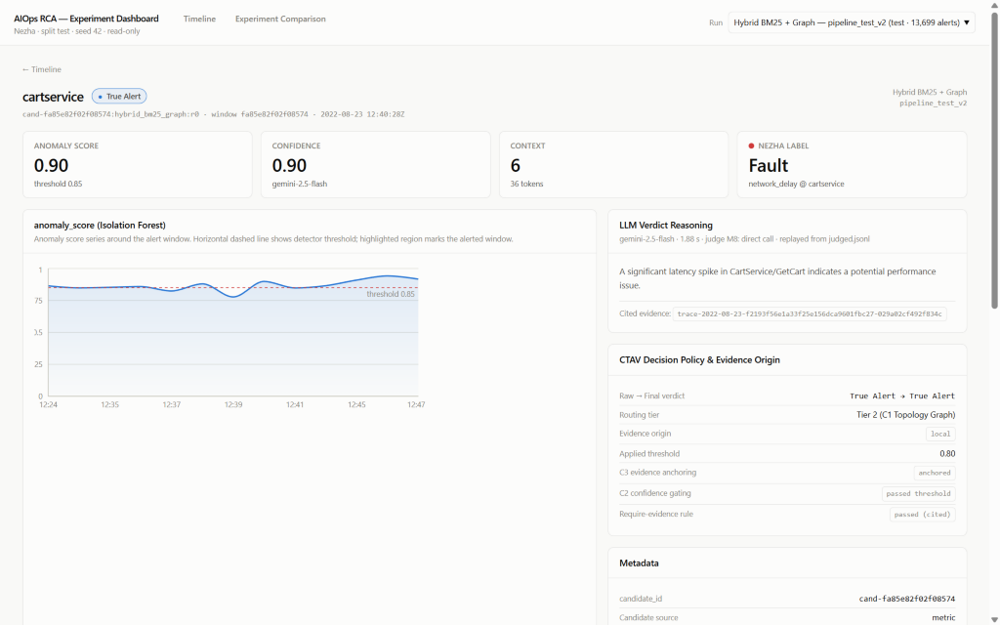

# Chương 6 — Platform demo

Chương này trả lời câu hỏi làm thế nào chuyển toàn bộ chuỗi xử lý từ phát hiện bất thường, thẩm định cảnh báo hiệu chỉnh theo bằng chứng đa phương thức (CTAV) đến tác tử phân tích nguyên nhân gốc (RCA) thành một hệ thống trực quan hoá chạy khép kín trên dữ liệu thật và tái lập được ngoại tuyến lúc bảo vệ. Nội dung đi từ vai trò thiết kế của platform (§6.1) và luồng dữ liệu đầu–cuối kèm số đo thời gian, token thực tế (§6.2), sang bốn màn hình vận hành gắn trực tiếp với từng thành phần phương pháp ở Chương 4 (§6.3). Hai mục cuối trình bày kịch bản demo năm phút với mã ca chạy xác định bằng quy tắc trên tập `test` (§6.4), cùng kết quả kiểm thử ngoại tuyến, kiểm duyệt trình duyệt thật và các phương án dự phòng (§6.5).

---

### 6.1 Vai trò của platform

Platform không được xây dựng như một sản phẩm thương mại mà là hiện thực thực thi thống nhất cho cả thực nghiệm khoa học lẫn trình diễn hội đồng: cùng một đường ống mã nguồn điều phối dữ liệu vào kho phân tích, sinh bảng kiểm định giả thuyết H0–H5 và phục vụ giao diện web bốn màn hình. Vì mục tiêu ưu tiên khả năng tái lập thực nghiệm và độ ổn định khi trình diễn, phạm vi hệ thống được khoanh vùng chặt chẽ: không xác thực người dùng, không phân quyền đa đối tượng thuê bao, không gửi thông báo cảnh báo ra ngoài và không tự động thực thi `runbook` khắc phục sự cố.

Để loại bỏ rủi ro phụ thuộc mạng Internet hoặc hạn mức API lúc bảo vệ, toàn bộ quá trình suy luận mô hình ngôn ngữ lớn (LLM) trong chế độ demo chạy ngoại tuyến 100% từ bộ nhớ đệm (`cache`) cục bộ. Khi bật biến môi trường `DEMO_OFFLINE=1`, đường ống tự động xoá mọi khoá API (`GEMINI_API_KEY`, `GOOGLE_API_KEY`) khỏi tiến trình sau khi nạp cấu hình môi trường, buộc mọi lời gọi thẩm định và tóm tắt đọc thẳng từ đĩa (`data/llm_cache/gemini.jsonl`) và từ chối ngay nếu phát sinh hụt `cache`. Tài nguyên giao diện web cũng đóng gói cục bộ toàn bộ kịch bản và bảng kiểu nội bộ, không tham chiếu phông chữ hay thư viện từ máy chủ bên ngoài.

---

### 6.2 Luồng end-to-end

Chuỗi xử lý đầu–cuối gắn kết bốn giao diện lập trình (`Protocol`) lõi tại `packages/schemas/protocols.py` gồm `SourceAdapter`, `Detector`, `RetrievalStrategy` và `Judge`, dưới sự điều phối của `services/rca_agent/pipeline.py`. Dữ liệu từ bộ phát lại (`Replayer`) đi qua bộ phát hiện `Isolation Forest` trên chuỗi thời gian `metric` (kèm giao diện sẵn cho điểm `Rescue` từ thành phần C5 — `ablation` một điểm), sau đó chuyển sang CTAV với truy xuất lai `BM25`–`topology` (C1, đang dùng), bộ thẩm định `gemini-2.5-flash` đọc từ `cache` và chính sách neo bằng chứng theo ngưỡng nền `p90` của `dev` (C3, đang dùng, đóng góp chính; hai thành phần C2 — gating theo nguồn bằng chứng — và C4 — định tuyến hai tầng — đã được loại sau `ablation`). Cảnh báo xác nhận (`TRUE_ALERT`) được tác tử RCA gom nhóm trong cửa sổ `T_group = 180 s`, xếp hạng lan truyền ngược 1 bước trên đồ thị phụ thuộc service (`signals = alert`) và tóm tắt thành báo cáo JSON có trích dẫn bằng chứng.

```text
Replayer ─▶ Detector (IForest) ─▶ CTAV (C1 BM25-Graph ─▶ Judge ─▶ C3 neo p90)
                                              │                     │
                                              ▼                     ▼
                                     ClickHouse (mọi candidate)   Tác tử RCA (Gom nhóm ─▶ Lan truyền 1 bước ─▶ Báo cáo JSON)
                                              │                     │
                                              └──────────┬──────────┘
                                                         ▼
                                            PostgreSQL (incident & báo cáo)
                                                         │
                                                         ▼
                                       API FastAPI chỉ đọc (7 endpoint) ─▶ Dashboard React/Vite
```

Bảng 6.1 tổng hợp số bản ghi, mức khớp kiểm chứng kỹ thuật với kết quả nghiên cứu (100% khớp danh sách `alert_ids`, thứ hạng `level1`/`baseline` và mã băm nội dung báo cáo JSON) cùng độ trễ tái lập từ `cache` và lượng token đã lưu đệm trên ba lượt chạy chính thức và độ nhạy (`eval/results/pipeline_{val_v2,test_v2,sens_test_v1}/runtime.json`). Số đo độ trễ dưới đây phản ánh tốc độ tái lập từ `cache` và ghi cơ sở dữ liệu, không phải độ trễ gọi API LLM trực tiếp; độ trễ suy luận LLM gốc từng `candidate` vẫn được giữ nguyên trong ClickHouse để hiển thị chi tiết.

Bảng 6.1. Số bản ghi, đối chiếu parity và độ trễ tái lập từ `cache` của luồng đầu–cuối (`0` lần gọi API mới, tỷ lệ trúng `cache` 100%).

| Chỉ số | `pipeline_val_v2` (`val`) | `pipeline_test_v2` (`test` chính thức) | `pipeline_sens_test_v1` (`test` — độ nhạy ngoài đăng ký) |
|---|---|---|---|
| Nguồn CTAV / biến thể | `ctav_final_val_v1` / mặc định | `ctav_final_test_v1` / mặc định | `ctav_final_test_v1` / `c3_rolling_baseline` |
| Đối chiếu nhất quán báo cáo | `rca_final_val_v1` (**26 / 26**) | `rca_final_test_v1` (**38 / 38**) | `rca_sens_test_c3rolling_v1` (**114 / 114**) |
| Số `candidate` nạp ClickHouse (`TRUE_ALERT`) | 5.677 (80 `TRUE_ALERT`) | 13.699 (78 `TRUE_ALERT`) | 13.699 (438 `TRUE_ALERT`) |
| Số dòng truy vết bằng chứng ClickHouse | 7.716 | 19.794 | 19.794 |
| `Incident` / báo cáo hợp lệ PostgreSQL | 26 / 26 (0 từ chối) | 38 / 38 (0 từ chối) | 114 / 114 (0 từ chối) |
| Nạp dữ liệu & chính sách (`load_alerts_ms`) | 615,161 ms | 1.249,668 ms | 5.278,743 ms |
| Ghi ClickHouse (`clickhouse_write_ms`) | 2.903,706 ms | 1.265,027 ms | 2.787,373 ms |
| Gom nhóm & lan truyền (`grouping` + `propagation`) | 4,276 ms | 5,683 ms | 19,372 ms |
| Tóm tắt chỉ đọc `cache` (`summarizer_ms`) | 424,397 ms | 442,432 ms | 706,557 ms |
| Ghi PostgreSQL (`postgres_write_ms`) | 333,750 ms | 191,637 ms | 347,860 ms |
| **Tổng thời gian đầu–cuối (`e2e_wall_ms`)** | **5.764,165 ms** | **4.242,424 ms** | **10.646,898 ms** |
| Token CTAV trong `cache` (prompt / completion) | 5.173.670 / 691.941 | 12.736.820 / 1.734.808 | 12.736.820 / 1.734.808 |
| Token Summarizer trong `cache` (prompt / completion) | 66.080 / 9.528 | 74.151 / 10.887 | 290.535 / 38.789 |

Trên máy chủ API chỉ đọc (`services/api`), cả bảy đường dẫn HTTP phục vụ bốn màn hình trực quan hoá với độ trễ dưới 1 giây ngay cả khi trả toàn bộ 13.699 `candidate` của `test`. Bảng thực nghiệm tĩnh cho màn hình so sánh được trích xuất trực tiếp từ các tệp kết quả JSON qua `scripts/m10_experiment_table.py`, không suy đoán hay làm tròn lại so với Chương 5.

---

### 6.3 Dashboard bốn màn hình

Giao diện trực quan hoá (`AIOps RCA — Experiment Dashboard`) hiển thị thống nhất bằng tiếng Anh để giữ nguyên thuật ngữ kỹ thuật quốc tế và đối chiếu một–một với kho mã; phần giải thích dưới đây trình bày theo góc nhìn người vận hành đi qua bốn màn hình chính. Người đọc cần quan sát vùng chọn lượt chạy ở góc trên bên phải và ba lớp thông tin trên mỗi ảnh: ô thống kê tổng hợp, đồ thị/sơ đồ chính giữa và danh sách chi tiết kèm thẻ giải thích chính sách ở phần dưới.

**Màn hình 1 — Dòng thời gian cảnh báo (`Timeline`).** Hình 6.1 minh hoạ toàn bộ 13.699 `candidate` của lượt chạy chính thức `pipeline_test_v2` trên tập `test`, nhóm thành các cột 10 phút xếp chồng theo phán quyết cuối (`True Alert`, `False Positive`, `Uncertain`) đối chiếu cùng đường liền biểu diễn cửa sổ tiêm lỗi gốc của `Nezha`.


*Hình 6.1. Màn hình Timeline (`pipeline_test_v2`, tập `test`, 13.699 `candidate`, 78 `TRUE_ALERT`, 38 `incident`): người vận hành nhìn được ngay mức nén báo động giả theo thời gian và phân tách phần bị C3 hạ bậc so với vùng tiêm lỗi.*

Màn hình này trả lời câu hỏi: *trong suốt khoảng thời gian vận hành, bộ phát hiện kích hoạt bao nhiêu cảnh báo ứng viên và CTAV lọc được bao nhiêu cảnh báo nhiễu theo thời gian?* Người vận hành có thể lọc theo phán quyết hoặc `microservice`, chuyển nhanh giữa danh sách `Alerts (13699)` phân trang 200 dòng và `Incidents (38)`, đồng thời thấy ngay 1.253 trường hợp bị neo bằng chứng C3 hạ xuống `Uncertain` (trong tổng 2.223 ca bị chính sách CTAV hạ bậc trên `test`).

Trên phương diện phương pháp Chương 4, bốn thẻ KPI đầu trang phản ánh trực tiếp tác động phối hợp giữa ngưỡng `Isolation Forest`, tầng truy xuất C1 và chính sách C3. Đường màu đen liền nét trùng khớp theo cụm thời gian giúp quan sát ngay phần sai số tồn dư: nhiều cửa sổ tiêm lỗi không có bất kỳ `TRUE_ALERT` nào vượt qua bộ lọc C3 khi service đích thiếu ngưỡng `dev`.

**Màn hình 2 — Chi tiết cảnh báo (`Alert Detail`).** Hình 6.2 và Hình 6.3 minh hoạ hai ca đối lập nhau rút từ cùng lượt chạy `pipeline_test_v2`: một cửa sổ bình thường bị hạ bậc để chống báo động giả và một cửa sổ lỗi `network_delay` được giữ lại làm cảnh báo thật.



*Hình 6.2. Màn hình Alert Detail cho ca normal `cand-ad327c0b162f6198:hybrid_bm25_graph:r0` (`productcatalogservice`, `pipeline_test_v2`): chuỗi `anomaly_score` vượt ngưỡng 0,85 khiến LLM thô đánh nhãn `True Alert`, nhưng thẻ chính sách CTAV ghi rõ `C3 evidence anchoring: downgraded` hạ phán quyết cuối xuống `Uncertain`.*



*Hình 6.3. Màn hình Alert Detail cho ca lỗi `network_delay` `cand-fa85e82f02f08574:hybrid_bm25_graph:r0` (`cartservice`, `pipeline_test_v2`): bằng chứng `trace` độ trễ bất thường của `CartService/GetCart` đáp ứng neo C3 (`anchored`), giữ nguyên `True Alert` trong khi `BM25` đơn lẻ từng đánh giá nhầm là `False Positive`.*

Màn hình này trả lời câu hỏi: *tại sao cùng một điểm bất thường cao của detector, hệ thống lại kết luận giữ hay hạ một cảnh báo cụ thể?* Trên cùng khung nhìn, người vận hành đối chiếu được chuỗi điểm `Isolation Forest` quanh cửa sổ mục tiêu, lời giải thích gốc của `gemini-2.5-flash` (kèm trạng thái trúng `cache` của lần chấm gốc), bảng từng bước chính sách (`Raw -> Final verdict`, tầng định tuyến, nguồn gốc bằng chứng `local`/`graph`/`mixed`, ngưỡng `θ`, kiểm tra C3, C2 và luật bắt buộc bằng chứng) cùng từng sự kiện `RAG` kèm điểm liên quan, khoảng cách đồ thị `d_G` và dấu `cited by LLM`.

Về mặt phương pháp, đây là nơi hiện hình trực tiếp cơ chế hiệu chỉnh của Chương 4: thay vì giữ cứng phán quyết cảm tính của LLM dựa theo `anomaly_score`, bước C3 đối chiếu từng span `trace` được trích dẫn với phân vị `p90` của tập `dev`. Khi mọi span được trích dẫn trên cửa sổ bình thường `productcatalogservice` đều nằm trong vùng bình thường (Hình 6.2), C3 chặn thiên lệch xác nhận và hạ nhãn; ngược lại, khi độ trễ `CartService/GetCart` (`298,570 ms`) vượt ngưỡng `p90` của `dev` (Hình 6.3), cảnh báo được neo vững chắc thành `True Alert`.

**Màn hình 3 — Chi tiết sự cố và đồ thị lan truyền (`Incident Detail`).** Hình 6.4 trình bày màn hình sự cố nhiều `microservice` được lấy từ dòng độ nhạy `pipeline_sens_test_v1` (biến thể `c3_rolling_baseline`), đi kèm hai dải cảnh báo màu vàng ở đỉnh màn hình và đầu trang để phân biệt rõ ràng với kết quả kiểm định H5 chính thức.


*Hình 6.4. Màn hình Incident Detail cho `inc-46289ea526eaa3f3` (`pipeline_sens_test_v1`, ngoài đăng ký H5 — xem băng vàng): ba cảnh báo thuộc hai service được gom theo cạnh gọi `ts-basic-service` ← `ts-preserve-service`, sơ đồ lan truyền ngược tô đỏ `ts-basic-service` khớp đúng nhãn `Nezha`, kèm báo cáo chẩn đoán JSON có kiểm chứng bằng chứng.*

Màn hình này trả lời câu hỏi: *khi nhiều cảnh báo nổ liên tiếp quanh một thời điểm, lỗi khởi phát từ service nào và tác tử RCA đưa ra khuyến nghị gì dựa trên bằng chứng nào?* Giao diện gồm sơ đồ đồ thị có hướng hiển thị nút gốc, nút bị ảnh hưởng và các service lân cận khoẻ mạnh để đối chiếu (hỗ trợ kéo thả, phóng to thu nhỏ), cùng thẻ `Diagnostic Report` liệt kê `root_cause_service`, `fault_type`, `propagation_path`, bốn trích đoạn bằng chứng bắt buộc (`>= 1`) và ba hành động khuyến nghị theo mức ưu tiên.

Gắn với Chương 4, phần đồ thị trực quan hoá chính xác thuật toán hai bước của tác tử RCA: thành phần liên thông của các service có cảnh báo trong bán kính `T_group = 180 s` và xếp hạng lan truyền ngược 1 bước theo dấu hiệu `alert`. Trong ca `inc-46289ea526eaa3f3`, ba cảnh báo của hai service hội tụ về `ts-basic-service` qua một cạnh phụ thuộc trực tiếp, chứng minh cơ chế gom và định vị của nhánh B hoạt động đúng khi đầu vào có đủ cảnh báo lan truyền.

**Màn hình 4 — So sánh thực nghiệm (`Experiment Comparison`).** Hình 6.5 hiển thị bảng tổng hợp kiểm định sáu giả thuyết H0–H5 trên tập `test` (có nút chuyển xem tham chiếu `val`), đi kèm biểu đồ cột 5 phương pháp với râu khoảng tin cậy 95% `bootstrap`, bảng hiệu ghép cặp, bảng `ablation` H3 + C5, đường cong ngân sách H4 và bảng H5 gồm cả dòng chính thức lẫn dòng độ nhạy `C3-rolling`.


*Hình 6.5. Màn hình Experiment Comparison (`/compare`, `test split — G-test`): tóm tắt minh bạch H0, H3, H4 được chấp nhận, H1 giữ một phần trên `val`, còn H2 và H5 không được chấp nhận kèm phần ghi nhận trung thực nhánh B của tác tử RCA.*

Màn hình này trả lời câu hỏi: *khi đặt CTAV và các biến thể cạnh nhau theo đúng tiêu chí đã đăng ký trước trên tập `test`, giả thuyết nào đạt và giả thuyết nào bác bỏ?* Người xem không thể hiểu nhầm hiệu quả của phương pháp vì mỗi dòng giả thuyết đều in rõ từng vế định lượng, khoảng tin cậy 95% và nhãn trạng thái xanh/vàng/đỏ cố định, đọc từ `services/web/src/data/experiment_table.json` đã kiểm khớp tự động với Chương 5.

---

### 6.4 Kịch bản demo 5 phút

Để đảm bảo mọi con số và ví dụ đều tái lập được mà không chọn tay cảm tính, `scripts/m10_pick_demo_cases.py` (`seed = 42`) lọc hoàn toàn theo quy tắc từ các tệp kết quả đã khoá trên `test` và `val`, ghi vào `eval/results/m10_demo_cases_v1/demo_cases.json`. Một lưu ý trung thực quan trọng khi chuyển kịch bản lý thuyết sang dữ liệu thật: trên tập `val`, CTAV mất toàn bộ các ca `network_delay` mà C1 bắt được, nhưng trên tập `test` chính thức (`pipeline_test_v2`), CTAV xác nhận được 2 ca `network_delay` mà `BM25` đã bỏ sót (`pool_size = 2`: `cartservice` và `ts-travel-service`), do đó bước 3 trình diễn hợp lệ bằng ca `cartservice` mà không cần sửa thông điệp khoa học.

Tương tự, đối với bước 4 về sự cố `cascade`, lượt chạy `test` chính thức (`pipeline_test_v2`, 78 cảnh báo) không tạo được bất kỳ sự cố nhiều service nào (`0` ca), trong khi lượt chạy `val` (`pipeline_val_v2`) có lần tiêm `cascade` `2023-01-30#009` nhưng lại bị tách thành hai sự cố đơn lẻ (`inc-436591bffc66bccb` ở `ts-travel2-service` và `inc-6f002204f405e84e` ở `ts-travel-service`) vì service trung gian không có cảnh báo xác nhận để bắc cầu cạnh đồ thị. Nhằm trình diễn được khả năng gom nhóm và đồ thị lan truyền đa service mà vẫn giữ trọn tính trung thực khoa học, hệ thống nạp thêm dòng độ nhạy ngoài đăng ký `pipeline_sens_test_v1` (438 cảnh báo, 114 sự cố) gắn nhãn cảnh báo rõ ràng trên cả thanh đầu trang lẫn thẻ sự cố, đồng thời dùng ca tách của `val` để minh hoạ trực tiếp giới hạn của giả thuyết H5 (nhánh A). Bảng 6.2 mô tả năm bước thao tác trực tiếp trong buổi bảo vệ kéo dài khoảng năm phút.

Bảng 6.2. Kịch bản demo 5 phút sử dụng bộ ca chọn tự động (`seed = 42`, `DEMO_OFFLINE=1`).

| Bước | Thời lượng | Thao tác / Lệnh hoặc URL | Ca thật & con số cần chỉ | Thành phần minh hoạ |
|---|---|---|---|---|
| 1. Khởi động & Dòng thời gian | ~60 s | `docker compose --profile dev up -d`<br>Mở `/?run_id=pipeline_test_v2` | Nạp 13.699 `candidate` trong 4,24 s (`cache` 100%, 0 gọi API); chỉ 78 `TRUE_ALERT`, 1.253 ca bị C3 hạ | Platform đầu–cuối, nén nhiễu tổng thể |
| 2. Chặn báo động giả nhờ C3 | ~60 s | `/alerts/cand-ad327c0b162f6198:hybrid_bm25_graph:r0?run_id=pipeline_test_v2` | `productcatalogservice`, `Nezha = Normal`, điểm bất thường 0,99; LLM thô `True Alert` bị C3 hạ còn `Uncertain` (từ 1.171 cửa sổ bình thường `test`) | Chính sách neo C3 chặn thiên lệch xác nhận |
| 3. Ca `network_delay` BM25 bỏ sót | ~60 s | `/alerts/cand-fa85e82f02f08574:hybrid_bm25_graph:r0?run_id=pipeline_test_v2` | `cartservice` (`network_delay`): `BM25` phán quyết `False Positive` (0,90); CTAV giữ `True Alert` dựa trên span `CartService/GetCart` đạt neo C3 (1 trong 2 ca `test`) | Truy xuất C1 + C3 bảo toàn tín hiệu thật |
| 4. Gom nhóm `cascade` & giới hạn H5 | ~75 s | `/incidents/inc-46289ea526eaa3f3?run_id=pipeline_sens_test_v1` | Giải thích dải cảnh báo vàng (ngoài đăng ký H5); 3 cảnh báo ở 2 service → `ts-basic-service` gốc (`cpu_contention`), báo cáo JSON hợp lệ; đối chiếu ca tách `2023-01-30#009` trên `pipeline_val_v2` | Tác tử RCA nhánh B + giới hạn độ phủ cảnh báo ở nhánh A |
| 5. Bảng tổng hợp khoa học | ~45 s | `/compare` | Trình bày bảng H0–H5 (`test`), nhấn mạnh C3 góp chính xác nhận giảm FP, C2/C4/C5 không đạt qua `ablation`, H5 đạt nhánh B | Tính trung thực thực nghiệm & khả năng tái lập |

---

### 6.5 Kiểm thử demo ngoại tuyến và dự phòng

Khả năng chạy độc lập hoàn toàn được kiểm chứng theo hai lớp: chạy lại `pipeline.py` ở chế độ `DEMO_OFFLINE=1` và tự kiểm qua trình duyệt thật Chromium trên bốn màn hình dựng bởi Docker Compose. Khi đặt `DEMO_OFFLINE=1` cùng các biến `GEMINI_API_KEY` và `GOOGLE_API_KEY` giả trong `tests/test_demo_cases.py`, `run_pipeline` trên `eval/configs/rca_final.yaml` tự động xoá cả hai khoá API khỏi môi trường, hoàn thành đối chiếu 26 / 26 `incident` với `cache_hit_rate = 1,0` và `api_calls = 0`, ghi rõ `"offline_mode": true` vào `runtime.json`. Ngoài ra, kiểm thử tĩnh xác nhận `services/web/index.html` và `src/index.css` không chứa bất kỳ đường dẫn `http://` hay `https://` bên ngoài nào.

Trong đợt tự kiểm năm bước bằng trình duyệt Chromium tại `http://localhost:5173/` ở độ phân giải `1440x900`, cả năm màn hình tương ứng Hình 6.1–6.5 đều tải hoàn chỉnh không lỗi `console` (`0` lỗi), toàn bộ yêu cầu mạng trả mã HTTP `200` chỉ về `http://localhost:5173` (`0` yêu cầu ngoài `localhost`) và nút chuyển `test` / `val` tại `/compare` hoạt động thông suốt. Trong quá trình này ghi nhận ba khiếm khuyết mức thấp và thẩm mỹ chưa ảnh hưởng kịch bản chính (xếp theo mức độ để xử lý hoặc ghi nhận trong tổng duyệt `[CHỜ M11: danh sách lỗi tổng duyệt lần 1]`):

1. *Thấp (`UX`):* `GET /runs` sắp xếp nhóm lượt chạy `pipeline_%` theo `started_at DESC`, nên sau khi nạp `pipeline_sens_test_v1` thì trang chủ `/` mở không kèm `?run_id=` mặc định chọn lượt chạy độ nhạy thay vì `pipeline_test_v2` (đã giảm thiểu bằng băng cảnh báo vàng rõ ràng và truyền `?run_id=` tường minh trong toàn bộ liên kết demo).
2. *Thấp (`UX`):* Trục hoành đồ thị Timeline chỉ gắn tiền tố ngày `dd/MM` tại cột đầu tiên của biểu đồ thay vì lặp lại mỗi điểm chuyển ngày qua nửa đêm trên các tập nhiều ngày.
3. *Thẩm mỹ (`Build`):* Tệp gói JavaScript dựng bởi Vite (`dist/assets/index-*.js`, khoảng 915,84 kB trước gzip / 274,61 kB sau gzip) vượt mức cảnh báo 500 kB mặc định vì chưa chia mảnh theo màn hình.

Phương án dự phòng khi trình diễn gặp trục trặc phần mềm tại chỗ gồm hai mức: mức một là khởi động lại container API và Web bằng lệnh một dòng không đụng dữ liệu (`docker compose --profile dev up -d`), mức hai khi máy chiếu mất dịch vụ Docker hoàn toàn là mở sẵn tệp xuất JSON tĩnh `eval/results/m10_demo_cases_v1/demo_cases.json`, `services/web/src/data/experiment_table.json` và năm ảnh chụp kiểm chứng đã lưu tại `docs/drafts/figures/m10-*.png`.

---

### Tóm tắt chương

Chương này đã trình bày hiện thực kỹ thuật của platform nghiên cứu AIOps RCA từ lớp lưu trữ, máy chủ API chỉ đọc đến dashboard bốn màn hình phục vụ đồng thời thực nghiệm và bảo vệ luận văn. Dữ liệu từ các lượt chạy chính thức (`pipeline_val_v2`, `pipeline_test_v2`) và độ nhạy (`pipeline_sens_test_v1`) được tái lập ngoại tuyến hoàn toàn từ `cache` với độ trễ đầu–cuối 4,24–10,65 giây, tỷ lệ trúng `cache` 100% và không tiêu tốn API hay kết nối ngoài `localhost`. Năm bước kịch bản demo ngắn gọn minh hoạ trọn vẹn cơ chế nén báo động giả của neo bằng chứng C3, khả năng bảo toàn ca `network_delay` mà `BM25` bỏ sót trên tập `test`, cơ chế gom nhóm và đồ thị lan truyền của tác tử RCA (nhánh B) cùng ranh giới trung thực về H2 và H5 (nhánh A). Toàn bộ mã nguồn kiểm thử tự động, kịch bản chọn ca xác định theo quy tắc và năm ảnh chụp giao diện thực tế đều được kiểm chứng trước khi bước vào các vòng tổng duyệt trình bày ở Chương 7 và các mốc hoàn thiện cuối cùng.
