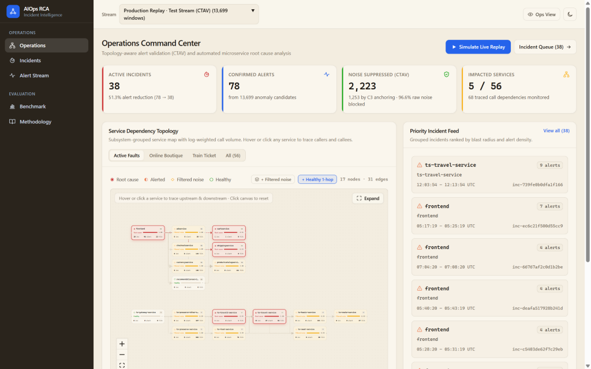
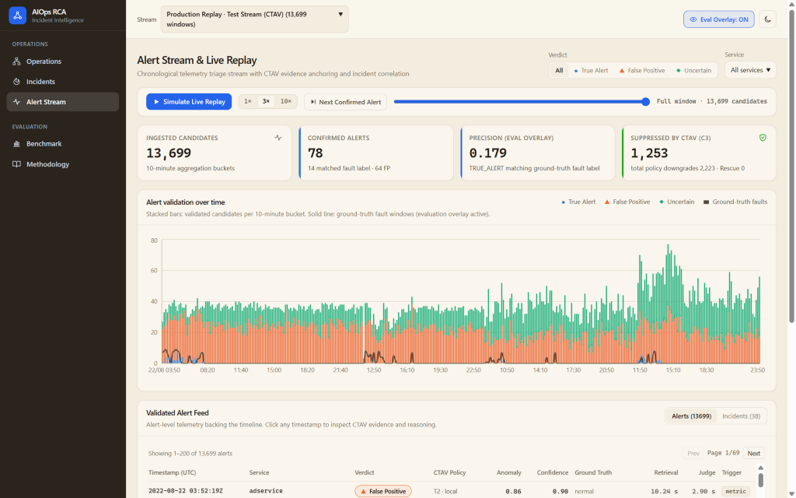
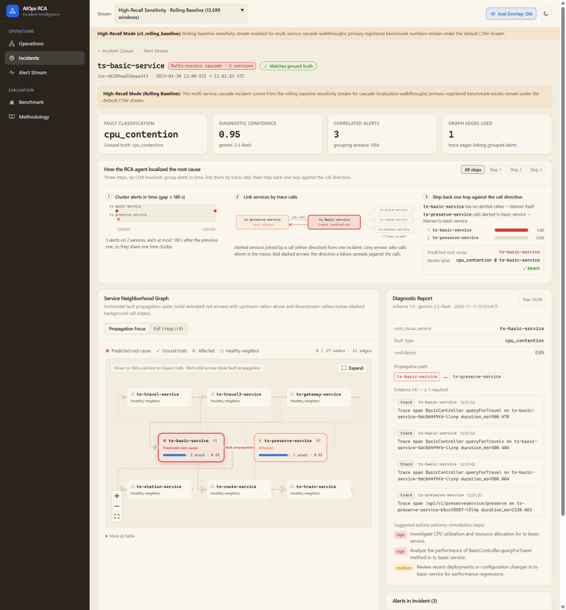
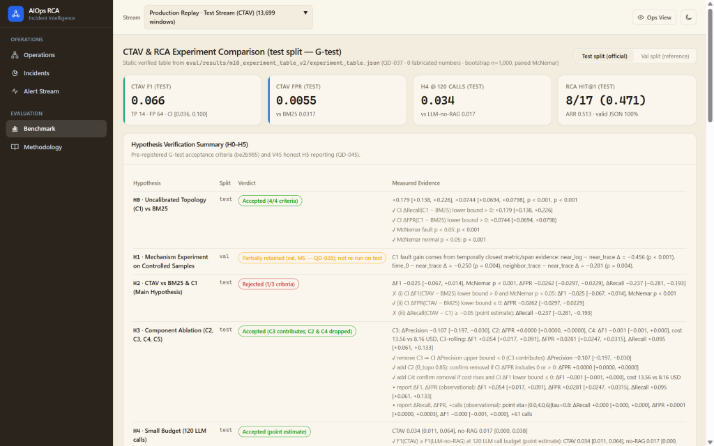

# Chương 6 — Platform demo

Chương này trả lời câu hỏi làm thế nào chuyển toàn bộ chuỗi xử lý từ phát hiện bất thường, thẩm định cảnh báo hiệu chỉnh theo bằng chứng đa phương thức (CTAV) đến tác tử phân tích nguyên nhân gốc (RCA) thành một hệ thống điều hành trực quan chạy khép kín trên dữ liệu thật và tái lập được ngoại tuyến lúc bảo vệ. Nội dung đi từ vai trò thiết kế của platform (§6.1) và luồng dữ liệu đầu–cuối kèm tám endpoint chỉ đọc, số đo thời gian, token thực tế (§6.2), sang năm màn hình thuộc hai phân khu điều hành và đánh giá gắn trực tiếp với từng thành phần phương pháp ở Chương 4 (§6.3). Hai mục cuối trình bày kịch bản demo năm phút với mã ca chạy xác định bằng quy tắc trên tập `test` (§6.4), cùng kết quả kiểm thử ngoại tuyến, tổng duyệt trình duyệt thật và phương án dự phòng snapshot tĩnh không phụ thuộc Docker (§6.5).

---

### 6.1 Vai trò của platform

Platform không được xây dựng như một sản phẩm thương mại mà là hiện thực thực thi thống nhất cho cả thực nghiệm khoa học lẫn trình diễn hội đồng: cùng một đường ống mã nguồn điều phối dữ liệu vào kho phân tích, sinh bảng kiểm định giả thuyết H0–H5 và phục vụ giao diện điều hành năm màn hình. Giao diện tách rõ hai chế độ quan sát qua công tắc trên thanh công cụ: chế độ vận hành (`Ops View`) ẩn hoàn toàn nhãn lỗi chuẩn để phản ánh đúng thông tin người trực ca nhìn thấy, còn lớp phủ đánh giá (`Eval Overlay`) bật đường lỗi chuẩn Nezha và huy hiệu đối chiếu đúng/sai cho hội đồng kiểm chứng. Vì ưu tiên khả năng tái lập thực nghiệm, phạm vi hệ thống được khoanh vùng chặt chẽ: không xác thực người dùng, không phân quyền đa thuê bao, không gửi thông báo cảnh báo ra ngoài và không tự động thực thi `runbook` khắc phục sự cố.

Để loại bỏ rủi ro phụ thuộc mạng Internet hoặc hạn mức API lúc bảo vệ, toàn bộ quá trình suy luận mô hình ngôn ngữ lớn (LLM) trong chế độ demo chạy ngoại tuyến 100% từ bộ nhớ đệm (`cache`) cục bộ. Khi bật biến môi trường `DEMO_OFFLINE=1`, đường ống tự động xóa mọi khóa API khỏi tiến trình sau khi nạp cấu hình môi trường, buộc mọi lời gọi thẩm định và tóm tắt đọc thẳng từ đĩa và dừng báo lỗi ngay nếu phát sinh hụt `cache`. Tài nguyên giao diện web cũng đóng gói cục bộ toàn bộ biểu tượng vector, bảng màu và mã nguồn, không tham chiếu phông chữ hay thư viện từ máy chủ bên ngoài.

---

### 6.2 Luồng end-to-end

Chuỗi xử lý đầu–cuối gắn kết bốn giao diện lập trình lõi gồm `SourceAdapter`, `Detector`, `RetrievalStrategy` và `Judge`. Dữ liệu từ bộ phát lại đi qua bộ phát hiện `Isolation Forest` trên chuỗi thời gian `metric` (ngưỡng 0,85; kèm cổng `Rescue Score` C5 chỉ dùng cho `ablation` một điểm), sau đó chuyển sang CTAV với truy xuất lai `BM25`–`topology` (C1, đang dùng), bộ thẩm định `gemini-2.5-flash` đọc từ `cache` và chính sách neo bằng chứng theo ngưỡng nền `p90` của `dev` (C3, đang dùng, đóng góp chính; hai thành phần C2 — ngưỡng bất đối xứng theo nguồn bằng chứng — và C4 — định tuyến hai tầng thích nghi — đã được loại sau kiểm định trên `val`). Cảnh báo xác nhận (`TRUE_ALERT`) được tác tử RCA gom nhóm trong cửa sổ `T_group = 180 s`, xếp hạng lan truyền ngược 1 bước trên đồ thị phụ thuộc service (`signals = alert`) và tóm tắt thành báo cáo JSON có trích dẫn bằng chứng.

```text
Replayer ─▶ Detector (IForest) ─▶ CTAV (C1 BM25-Graph ─▶ Judge ─▶ C3 neo p90)
                                              │                     │
                                              ▼                     ▼
                                     ClickHouse (mọi candidate)   Tác tử RCA (Gom nhóm ─▶ Lan truyền 1 bước ─▶ Báo cáo JSON)
                                              │                     │
                                              └──────────┬──────────┘
                                                         ▼
                                            PostgreSQL (incident & báo cáo)
                                                         │
                                                         ▼
                                       API FastAPI chỉ đọc (8 endpoint) ─▶ Dashboard 5 màn hình (Operations & Evaluation)
```

Bảng 6.1 tổng hợp số bản ghi, mức khớp kiểm chứng kỹ thuật với kết quả nghiên cứu (100% khớp danh sách `alert_ids`, thứ hạng `level1`/`baseline` và mã băm nội dung báo cáo JSON) cùng độ trễ tái lập từ `cache` và lượng token đã lưu đệm trên ba lượt chạy chính thức và độ nhạy. Số đo độ trễ dưới đây phản ánh tốc độ tái lập từ `cache` và ghi cơ sở dữ liệu, không phải độ trễ gọi API LLM trực tiếp; độ trễ suy luận LLM gốc từng `candidate` vẫn được giữ nguyên trong ClickHouse để hiển thị chi tiết.

Bảng 6.1. Số bản ghi, đối chiếu parity và độ trễ tái lập từ `cache` của luồng đầu–cuối (`0` lần gọi API mới, tỷ lệ trúng `cache` 100%).

| Chỉ số | `pipeline_val_v2` (`val`) | `pipeline_test_v2` (`test` chính thức) | `pipeline_sens_test_v1` (`test` — độ nhạy ngoài đăng ký) |
|---|---|---|---|
| Nguồn CTAV / biến thể | `ctav_final_val_v1` / mặc định | `ctav_final_test_v1` / mặc định | `ctav_final_test_v1` / `c3_rolling_baseline` |
| Đối chiếu nhất quán báo cáo | `rca_final_val_v1` (**26 / 26**) | `rca_final_test_v1` (**38 / 38**) | `rca_sens_test_c3rolling_v1` (**114 / 114**) |
| Số `candidate` nạp ClickHouse (`TRUE_ALERT`) | 5.677 (80 `TRUE_ALERT`) | 13.699 (78 `TRUE_ALERT`) | 13.699 (438 `TRUE_ALERT`) |
| Số dòng truy vết bằng chứng ClickHouse | 7.716 | 19.794 | 19.794 |
| `Incident` / báo cáo hợp lệ PostgreSQL | 26 / 26 (0 từ chối) | 38 / 38 (0 từ chối) | 114 / 114 (0 từ chối) |
| Nạp dữ liệu & chính sách (`load_alerts_ms`) | 615,161 ms | 1.249,668 ms | 5.278,743 ms |
| Ghi ClickHouse (`clickhouse_write_ms`) | 2.903,706 ms | 1.265,027 ms | 2.787,373 ms |
| Gom nhóm & lan truyền (`grouping` + `propagation`) | 4,276 ms | 5,683 ms | 19,372 ms |
| Tóm tắt chỉ đọc `cache` (`summarizer_ms`) | 424,397 ms | 442,432 ms | 706,557 ms |
| Ghi PostgreSQL (`postgres_write_ms`) | 333,750 ms | 191,637 ms | 347,860 ms |
| **Tổng thời gian đầu–cuối (`e2e_wall_ms`)** | **5.764,165 ms** | **4.242,424 ms** | **10.646,898 ms** |
| Token CTAV trong `cache` (prompt / completion) | 5.173.670 / 691.941 | 12.736.820 / 1.734.808 | 12.736.820 / 1.734.808 |
| Token Summarizer trong `cache` (prompt / completion) | 66.080 / 9.528 | 74.151 / 10.887 | 290.535 / 38.789 |

Máy chủ API chỉ đọc phục vụ tám đường dẫn HTTP (`GET /health`, `/runs`, `/runs/{run_id}/metrics`, `/topology`, `/alerts`, `/alerts/{alert_id}`, `/incidents`, `/incidents/{incident_id}`) với độ trễ dưới 1 giây ngay cả khi trả toàn bộ 13.699 `candidate` và đồ thị 56 service / 68 cạnh của `test`. Bảng thực nghiệm cho phân khu đánh giá (`/compare`, `/guide`) được kết xuất tĩnh trực tiếp từ các tệp JSON kết quả và kiểm khớp tự động với Chương 5.

---

### 6.3 Dashboard điều hành và đánh giá năm màn hình

Thanh điều hướng cố định bên trái chia giao diện thành hai phân khu: **Operations** (`Operations`, `Incidents`, `Alert Stream`) và **Evaluation** (`Benchmark`, `Methodology`), kèm trình khởi chạy nhanh 5 kịch bản mẫu (`Guided Scenarios`). Thanh công cụ phía trên giữ cố định bộ chọn luồng dữ liệu (`?run_id=`), công tắc `Ops View` / `Eval Overlay` và nút đổi giao diện nền giấy kem sáng hoặc nền tối vận hành.

**Màn hình 1 — Trung tâm điều hành và đồ thị phụ thuộc (`Operations`, `/overview`).** Hình 6.1 mở toàn cảnh lượt chạy chính thức `pipeline_test_v2` ở chế độ vận hành (`Ops View`).



*Hình 6.1. Màn hình Operations Command Center giám sát đồ thị phụ thuộc 56 service và hàng đợi sự cố trên tập `test` (`pipeline_test_v2`).*

Màn hình trả lời câu hỏi định hướng đầu ca trực: *những service nào đang gặp sự cố, bán kính ảnh hưởng trên đồ thị phụ thuộc rộng đến đâu và bộ thẩm định đã chặn bao nhiêu nhiễu trước khi vào hàng đợi trực?* Bản đồ phân cụm tự động hai hệ OnlineBoutique và TrainTicket, quy đổi lưu lượng gọi theo thang logarit, hỗ trợ lọc nhanh `Active Faults` (17 nút, 31 cạnh), tra cứu `upstream callers` / `downstream callees` khi nhấp vào từng service và phóng toàn màn hình.

**Màn hình 2 — Dòng cảnh báo phát lại và hàng đợi sự cố (`Alert Stream` `/timeline` & `Incidents` `/incidents`).** Hình 6.2 minh hoạ toàn bộ 13.699 `candidate` của `pipeline_test_v2` khi bật `Eval Overlay: ON`, gom thành cột 10 phút xếp chồng theo phán quyết cuối (`True Alert`, `False Positive`, `Uncertain`) đối chiếu cùng đường lỗi chuẩn Nezha.



*Hình 6.2. Màn hình Alert Stream phát lại dòng phân loại 13.699 cảnh báo đối chiếu nhãn chuẩn trên tập `test` (`pipeline_test_v2`).*

Màn hình này trả lời câu hỏi: *theo diễn tiến thời gian, bộ phát hiện kích hoạt bao nhiêu ứng viên và CTAV nén nhiễu ra sao?* Đi kèm là màn hình hàng đợi sự cố chuyên biệt `Incidents` (`/incidents`), cho phép lọc riêng các sự cố đa service (`Multi-service`) hoặc đơn service (`Single-service`). Khi bật `Eval Overlay`, biểu đồ cũng phơi bày trung thực Phát hiện 11: nhiều đỉnh lỗi chuẩn không có vạch `True Alert` bên dưới do rơi vào nhóm 32/42 service thiếu ngưỡng nền `dev`.

**Màn hình 3 — Chi tiết cảnh báo (`Alert Detail`).** Hình 6.3 và Hình 6.4 minh hoạ hai ca đối lập trên cùng `pipeline_test_v2`: một cửa sổ bình thường bị C3 hạ bậc và một cửa sổ lỗi `network_delay` được giữ lại, cả hai đều hiển thị trực tiếp thẻ giải thích **How C1 built this context**.


*Hình 6.3. Màn hình Alert Detail giải thích ca báo động giả bị `C3` hạ bậc và vùng ngữ cảnh `C1` (`cand-ad327c0b162f6198`, `pipeline_test_v2`).*


*Hình 6.4. Màn hình Alert Detail xác nhận ca lỗi `network_delay` vượt ngưỡng neo `C3` (`cand-fa85e82f02f08574`, `pipeline_test_v2`).*

Màn hình trả lời câu hỏi: *vì sao cùng điểm bất thường rất cao, hệ thống giữ cảnh báo này nhưng hạ cảnh báo kia, và đồ thị phụ thuộc đóng góp gì vào ngữ cảnh?* Thẻ **How C1 built this context** chia vùng tìm thành ba dải `d = 0, 1, 2` và vẽ thanh thành phần Fusion Score (`0,35 × BM25`, `0,25 × độ gần thời gian`, `0,40 × 1/(1+d)`), phản ánh trung thực Phát hiện 7 (chỉ 75/19.794 bằng chứng = 0,38% trên `pipeline_test_v2` đến từ service lân cận).

**Màn hình 4 — Chi tiết sự cố và đồ thị lân cận (`Incident Detail`).** Hình 6.5 trình bày sự cố đa service `inc-46289ea526eaa3f3` từ luồng độ nhạy ngoài đăng ký `pipeline_sens_test_v1` kèm hai dải băng vàng cảnh báo.



*Hình 6.5. Màn hình Incident Detail định vị service gốc ba bước và hiển thị đồ thị lan truyền của sự cố `inc-46289ea526eaa3f3` (`pipeline_sens_test_v1`).*

Màn hình trả lời câu hỏi: *khi nhiều cảnh báo nổ liên tiếp trên các service liên kết nhau, lỗi phát sinh từ đâu và thuật toán suy diễn thứ hạng thế nào?* Đồ thị trục ngang đặt chuỗi lan truyền chính trên trục giữa (`#1 ts-basic-service` → `#2 ts-preserve-service`), tách callers lên trên và callees xuống dưới, song hành cùng báo cáo JSON 4 trích đoạn bằng chứng và 3 hành động khuyến nghị.

**Màn hình 5 — Đối chiếu kiểm định và sổ tay phương pháp (`Benchmark` `/compare` & `Methodology` `/guide`).** Hình 6.6 hiển thị bảng tổng hợp kiểm định H0–H5 trên tập `test` (có nút chuyển sang `val` và tự ẩn dải vàng của luồng độ nhạy).



*Hình 6.6. Màn hình Benchmark (`/compare`) đối chiếu kết quả kiểm định H0–H5 trên tập `test`.*

Đi kèm `/compare` là màn hình `Methodology` (`/guide`), cung cấp sổ tay công thức 4 tầng xử lý, tóm tắt các mô-đun loại trừ (C2, C4, C5) và từ điển thuật ngữ thống kê để phục vụ trực tiếp phiên hỏi đáp với hội đồng.

---

### 6.4 Kịch bản demo 5 phút

Bộ ca trình diễn được rút tự động bằng quy tắc xác định (`seed = 42`) vào `eval/results/m10_demo_cases_v1/demo_cases.json` và tích hợp sẵn vào menu **Guided Scenarios** ở thanh bên trái. Bảng 6.2 mô tả năm bước thao tác trong khoảng năm phút.

Bảng 6.2. Kịch bản demo 5 phút sử dụng bộ ca chọn tự động (`seed = 42`, `DEMO_OFFLINE=1`).

| Bước | Thời lượng | Thao tác / URL | Ca thật & con số cần chỉ | Thành phần minh hoạ |
|---|---|---|---|---|
| 1. Toàn cảnh & Dòng cảnh báo | ~60 s | Mở `/overview` rồi `/timeline?run_id=pipeline_test_v2&gt=1` | Bản đồ 56 service (5 service có sự cố), chặn 96,6% nhiễu thô (2.223 ca, riêng C3 hạ 1.253 ca); còn 78 `TRUE_ALERT` → 38 sự cố; tua nhanh `Live Replay` | Platform đầu–cuối, đồ thị toàn hệ & nén nhiễu |
| 2. Chặn báo động giả nhờ C3 | ~60 s | Kịch bản 2: `/alerts/cand-ad327c0b162f6198:hybrid_bm25_graph:r0?run_id=pipeline_test_v2&gt=1` | `productcatalogservice`, `Normal`, điểm bất thường 0,99; judge thô `True Alert` bị C3 hạ xuống `Uncertain`; thẻ C1 hiện đủ 6 bằng chứng ở `d = 0` | Chính sách neo C3 chặn thiên lệch xác nhận |
| 3. Ca `network_delay` BM25 bỏ sót | ~60 s | Kịch bản 3: `/alerts/cand-fa85e82f02f08574:hybrid_bm25_graph:r0?run_id=pipeline_test_v2&gt=1` | `cartservice` (`network_delay`): `BM25` phán `False Positive` (0,90); CTAV giữ `True Alert` nhờ span `CartService/GetCart` đạt neo C3 (`d = 0`, 1 trong 2 ca `test`) | Truy xuất C1 + C3 bảo toàn tín hiệu thật |
| 4. Sự cố `cascade` & giới hạn H5 | ~75 s | Kịch bản 4: `/incidents/inc-46289ea526eaa3f3?run_id=pipeline_sens_test_v1&gt=1` | Hai dải vàng ngoài đăng ký; thẻ 3 bước bầu `ts-basic-service` đạt 1,00 khớp nhãn; đồ thị trục ngang + JSON hợp lệ; đối chiếu ca tách `2023-01-30#009` trên `pipeline_val_v2` | Tác tử RCA nhánh B + giới hạn độ phủ cảnh báo ở nhánh A |
| 5. Bảng kiểm định & Sổ tay | ~45 s | Kịch bản 5: `/compare` (chuyển thử `test`/`val`) và `/guide` | Bảng H0–H5 kèm CI95, đường cong H4, bảng ablation H3 + C5 và công thức 4 tầng ở `/guide` | Tính trung thực thực nghiệm & khả năng tái lập |

---

### 6.5 Kiểm thử demo ngoại tuyến và dự phòng

Khả năng chạy độc lập được kiểm chứng ở hai lớp: kiểm thử tự động (`288/288` bài test `pytest` xanh trên ClickHouse + PostgreSQL thật, kiểm thử hợp đồng đủ 8 endpoint và 67 kiểm tra khói SSR trên cả 5 màn hình) và tổng duyệt trình duyệt thật Chromium ngày 25/11/2026 tại `http://localhost:5173` (`0` lỗi console, `0` kết nối ngoài `localhost`, mọi truy vấn nội bộ trả HTTP `200`). Toàn bộ tồn đọng giao diện từ đợt tổng duyệt trước đã được xử lý: bộ ảnh chụp cập nhật đủ thẻ giải thích C1, thẻ 3 bước RCA và bản đồ phụ thuộc; trục thời gian lặp lại nhãn `dd/MM` khi qua nửa đêm; dải băng vàng cô lập khỏi `/compare` và `/guide`; và gói khởi tạo JavaScript giảm xuống còn ~46 kB (~16 kB sau gzip) nhờ tách gói theo màn hình.

Phương án dự phòng gồm hai mức: mức một khởi động lại dịch vụ bằng `docker compose --profile dev up -d` không ảnh hưởng dữ liệu volume; mức hai sử dụng chế độ **snapshot API tĩnh (`VITE_DATA_SOURCE=static`)** đã kết xuất sẵn trọn bộ ba lượt chạy (nén bảng `alerts` dạng cột giảm ~65% dung lượng cùng đầy đủ chi tiết sự cố, cảnh báo mẫu và đồ thị `topology`), cho phép mở và tương tác đầy đủ cả 5 màn hình ngay trên trình duyệt mà không cần Docker hay cơ sở dữ liệu chạy nền, kèm bộ ảnh PNG 300 dpi lưu sẵn.

---

### 6.6 Kết chương

Chương này đã trình bày hiện thực của nền tảng trình diễn AIOps RCA từ kho lưu trữ kép, máy chủ API chỉ đọc tám endpoint đến giao diện năm màn hình tách bạch giữa vận hành trực ca và đối chiếu kiểm định. Dữ liệu từ ba lượt chạy được tái lập ngoại tuyến hoàn toàn từ `cache` trong 4,24–10,65 giây với tỷ lệ trúng `cache` 100% và `0` lời gọi API mới, kết hợp cùng chế độ snapshot tĩnh không phụ thuộc Docker để sẵn sàng cho buổi bảo vệ trước khi đi vào phân tích chi tiết các ca sai ở Chương 7.
