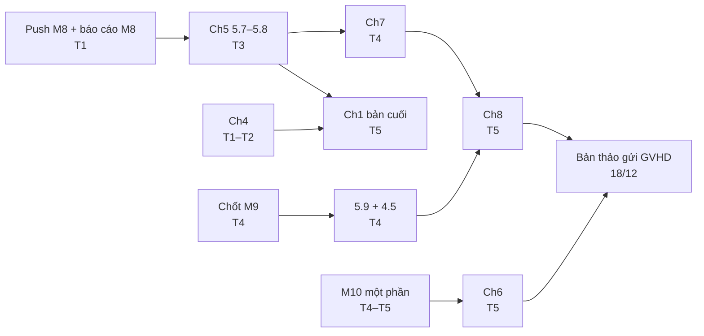

# Kế hoạch viết báo cáo luận văn (LaTeX)

> Soạn 2026-11-16. Ba file đi cùng nhau:
> - `style-guide-luan-van.md`: **viết thế nào** (văn phong, khuôn chương, số liệu, LaTeX).
> - `outline-bao-cao-gd2.md`: **viết gì** (đề mục, hình, bảng, trạng thái từng mục).
> - File này: **viết khi nào**, theo tuần, song song với M9–M10.
>
> **Giả định hạn nộp: 2026-12-31** (người dùng báo "khoảng 1,5 tháng" tính từ 2026-11-16). Hạn thật khác thì dời
> cả bảng §2 theo số tuần, giữ nguyên thứ tự. Bảo vệ phần này diễn ra sau khi nộp; giai đoạn cuối của luận văn
> nằm ngoài kế hoạch này.

---

## 1. Hiện trạng (2026-11-16)

| Hạng mục | Trạng thái |
|---|---|
| M8 (G-test) | Người dùng báo đã xong trên máy, **chưa push**; báo cáo `docs/milestones/M8-g-test.md` chưa có trong repo |
| M9 (RCA Agent) | Đang làm; hạn roadmap 2027-01-03, **trễ so với hạn nộp** |
| M10 (platform), M11 (chấm tay) | Chưa bắt đầu; hạn roadmap 2027-01-10, 2027-01-17 |
| Văn bản đã có | §5.7.1–5.7.4 (`ch5-ket-qua-test.md`), chương bài toán (`chuong-bai-toan.md`), sườn nội dung, outline, style guide |
| LaTeX | Đang viết Chương 1; mục tiêu cụ thể đã chốt (style guide §7) |

Hệ quả: báo cáo nộp lần này có **đủ Ch1–Ch5 (trừ 5.9), Ch7, Ch8**. 5.9 (H5) và Ch6 phụ thuộc M9, M10: viết phần thiết
kế chắc chắn, kết quả điền tới đâu hay tới đó, phần còn thiếu chuyển vào mục Kế hoạch thực hiện (quy tắc §4).

---

## 2. Lịch theo tuần

Mỗi tuần có hai làn: **Viết** (LaTeX) và **Code / số** (việc kỹ thuật mà phần viết phụ thuộc). Mã hình/bảng theo outline.

| Tuần | Viết | Hình, bảng làm cùng | Code / số (song song) | Đầu ra cuối tuần |
|---|---|---|---|---|
| **T1** 16–22/11 | Dựng khung LaTeX (style guide §6): chương, macro, nhãn, bảng từ viết tắt · Ch1 bản thô (đã bắt đầu) · Ch4 4.1–4.3 | H1.1, H1.3, H4.1–H4.3; B4.1–B4.3 | **Push M8** + viết `M8-g-test.md` (bắt buộc trước khi đóng M8) · M9 grouping | Khung biên dịch được; Ch4 nửa đầu |
| **T2** 23–29/11 | Ch4 4.4, 4.6, thiết kế 4.5 · Ch5 5.1–5.6 | H4.4–H4.10, H4.12, H5.1–H5.6; B4.4–B4.10, B5.1–B5.13 | Script vẽ biểu đồ đọc `eval/results/` · M9 propagation 1-hop | Ch4 đủ (trừ ví dụ 4.5) · Ch5 nửa đầu |
| **T3** 30/11–6/12 | Ch5 5.7 (toàn bộ, số M8) · 5.8.1–5.8.5 · 5.10 · Ch2 | H5.7–H5.13, H5.16, H2.1–H2.9; B5.14–B5.27, B5.34, B2.x | M9 summarizer + Hit@k trên `val` · xuất 50 cửa sổ chấm tay (V35) | Ch5 trừ 5.8.6, 5.9 · Ch2 đủ |
| **T4** 7–13/12 | Ch3 (tra cứu trích dẫn) · 5.9 và 4.5 chi tiết (số M9 nếu có) · Ch7 7.1–7.4, 7.6 | H3.1, H4.11, H5.14, H5.15; B3.1, B5.31, B5.32, B7.1, B7.2, B7.4 | **Chốt M9** (hạn mềm cho báo cáo) · bạn chấm 50 cửa sổ · M10 nối API cho 2 màn hình chính | Ch3, Ch7 đủ · 5.9 có số hoặc gắn `[CHỜ M9]` |
| **T5** 14–20/12 | Ch1 bản cuối (đóng góp khớp Ch4–Ch5) · Ch6 (theo M10 tới đâu) · Ch8 · Công bố khoa học · Kế hoạch thực hiện · tóm tắt, abstract · phụ lục A–E | H1.2, H6.1, H6.6, HK.1, ảnh chụp có sẵn; B1.x, B6.2, B8.x, BK.1 | M10: chụp màn hình Timeline, Alert detail · 5.8.6 nhập số chấm tay | **Bản thảo đủ, gửi GVHD 2026-12-18** |
| **T6** 21–27/12 | Sửa theo góp ý GVHD · rà chéo mọi số với `eval/results/` · checklist style guide §8 cho từng chương | Rà caption, danh sách hình/bảng | Không thêm thực nghiệm mới | Bản sửa |
| **Đệm** 28–31/12 | Biên dịch PDF cuối, kiểm định dạng theo quy định khoa, nộp | | | **Nộp** |

Slide và tổng duyệt bảo vệ làm sau khi nộp; không chen vào T1–T6.

---

## 3. Phụ thuộc và đường găng

Đường găng: **push M8 (T1) → Ch5 (T3) → Ch7 (T4) → Ch1, Ch8 (T5) → GVHD**. Trễ ở push M8 thì cả chuỗi trễ theo; đây
là việc đầu tiên của tuần này.

---

## 4. Quy tắc cắt khi trễ

Cắt theo thứ tự, từ trên xuống. Không cắt các mục ở dòng "Không bao giờ cắt".

| Thứ tự | Nếu đến | Thì |
|---|---|---|
| 1 | 13/12 M9 chưa có Hit@k trên `test` | 5.9 báo số trên `val`, gắn rõ "trên `val`"; H5 chuyển sang Kế hoạch; Ch8 trả lời RQ5 "chưa kiểm định" |
| 2 | 18/12 M10 chưa có dữ liệu thật trên dashboard | Ch6 viết kiến trúc, luồng, kịch bản demo; ảnh chụp từ bản MVP có ghi chú; phần còn lại vào Kế hoạch |
| 3 | 18/12 chưa chấm xong 50 cửa sổ | 5.8.6 chỉ mô tả giao thức chấm, số vào Kế hoạch |
| 4 | Ch3 thiếu thời gian | Giữ 3.3, 3.4, 3.6, 3.8, 3.9; rút 3.1, 3.2, 3.7 còn mỗi mục một đoạn |
| 5 | Vượt trang | Bảng tra cứu và chi tiết theo service sang phụ lục D |

**Không bao giờ cắt:** bảng H0–H4 trên `test` và kết luận H2 viết ra dù kết quả là gì · phần kết quả âm (C2, C4, C5,
recall của CTAV) · mục kiểm tra tính đúng của pipeline · đoạn đổi hướng có ghi lại (Phát hiện 7).

---

## 5. Việc của người dùng (agent không làm thay được)

| Việc | Hạn | Chặn gì |
|---|---|---|
| Push M8 (kết quả + `M8-g-test.md`) | 22/11 | Ch5 5.7–5.8, Ch1 1.2.4, Ch7, Ch8 |
| Commit `docs/Thesis_Phase1.pdf`, `docs/Template_LuanVan.docx` (hoặc template LaTeX của khoa) | 22/11 | Khung LaTeX, đối chiếu để không trùng câu |
| Xác nhận hạn nộp thật và số chương bắt buộc (6 hay 8) | 22/11 | Toàn bộ lịch §2; mục 1.5 Bố cục |
| Xác nhận trạng thái bài ICAETM 2026 (đã nộp / được nhận / đã đăng) | 13/12 | Mục Công bố khoa học |
| Chấm 50 cửa sổ context precision | 13/12 | 5.8.6 |
| Chụp màn hình dashboard | 20/12 | Ch6 |
| Gửi bản thảo GVHD | 18/12 | T6 |

---

## 6. Cách làm với agent mỗi phiên viết

1. Nêu mục cần viết theo mã outline (ví dụ "viết 4.4.4"). Agent đọc style guide, outline và sườn nội dung của mục đó.
2. Agent viết LaTeX vào `thesis/chapters/chX.tex` (hoặc trả về trong chat nếu bạn giữ LaTeX ở Overleaf), số lấy thẳng
   từ `eval/results/`, mỗi số kèm chú thích `% src: <run_id>`.
3. Chỗ thiếu số dùng macro `\CHO{M9}{...}`; không ước lượng.
4. Cuối phiên: chạy checklist style guide §8 cho mục vừa viết, cập nhật cột trạng thái trong outline.
