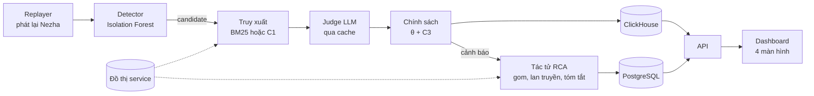
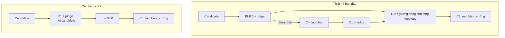
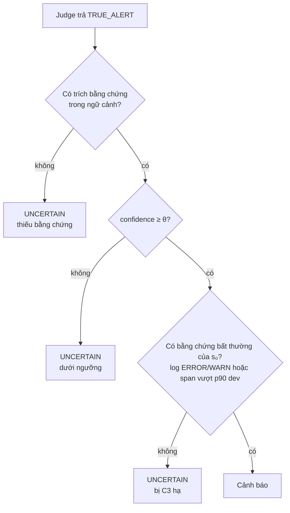
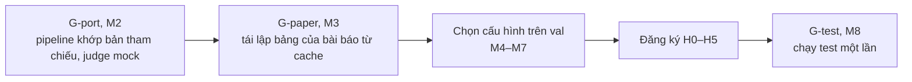

# Outline dựng báo cáo luận văn GĐ2 (toàn bộ)

> Soạn 2026-11-14. File này trả lời ba câu hỏi để dựng báo cáo song song với thực nghiệm: **viết theo thứ tự nào**,
> **mỗi mục viết kiểu gì, dài bao nhiêu**, và **cần hình, bảng nào**. Số liệu chính thức điền sau.
>
> Quan hệ với các file khác trong `docs/drafts/`:
> - `suon-bao-cao-gd2.md`: **nội dung** từng mục (các ý phải có, nguồn số liệu). File này không chép lại các ý đó.
> - `ch5-outline-ket-qua-test.md`: outline chi tiết riêng cho §5.7–§5.8 (kết quả `test`), mã bảng T1–T15, hình F1–F7.
> - `ch5-ket-qua-test.md`: phần văn đã viết cho §5.7.1–§5.7.3.
>
> Ký hiệu trạng thái: ✅ dựng được ngay (số đã chốt hoặc không cần số) · ⏳ M8 / M9 / M10 / M11 chờ mốc đó ·
> ♻️ lấy lại từ báo cáo GĐ1, rút gọn · ✍️ cần bạn làm tay (chấm, chụp màn hình).
> Số trang là ước lượng để cân đối các chương, chỉnh theo quy định của khoa.

## 1. Mạch lập luận của cả báo cáo

Toàn bộ báo cáo đi theo một sợi chỉ, mỗi chương trả lời một câu:

1. **Chương 1:** cảnh báo từ detector metric nhiều nhưng thiếu bằng chứng; đưa ngữ cảnh topology cho judge LLM thì bắt thêm sự cố nhưng báo sai nhiều hơn. Vì sao, sửa được không, và từ cảnh báo đã thẩm định có định vị được service gốc không?
2. **Chương 2:** cần những khái niệm nào để hiểu câu hỏi đó.
3. **Chương 3:** người khác đã làm gì, khoảng trống ở đâu.
4. **Chương 4:** phương pháp đề xuất (CTAV) và tác tử RCA; cả những thành phần đã thử rồi bỏ.
5. **Chương 5:** kiểm chứng theo ba lớp: kiểm tra tính đúng của pipeline, chọn cấu hình trên `val`, kiểm định một lần trên `test`.
6. **Chương 6:** phương pháp chạy được thành một hệ thống demo.
7. **Chương 7:** kết quả có nghĩa gì, giới hạn ở đâu.
8. **Chương 8:** trả lời từng câu hỏi nghiên cứu.

Hai điểm phải giữ xuyên suốt, vì đây là điểm mạnh của luận văn chứ không phải điểm yếu:
- **Đổi hướng có ghi lại.** Trên `val`, hiện tượng của bài báo lặp lại nhưng cơ chế thì không (Phát hiện 7). Viết thẳng
  điều này ở Ch1, Ch4, Ch5, không giấu.
- **Kết quả âm là kết quả.** C2, C4 bị bỏ; C5 không đóng góp; CTAV giảm cảnh báo sai nhưng không giữ được recall của
  topology. Mỗi thứ viết như một thiết kế đã kiểm và loại, có số.

## 2. Cấu trúc tổng thể và ngân sách trang

| Phần | Nội dung | Trang | Hình | Bảng | Dựng được ngay |
|---|---|---:|---:|---:|---|
| Phần đầu | Bìa, cam đoan, cảm ơn, tóm tắt, abstract, mục lục, danh sách hình/bảng, từ viết tắt | 10 | — | — | khung ✅; tóm tắt ⏳ M12 |
| Chương 1 | Giới thiệu đề tài | 8 | 2 | 2 | ✅ (trừ câu số `test` ở phần đóng góp) |
| Chương 2 | Cơ sở lý thuyết | 14 | 8 | 4 | ✅ |
| Chương 3 | Công trình liên quan | 12 | 1 | 1 | ✅ (cần tra cứu trích dẫn) |
| Chương 4 | Phương pháp đề xuất: CTAV và tác tử RCA | 18 | 12 | 10 | §4.1–4.4, 4.6 ✅; §4.5 thiết kế ✅, chi tiết ⏳ M9 |
| Chương 5 | Thực nghiệm và đánh giá | 28 | 16 | 34 | §5.1–5.6 ✅; §5.7–5.8 ⏳ M8; §5.9 ⏳ M9; §5.10 ⏳ |
| Chương 6 | Demo platform | 8 | 7 | 3 | khung ✅; ảnh chụp ⏳ M10 ✍️ |
| Chương 7 | Thảo luận, hạn chế, hướng phát triển | 8 | 1 | 4 | §7.3, 7.4, 7.6 khung ✅; còn lại ⏳ M8, M11 |
| Chương 8 | Kết luận | 3 | — | 2 | ⏳ M8, M9 |
| Cuối | Tài liệu tham khảo, phụ lục A–F | 4 + 15 | — | — | A, B, C, E ✅ |
| **Tổng** | | **≈ 113 + phụ lục** | **≈ 47** | **≈ 60** | |

Template của khoa có 6 chương. Nếu bắt buộc đúng 6: gộp Chương 6 vào cuối Chương 5 thành mục "Hiện thực và demo", gộp
Chương 7 vào "Định hướng phát triển". Hỏi GVHD trước khi lắp Word.

## 3. Nguyên tắc viết chung

Toàn bộ quy tắc văn phong, khuôn từng chương, kỷ luật số liệu, hình/bảng và LaTeX nằm ở
**`docs/drafts/style-guide-luan-van.md`** (nguồn duy nhất, soạn 2026-11-16). File này không chép lại. Khi khuôn "Cách viết"
của một chương bên dưới lệch với style guide, style guide thắng.

---

## 4. Từng chương

Cột "Hình", "Bảng" ghi số thứ tự dự kiến; danh mục đầy đủ ở mục 5 và 6.

### Chương 1 — Giới thiệu đề tài (8 trang) ✅

**Cách viết:** hình phễu, đi từ rộng đến hẹp. Không công thức, không chi tiết kỹ thuật. Số liệu chỉ dùng số "đầu bài"
(kết quả bài báo, kết quả chính của luận văn). Mỗi mục cấp 3 không quá một trang.

| Mục | Mục đích | Viết kiểu gì | Hình | Bảng | Trang |
|---|---|---|---|---|---:|
| 1.1.1 Bối cảnh AIOps | Vì sao cần thẩm định cảnh báo | 2 đoạn dẫn nhập ♻️ | H1.1 | | 1 |
| 1.1.2 Thẩm định cảnh báo bằng LLM và đánh đổi của topology | Hiện tượng làm xuất phát điểm | Nêu hiện tượng; trích khảo sát bước đầu của tác giả (ICAETM 2026, `paper_500`) như một nguồn, kèm giới hạn bài báo tự nhận. Không kể theo "giai đoạn" (style guide §1.1–1.2) | H1.2 | B1.1 | 1½ |
| 1.1.3 Phát hiện làm đổi cách đặt vấn đề | Trung thực về điểm đổi hướng | 2 đoạn: hiện tượng lặp lại, cơ chế thì không | | | 1 |
| 1.2 Mục tiêu, câu hỏi, đóng góp | Cam kết của luận văn | Liệt kê có đánh số; mỗi đóng góp kèm một câu bằng chứng | | B1.2 | 2 |
| 1.3 Đối tượng và phạm vi | Trong và ngoài phạm vi | Hai danh sách ngắn | | | 1 |
| 1.4 Ý nghĩa | Thực tiễn và khoa học | 2 đoạn | | | ½ |
| 1.5 Bố cục | Dẫn đường | 1 đoạn, mỗi chương một câu | | | ½ |

Chờ số: câu kết quả `test` trong 1.2.4 `[CHỜ M8]`; mục tiêu RCA trong 1.4.1 `[CHỜ M9]`.

### Chương 2 — Cơ sở lý thuyết (14 trang) ✅

**Cách viết:** mỗi khái niệm theo bốn bước: định nghĩa, công thức hoặc sơ đồ, một ví dụ nhỏ trên dữ liệu của đề tài, một
câu "luận văn dùng nó ở đâu" trỏ sang Chương 4. Không đưa kết quả thực nghiệm vào chương này. Phần lấy lại từ GĐ1 rút
còn một nửa.

| Mục | Mục đích | Hình | Bảng | Trang |
|---|---|---|---|---:|
| 2.1 Dữ liệu quan sát (metric, log, trace, cửa sổ; Nezha) | Đơn vị phân tích và nhãn | H2.1, H2.2 | B2.1 | 2½ |
| 2.2 Phát hiện bất thường, quá tải cảnh báo, Isolation Forest | Vì sao có nhiều cảnh báo sai | H2.3 | | 2 |
| 2.3 Truy xuất bằng chứng (BM25, đồ thị service, Fusion Score, RAG) | Nền của C1 | H2.4, H2.5 | | 3 |
| 2.4 LLM làm judge (prompt, hai tầng, thiên lệch xác nhận, Rescue) | Nền của C2–C5 | H2.6, H2.7 | B2.2 | 3 |
| 2.5 RCA (incident, lan truyền ngược, báo cáo có cấu trúc) | Nền của nhánh B | H2.8 | | 1½ |
| 2.6 Tiêu chí đánh giá (chỉ số, Hit@k, bootstrap, McNemar, ngân sách) | Cách đo | | B2.3 | 1½ |
| 2.7 Giả thuyết và đăng ký trước | Kỷ luật kiểm định | | | ½ |
| 2.8 Tóm tắt chương | Nối sang Chương 4 | | B2.4 | ½ |

Lưu ý: bảng giả thuyết H0–H5 đầy đủ chỉ đặt một lần ở §5.1. §2.7 chỉ giải thích vì sao đăng ký trước và trỏ sang đó.

### Chương 3 — Công trình liên quan (12 trang) ✅

**Cách viết:** mỗi nhóm công trình theo ba bước: họ làm gì, giới hạn nào liên quan đến đề tài, luận văn khác ở đâu.
Mỗi công trình 1 đoạn, không tóm tắt lại cả bài. Kết chương bằng bảng so sánh và đoạn khoảng trống. Chỉ trích dẫn bài
đã đọc; chỗ chưa xác minh giữ nhãn `[CẦN TRA CỨU]`.

| Mục | Hình | Bảng | Trang |
|---|---|---|---:|
| 3.0 Dẫn nhập | | | ½ |
| 3.1 Phát hiện bất thường chuỗi thời gian ♻️ | | | 1½ |
| 3.2 LLM trong phân tích log và RCA ♻️ | | | 1½ |
| 3.3 Giám sát lai và LLM-as-a-Judge ♻️ | | | 2 |
| 3.4 RCA dựa topology, nhân quả | | | 2 |
| 3.5 Truy xuất dựa đồ thị cho AIOps | | | 1 |
| 3.6 Hiệu chỉnh và độ tin cậy của LLM judge | | | 1½ |
| 3.7 Cứu cảnh báo và alert triage | | | ½ |
| 3.8 Bảng so sánh | | B3.1 | 1 |
| 3.9 Khoảng trống và định vị CTAV | H3.1 | | ½ |

### Chương 4 — Phương pháp đề xuất (18 trang)

**Cách viết:** mỗi thành phần theo năm bước: vấn đề nó giải, thiết kế (công thức hoặc luật), tham số và cách chọn, vai trò
hiện tại (đang dùng, đã bỏ, chỉ là ablation), dẫn chiếu sang mục Chương 5 chứa bằng chứng. Số `val` chỉ xuất hiện để giải
thích một lựa chọn thiết kế, mỗi chỗ một câu. Không đưa số `test` vào chương này. Thành phần đã bỏ (C2, C4) viết ngắn hơn
thành phần đang dùng, nhưng không lược.

| Mục | Mục đích | Hình | Bảng | Trang | Trạng thái |
|---|---|---|---|---:|---|
| 4.1 Phát biểu bài toán | Ký hiệu và mục tiêu tối ưu | H4.1 | B4.1 | 1½ | ✅ |
| 4.2 Kiến trúc tổng thể | Bốn khâu detector → CTAV → RCA → platform, đầu vào/đầu ra mỗi khâu | H4.2 | B4.2 | 2 | ✅ |
| 4.3 Detector và luật tạo candidate (kèm Rescue) | Đầu vào của CTAV | H4.3 | B4.3 | 2 | ✅ |
| 4.4.1 Tổng quan CTAV | Thiết kế ban đầu so với cấu hình chốt | H4.4 | B4.4 | 1½ | ✅ |
| 4.4.2 BM25 và judge | Baseline và tầng 1 | | B4.5 | 1 | ✅ |
| 4.4.3 Truy xuất topology C1 | Fusion Score, mở rộng 2-hop | H4.5 | B4.6 | 2 | ✅ |
| 4.4.4 Chính sách quyết định: C3 (và C2) | Đóng góp chính | H4.6, H4.7 | B4.7 | 2½ | ✅ |
| 4.4.5 Định tuyến hai tầng C4 | Thiết kế đã kiểm và loại | | | ½ | ✅ |
| 4.4.6 Judge: prompt, đầu ra, cache | Tái lập được | H4.8, H4.9 | B4.8 | 1½ | ✅ |
| 4.5 Tác tử RCA | Gom incident, lan truyền, tóm tắt | H4.10, H4.11 | B4.9 | 2 | thiết kế ✅; chi tiết ⏳ M9 |
| 4.6 Hiện thực hoá | Công nghệ, harness, tái lập | H4.12 | B4.10 | 1½ | ✅ |

### Chương 5 — Thực nghiệm và đánh giá (28 trang)

**Cách viết:** ba lớp kiểm chứng theo đúng thứ tự đã làm: kiểm tra tính đúng của pipeline (§5.5), chọn cấu hình trên `val` (§5.6), kiểm
định trên `test` (§5.7–5.8). Mỗi thí nghiệm theo sáu bước: câu hỏi và tiêu chí, thiết lập, bảng, một câu kết luận in
đậm, diễn giải bằng số đếm, giới hạn. Phát hiện 1–12 gắn vào đúng thí nghiệm sinh ra nó, rồi tổng hợp lại ở §5.10.

| Mục | Mục đích | Hình | Bảng | Trang | Trạng thái |
|---|---|---|---|---:|---|
| 5.1 Mục tiêu và giả thuyết H0–H5 | Cái gì được kiểm, tiêu chí nào | | B5.1 | 1½ | ✅ |
| 5.2 Dữ liệu và chia split | Chống rò rỉ; tập chấm chính | H5.1, H5.2 | B5.2, B5.3 | 2 | ✅ |
| 5.3 Thiết lập | Judge, detector, ngân sách, chi phí | | B5.4 | 1½ | ✅ |
| 5.4 Thước đo | Định nghĩa chỉ số, kiểm định | | | 1 | ✅ |
| 5.5 Kiểm tra tính đúng của pipeline (G-port, G-paper) | Pipeline tái lập đúng baseline đã công bố | H5.3 | B5.5, B5.6 | 2 | ✅ |
| 5.6.1 H0 trên `val` | Hiện tượng lặp lại, cơ chế không | | B5.7, B5.8 | 1½ | ✅ |
| 5.6.2 Tuning C1 | `k_graph`, trọng số Fusion | | B5.9 | 1 | ✅ |
| 5.6.3 H1: cơ chế thiên lệch xác nhận | Bằng chứng nào làm judge xác nhận | H5.4 | B5.10 | 1½ | ✅ |
| 5.6.4 C3, C2, C4 trên `val` | Chốt cấu hình CTAV | H5.5 | B5.11, B5.12 | 1½ | ✅ |
| 5.6.5 C5 trên `val` | Rescue không đóng góp | H5.6 | B5.13 | 1 | ✅ |
| 5.7 Kết quả trên `test` (8 mục con) | Kiểm định H0–H4 | H5.7–H5.10 | B5.14–B5.21 | 6 | 5.7.1–5.7.4 ✅; còn lại ⏳ M8 |
| 5.8 Ablation và đường cong (6 mục con) | Thành phần nào gây ra kết quả | H5.11–H5.13 | B5.22–B5.30 | 4 | bảng `val` ✅; `test` ⏳ M8; chấm tay ✍️ |
| 5.9 Đánh giá RCA (H5) | Định vị service gốc | H5.14, H5.15 | B5.31–B5.33 | 2 | ⏳ M9; chấm tay ⏳ M11 ✍️ |
| 5.10 Phân tích và thảo luận | Nối các phát hiện | H5.16 | B5.34 | 1½ | khung ✅; cập nhật ⏳ M8 |

Chi tiết §5.7–§5.8 (thứ tự mục con, cột của từng bảng, đặc tả từng hình, chỗ lấy số): `ch5-outline-ket-qua-test.md`.

### Chương 6 — Demo platform (8 trang)

**Cách viết:** mô tả theo mắt người dùng, không theo mã nguồn. Mỗi màn hình: một ảnh chụp, một đoạn nói màn hình trả lời
câu hỏi gì của người vận hành, một đoạn nối với thành phần ở Chương 4. Kịch bản demo viết thành bảng từng bước.

| Mục | Hình | Bảng | Trang | Trạng thái |
|---|---|---|---:|---|
| 6.1 Vai trò của platform | | | ½ | ✅ |
| 6.2 Luồng end-to-end và triển khai | H6.1 | B6.1 | 1½ | khung ✅; ⏳ M10 |
| 6.3 Dashboard bốn màn hình | H6.2–H6.5 | | 3 | ⏳ M10 ✍️ |
| 6.4 Kịch bản demo 5 phút | H6.6 | B6.2 | 1½ | khung ✅; chọn ca ⏳ M8, M9 |
| 6.5 Kiểm thử demo và dự phòng | H6.7 | B6.3 | 1 | ⏳ M10 |

### Chương 7 — Thảo luận, hạn chế, hướng phát triển (8 trang)

**Cách viết:** không lặp lại bảng số của Chương 5; mỗi luận điểm trích lại một hai con số rồi giải thích vì sao. Hạn chế
viết cụ thể (cái gì, ảnh hưởng đến kết luận nào), không viết chung chung. Hướng phát triển gắn mỗi hướng với một hạn chế.

| Mục | Hình | Bảng | Trang | Trạng thái |
|---|---|---|---:|---|
| 7.1 Tổng hợp kết quả chính | | B7.1 | 1 | ⏳ M8 |
| 7.2 Thảo luận (vì sao C3 hiệu quả; vì sao C2, C4, C5 không) | | | 2 | `val` ✅; cập nhật ⏳ M8 |
| 7.3 Hạn chế | | | 1 | khung ✅ |
| 7.4 Mối đe doạ tính hợp lệ | | B7.2 | 1 | khung ✅ |
| 7.5 Phân tích ca sai | H7.1 | B7.3 | 1½ | ⏳ M11 ✍️ |
| 7.6 Hướng phát triển | | B7.4 | 1 | ✅ |

### Chương 8 — Kết luận (3 trang) ⏳

**Cách viết:** không ý mới, không hình. Mỗi câu hỏi nghiên cứu một đoạn 3–4 câu: câu trả lời, số chính, giới hạn.

| Mục | Bảng | Trang |
|---|---|---:|
| 8.1 Trả lời câu hỏi nghiên cứu | B8.1 | 1 |
| 8.2 Tóm tắt đóng góp | | ½ |
| 8.3 Kết quả H0–H5 | B8.2 | ½ |
| 8.4 Ý nghĩa và kết luận chung | | ½ |

### Phụ lục

A Cấu hình thực nghiệm ✅ · B Prompt judge ✅ · C Schema và hợp đồng ✅ (RCA ⏳ M9) · D Bảng đầy đủ: `val` ✅, `test`
"mọi cửa sổ" và theo từng service ⏳ M8 · E Hướng dẫn tái lập ✅ · F Đánh giá bằng người ✍️.

---

## 5. Danh mục hình (47)

Loại: **SĐ** sơ đồ vẽ tay bằng công cụ · **BĐ** biểu đồ sinh từ script · **AC** ảnh chụp · **VD** ví dụ trích từ dữ liệu.

| Mã | Tên | Loại | Nội dung cần thể hiện | Nguồn | Trạng thái |
|---|---|---|---|---|---|
| H1.1 | Vị trí của tầng thẩm định cảnh báo | SĐ | Telemetry, detector, dòng cảnh báo, judge có ngữ cảnh, người vận hành | mới | ✅ |
| H1.2 | Hiện tượng của bài báo | BĐ | Cột TP và FP của BM25 và Topology trên `paper_500` (FP 7 so với 137; recall 0,58 so với 0,74) | G-paper, M3 | ✅ |
| H2.1 | Cửa sổ trượt và nhãn | SĐ | Cửa sổ 60 s, khoảng nhãn quanh thời điểm tiêm lỗi | ♻️ GĐ1 hình 1, sửa 120 s thành 60 s | ✅ |
| H2.2 | Metric, log, trace của một request | SĐ | Cây span cha–con, log gắn theo pod | mới | ✅ |
| H2.3 | Khoảng trống ngữ nghĩa | SĐ | Điểm bất thường cao không cho biết có sự cố hay không | ♻️ GĐ1 hình 2 | ✅ |
| H2.4 | Đồ thị phụ thuộc service và khoảng cách | BĐ | 56 service, 68 cạnh; tô một service và các lân cận 1, 2 hop | `data/graph/service_graph.json` | ✅ |
| H2.5 | Ba thành phần của Fusion Score | SĐ | BM25, độ gần thời gian, độ gần đồ thị cộng có trọng số | mới | ✅ |
| H2.6 | LLM-as-a-Judge có truy xuất | SĐ | Candidate, truy xuất, prompt, verdict có cấu trúc | ♻️ GĐ1 hình 3, bỏ local-first | ✅ |
| H2.7 | Thiên lệch xác nhận | SĐ | Cùng một cảnh báo, hai bộ bằng chứng, hai verdict | mới | ✅ |
| H2.8 | Gom incident và lan truyền ngược | SĐ | Nhiều cảnh báo thành một incident; đi ngược một hop tới service gốc | mới | ✅ |
| H3.1 | Bản đồ định vị công trình | SĐ | Hai trục: có dùng topology; có hiệu chỉnh judge. Đặt các công trình và CTAV | mới | ✅ |
| H4.1 | Cửa sổ, ngữ cảnh, nhãn | SĐ | Ký hiệu w, s₀, t₀, E(w) trên trục thời gian | mới | ✅ |
| H4.2 | Kiến trúc tổng thể | SĐ | Xem khung Mermaid bên dưới | `01` §3 | ✅ |
| H4.3 | Detector và cổng Rescue | SĐ | Điểm ≥ 0,85 thành candidate; nhánh Rescue cho cửa sổ dưới ngưỡng | `01` §6.2 | ✅ |
| H4.4 | CTAV: thiết kế ban đầu và cấu hình chốt | SĐ | Hai sơ đồ cạnh nhau; khối bị bỏ vẽ nét đứt. Xem khung bên dưới | QĐ-031 | ✅ |
| H4.5 | Mở rộng 2-hop và xếp hạng Fusion | SĐ | Pool BM25, mở rộng theo đồ thị, xếp hạng, lấy top-6 | `01` §6.3 | ✅ |
| H4.6 | Sơ đồ quyết định | SĐ | Ba luật theo thứ tự. Xem khung bên dưới | `services/judge/policy.py` | ✅ |
| H4.7 | Một cảnh báo sai bị C3 hạ | VD | Bằng chứng judge trích, ngưỡng nền, kết quả UNCERTAIN | `ctav_final_val_v1` | ✅ |
| H4.8 | Luồng gọi judge qua cache | SĐ | Khoá cache, trúng thì đọc, trượt thì gọi API và ghi | `services/judge/cache.py` | ✅ |
| H4.9 | Ví dụ prompt và JSON trả về | VD | Một prompt rút gọn và verdict | cache | ✅ |
| H4.10 | Ba bước của tác tử RCA | SĐ | Gom, lan truyền, tóm tắt | `01` §6.5 | ✅ |
| H4.11 | Ví dụ đồ thị lan truyền | VD | Một incident thật, service gốc được tô | ⏳ M9 | ⏳ M9 |
| H4.12 | Cấu trúc repo và harness | SĐ | Thư mục chính và đường đi của một run | `01` §7 | ✅ |
| H5.1 | Chia split theo lần tiêm lỗi | SĐ | Trục thời gian, các lần tiêm, vùng đệm 600 s, gán `dev` / `val` / `test` | QĐ-004 | ✅ |
| H5.2 | Có bằng chứng gắn với gần sự cố | BĐ | Tỉ lệ cửa sổ có bằng chứng: fault so với normal, kho bằng chứng của bài báo so với kho của luận văn | B5.3 | ✅ |
| H5.3 | Ba cổng kiểm chứng | SĐ | G-port, G-paper, G-test trên trục các mốc; mỗi cổng kiểm gì | `04` | ✅ |
| H5.4 | H1: tỉ lệ TRUE_ALERT theo độ gần thời gian | BĐ | Đường cho normal và fault ở 0, 33, 67, 100%, có CI | `h1_val_analysis_v2` | ✅ |
| H5.5 | Đường θ_topo trên `val` | BĐ | Recall và FPR theo θ | `m6_ctav_select_val_v2` | ✅ |
| H5.6 | Đường τ của Rescue trên `val` | BĐ | Recall phẳng, FPR giảm, số lần gọi theo τ | `m7_rescue_val_v1` | ✅ |
| H5.7 | Quy trình G-test | SĐ | = F1 trong outline §5.7 | | ✅ |
| H5.8 | Tỉ lệ candidate theo split và hệ thống | BĐ | = F2 | `m8_detector_shift_test_v1` | ✅ |
| H5.9 | Điểm vận hành Recall–FPR, `val` và `test` | BĐ | = F3. Hình chính của chương | | một phần ✅; ⏳ M8 |
| H5.10 | Hiệu ghép cặp và khoảng tin cậy | BĐ | = F4 | | một phần ✅; ⏳ M8 |
| H5.11 | Phễu quyết định của CTAV | SĐ + số | = F5 | `ctav_final_test_v1` | ⏳ M8 |
| H5.12 | Recall C1 và CTAV theo nhóm service | BĐ | = F6 | `m8_finding11_test_v1` | ⏳ M8 |
| H5.13 | F1 theo ngân sách, `val` và `test` | BĐ | = F7 | | ô `val` ✅; ⏳ M8 |
| H5.14 | Hit@1, Hit@3 của RCA và baseline | BĐ | Cột có CI | ⏳ M9 | ⏳ M9 |
| H5.15 | Số cảnh báo và số incident | BĐ | Mức giảm cảnh báo theo loại lỗi | ⏳ M9 | ⏳ M9 |
| H5.16 | Bản đồ 12 phát hiện | SĐ | Phát hiện nào dẫn tới quyết định thiết kế nào | experiment-log | ✅; cập nhật ⏳ M8 |
| H6.1 | Triển khai bằng Docker Compose | SĐ | Các container và luồng dữ liệu | `docker-compose.yml` | ✅ |
| H6.2 | Màn hình Timeline | AC | | ⏳ M10 | ✍️ |
| H6.3 | Màn hình Alert detail | AC | Bằng chứng top-k, lý do bị C3 hạ | ⏳ M10 | ✍️ |
| H6.4 | Màn hình Incident detail | AC | Đồ thị lan truyền, báo cáo JSON | ⏳ M10 | ✍️ |
| H6.5 | Màn hình Experiment comparison | AC | Bảng H0–H4 | ⏳ M10 | ✍️ |
| H6.6 | Kịch bản demo năm bước | SĐ | Dải năm ô, mỗi ô một bước và thông điệp | `08` §6 | ✅ |
| H6.7 | Demo chạy không cần mạng | AC | Cache hit 100%, độ trễ | ⏳ M10 | ✍️ |
| H7.1 | Hai ca sai tiêu biểu | VD | Một cảnh báo sai còn lại và một sự cố bị bỏ sót | ⏳ M11 | ✍️ |

**Khung cho bốn sơ đồ quan trọng nhất**

H4.2 — Kiến trúc tổng thể:

H4.4 — CTAV: thiết kế ban đầu (trái) và cấu hình chốt (phải). Khối nét đứt là thành phần đã bỏ:

H4.6 — Sơ đồ quyết định (thứ tự luật đúng như mã nguồn):

H5.3 — Ba cổng kiểm chứng:

## 6. Danh mục bảng (≈ 60)

| Mã | Tên | Mục | Trạng thái |
|---|---|---|---|
| B1.1 | Khảo sát bước đầu (bài báo) và luận văn: phạm vi, câu hỏi, judge, dữ liệu, đầu ra | 1.1.2 | ✅ |
| B1.2 | Câu hỏi nghiên cứu, giả thuyết, chương trả lời | 1.2.3 | ✅ |
| B2.1 | Nguồn telemetry ♻️ | 2.1 | ✅ |
| B2.2 | Định dạng đầu ra của judge ♻️ | 2.4 | ✅ |
| B2.3 | Chỉ số đánh giá và công thức | 2.6 | ✅ |
| B2.4 | Khái niệm, thành phần (C1–C5, RCA), giả thuyết | 2.8 | ✅ |
| B3.1 | So sánh các công trình | 3.8 | ✅ (cần tra cứu) |
| B4.1 | Bảng ký hiệu | 4.1 | ✅ |
| B4.2 | Bốn khâu của hệ thống: đầu vào, đầu ra, thành phần, mục trình bày | 4.2 | ✅ |
| B4.3 | Tham số detector và Rescue | 4.3 | ✅ |
| B4.4 | Vai trò và trạng thái C1–C5, kèm quyết định | 4.4.1 | ✅ |
| B4.5 | Ba chiến lược truy xuất | 4.4.2 | ✅ |
| B4.6 | Tham số Fusion | 4.4.3 | ✅ |
| B4.7 | Điều kiện neo của C3 và độ phủ ngưỡng | 4.4.4 | ✅ |
| B4.8 | Cấu hình judge và cache | 4.4.6 | ✅ |
| B4.9 | Schema báo cáo chẩn đoán | 4.5 | ✅; rà ⏳ M9 |
| B4.10 | Công nghệ, đầu ra của một run, lệnh chính | 4.6 | ✅ |
| B5.1 | Giả thuyết H0–H5 và tiêu chí đã đăng ký | 5.1 | ✅ |
| B5.2 | Kích thước split, tỉ lệ có telemetry | 5.2 | ✅ |
| B5.3 | Có bằng chứng gắn với gần sự cố | 5.2 | ✅ |
| B5.4 | Chi phí API theo mốc | 5.3 | ✅; dòng M8 ⏳ |
| B5.5 | G-port theo tầng | 5.5 | ✅ |
| B5.6 | G-paper | 5.5 | ✅ |
| B5.7 | H0 trên `val` | 5.6.1 | ✅ |
| B5.8 | Hiệu ghép cặp và McNemar trên `val` | 5.6.1 | ✅ |
| B5.9 | Quét `k_graph` | 5.6.2 | ✅ |
| B5.10 | H1: tỉ lệ TRUE_ALERT theo điều kiện can thiệp | 5.6.3 | ✅ |
| B5.11 | H3 tại cấu hình chốt, `val` | 5.6.4 | ✅ |
| B5.12 | CTAV so với baseline, `val` | 5.6.4 | ✅ |
| B5.13 | Rescue trên CTAV, `val` | 5.6.5 | ✅ |
| B5.14–B5.21 | Tám bảng của §5.7 (T1–T8 trong outline §5.7) | 5.7 | T1–T4 ✅ phần lớn; T5–T8 ⏳ M8 |
| B5.22–B5.28 | Bảy bảng của §5.8 (T9–T15) | 5.8 | ⏳ M8; T15 ✍️ |
| B5.29 | Đường θ_topo và đường τ trên `val` | 5.8 | ✅ |
| B5.30 | F1 theo ngân sách trên `val` | 5.8 | ✅ |
| B5.31 | Kết quả RCA: Hit@1, Hit@3, mức giảm cảnh báo | 5.9 | ⏳ M9 |
| B5.32 | Quét cửa sổ gom incident trên `val` | 5.9 | ⏳ M9 |
| B5.33 | Chất lượng chẩn đoán chấm tay | 5.9 | ⏳ M11 ✍️ |
| B5.34 | Tổng hợp các phát hiện | 5.10 | P1–P12 ✅; thêm ⏳ M8 |
| B6.1 | Endpoint API và màn hình dùng nó | 6.2 | ⏳ M10 |
| B6.2 | Kịch bản demo: bước, thao tác, điều người xem thấy, thông điệp | 6.4 | khung ✅ |
| B6.3 | Kiểm thử demo: không mạng, cache hit, độ trễ | 6.5 | ⏳ M10 |
| B7.1 | Tổng hợp kết quả chính, `val` và `test` | 7.1 | ⏳ M8 |
| B7.2 | Mối đe doạ tính hợp lệ và biện pháp | 7.4 | ✅ |
| B7.3 | Phân loại ca sai | 7.5 | ⏳ M11 ✍️ |
| B7.4 | Hạn chế và hướng phát triển tương ứng | 7.6 | ✅ |
| B8.1 | Câu hỏi nghiên cứu và câu trả lời | 8.1 | ⏳ M8, M9 |
| B8.2 | Kết quả H0–H5 | 8.3 | H0, H1 ✅; còn lại ⏳ |

## 7. Thứ tự dựng

Thứ tự viết khác thứ tự trình bày: viết trước phần đã có số và phần mà các chương khác phải trích.

| Đợt | Điều kiện | Viết | Hình và bảng làm cùng |
|---|---|---|---|
| 1 | Ngay bây giờ | Ch4 §4.1–4.4, 4.6 · Ch5 §5.1–5.6 · §5.7.1–5.7.4 | H4.1–H4.9, H4.12; H5.1–H5.8; B4.x, B5.1–B5.17, B5.29, B5.30 |
| 2 | Song song với đợt 1 | Ch2 · Ch3 | H2.x, H3.1; B2.x, B3.1 |
| 3 | Sau đợt 1 | Ch1 (viết sau Ch4, Ch5 để phần đóng góp khớp với thứ đã viết) · khung Ch7 §7.3, 7.4, 7.6 | H1.x; B1.x, B7.2, B7.4 |
| 4 | M8 đóng | §5.7.5–5.7.8, §5.8 · cập nhật §5.10 · Ch7 §7.1, 7.2 · câu số `test` ở Ch1, Ch4 | H5.9–H5.13, H5.16; B5.18–B5.28, B7.1 |
| 5 | M9 đóng | Ch4 §4.5 chi tiết · §5.9 | H4.11, H5.14, H5.15; B5.31, B5.32 |
| 6 | M10 đóng | Ch6 | H6.1–H6.7; B6.x |
| 7 | M11 đóng | Ch7 §7.5 · bảng chấm tay | H7.1; B5.33, B7.3 |
| 8 | M12 | Ch8 · tóm tắt, abstract · mục lục, danh sách · phụ lục · rà chéo số liệu | B8.x |

Lý do viết Ch4 và Ch5 trước: hai chương này quyết định thuật ngữ, ký hiệu và số liệu mà Ch1, Ch2, Ch7, Ch8 trích lại.

## 8. Những chỗ trong sườn hiện tại cần sửa cho khớp

Các điểm này thấy khi rà `suon-bao-cao-gd2.md`; nên sửa trước khi viết để các chương không lệch nhau.

1. **Số câu hỏi nghiên cứu không khớp.** §1.2.3 có RQ1–RQ4, §8.1 trả lời RQ1–RQ5 (tách "thành phần nào cần" thành câu
   riêng). Chọn một cách đánh số và dùng ở cả hai chỗ.
2. **§1.5 Bố cục dùng số chương cũ** (Ch5 platform, Ch6 thực nghiệm, Ch7 kết luận), không khớp cấu trúc 8 chương.
3. **Trạng thái đăng ký đã cũ.** Nhiều mục còn ghi "bản nháp, chờ V29, V33, V34". Hiện đã đăng ký ngày 2026-11-14:
   δ = 0,05; C5 chỉ là ablation; chấm toàn bộ candidate trên `test`.
4. **Ký hiệu τ dùng cho hai thứ:** hằng số thời gian của Fusion Score (300 s) và ngưỡng của Rescue Score. Đổi một
   trong hai (ví dụ τ_F và τ_R) và ghi vào bảng ký hiệu B4.1.
5. **Bảng giả thuyết xuất hiện hai lần** (§2.7 và §5.1). Giữ bảng đầy đủ ở §5.1.
6. **Bước 3 của kịch bản demo** (§6.4) dựa vào ca `network_delay`, nhưng trên `val` CTAV mất cả 10 ca loại này mà C1
   bắt được. Chọn lại ca sau khi có kết quả `test`.
