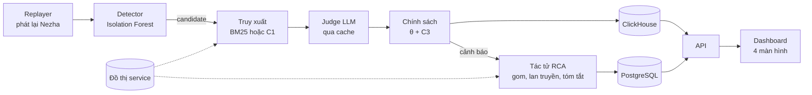
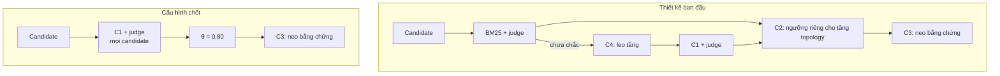
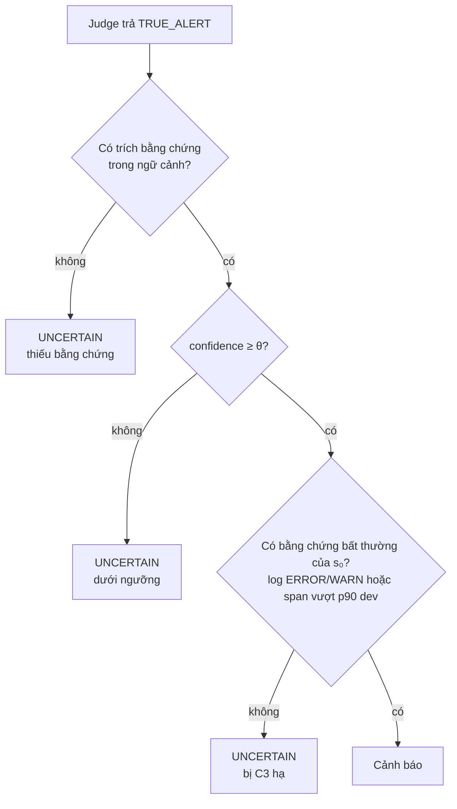
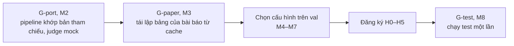

# Outline dựng báo cáo luận văn GĐ2 (toàn bộ)

> Soạn 2026-11-14. File này trả lời ba câu hỏi để dựng báo cáo song song với thực nghiệm: **viết theo thứ tự nào**,
> **mỗi mục viết kiểu gì, dài bao nhiêu**, và **cần hình, bảng nào**. Số liệu chính thức điền sau.
>
> Quan hệ với các file khác trong `docs/drafts/`:
> - `suon-bao-cao-gd2.md`: **nội dung** từng mục (các ý phải có, nguồn số liệu). File này không chép lại các ý đó.
> - `ch5-outline-ket-qua-test.md`: outline chi tiết riêng cho §5.7–§5.8 (kết quả `test`), mã bảng T1–T15, hình F1–F7.
> - `ch5-ket-qua-test.md`: phần văn đã viết cho §5.7.1–§5.7.3.
>
> Cập nhật 2026-11-16: dựng lại theo sườn đề mục người dùng chốt (đánh số tới cấp 3, thêm "Công bố khoa học" và
> "Kế hoạch thực hiện" ở phần cuối). Người dùng báo M8 đã xong trên máy, chưa push.
>
> Ký hiệu trạng thái: ✅ viết được ngay (số đã chốt hoặc không cần số) · 📊 M8 cần số `test` (đã có trên máy người dùng,
> agent điền được sau khi push) · ⏳ M9 / M10 / M11 chờ mốc đó ·
> ♻️ lấy lại từ báo cáo GĐ1, rút gọn · ✍️ cần bạn làm tay (chấm, chụp màn hình).
> Số trang là ước lượng để cân đối các chương, chỉnh theo quy định của khoa.

## 1. Mạch lập luận của cả báo cáo

Toàn bộ báo cáo đi theo một sợi chỉ, mỗi chương trả lời một câu:

1. **Chương 1:** cảnh báo từ detector metric nhiều nhưng thiếu bằng chứng; đưa ngữ cảnh topology cho judge LLM thì bắt thêm sự cố nhưng báo sai nhiều hơn. Vì sao, sửa được không, và từ cảnh báo đã thẩm định có định vị được service gốc không?
2. **Chương 2:** cần những khái niệm nào để hiểu câu hỏi đó.
3. **Chương 3:** người khác đã làm gì, khoảng trống ở đâu.
4. **Chương 4:** phương pháp đề xuất (CTAV) và tác tử RCA; cả những thành phần đã thử rồi bỏ.
5. **Chương 5:** kiểm chứng theo ba lớp: kiểm tra tính đúng của pipeline, chọn cấu hình trên `val`, kiểm định một lần trên `test`.
6. **Chương 6:** phương pháp chạy được thành một hệ thống demo.
7. **Chương 7:** kết quả có nghĩa gì, giới hạn ở đâu.
8. **Chương 8:** trả lời từng câu hỏi nghiên cứu.

Hai điểm phải giữ xuyên suốt, vì đây là điểm mạnh của luận văn chứ không phải điểm yếu:
- **Đổi hướng có ghi lại.** Trên `val`, hiện tượng của bài báo lặp lại nhưng cơ chế thì không (Phát hiện 7). Viết thẳng
  điều này ở Ch1, Ch4, Ch5, không giấu.
- **Kết quả âm là kết quả.** C2, C4 bị bỏ; C5 không đóng góp; CTAV giảm cảnh báo sai nhưng không giữ được recall của
  topology. Mỗi thứ viết như một thiết kế đã kiểm và loại, có số.

## 2. Cấu trúc tổng thể và ngân sách trang

| Phần | Nội dung | Trang | Hình | Bảng | Viết được ngay |
|---|---|---:|---:|---:|---|
| Phần đầu | Bìa, cam đoan, cảm ơn, tóm tắt, abstract, mục lục, danh sách hình/bảng, từ viết tắt | 10 | — | — | khung ✅; tóm tắt, abstract viết cuối cùng |
| Chương 1 | Giới thiệu đề tài | 8 | 3 | 2 | ✅ trừ câu số ở 1.2.4 (📊, ⏳ M9) |
| Chương 2 | Cơ sở lý thuyết | 14 | 9 | 4 | ✅ toàn chương |
| Chương 3 | Công trình liên quan | 12 | 1 | 1 | ✅ (cần tra cứu trích dẫn) |
| Chương 4 | Phương pháp đề xuất: CTAV và tác tử RCA | 18 | 12 | 10 | ✅ trừ 4.5 chi tiết (⏳ M9) |
| Chương 5 | Thực nghiệm và đánh giá | 28 | 16 | 34 | 5.1–5.6, 5.7.1–5.7.4 ✅; 5.7.5–5.8.5 📊; 5.8.6 ✍️; 5.9 ⏳ M9 |
| Chương 6 | Demo platform | 8 | 7 | 3 | 6.1, 6.4 khung ✅; còn lại ⏳ M10 |
| Chương 7 | Thảo luận, hạn chế, hướng phát triển | 8 | 1 | 4 | 7.3, 7.4, 7.6 ✅; 7.1, 7.2 📊; 7.5 ⏳ M11 |
| Chương 8 | Kết luận | 3 | — | 2 | 📊 + ⏳ M9 |
| Công bố khoa học | Bài báo ICAETM 2026 | ½ | — | — | ✅ (cần xác nhận trạng thái bài) |
| Kế hoạch thực hiện | Mục tiêu và lộ trình phần còn lại | 1½ | 1 | 1 | ✅ |
| Cuối | Tài liệu tham khảo, phụ lục A–F | 4 + 15 | — | — | A, B, C, E ✅ |
| **Tổng** | | **≈ 115 + phụ lục** | **≈ 49** | **≈ 61** | |

Template của khoa có 6 chương. Nếu bắt buộc đúng 6: gộp Chương 6 vào cuối Chương 5 thành mục "Hiện thực và demo", gộp
Chương 7 vào "Định hướng phát triển". Hỏi GVHD trước khi lắp Word.

## 3. Nguyên tắc viết chung

Toàn bộ quy tắc văn phong, khuôn từng chương, kỷ luật số liệu, hình/bảng và LaTeX nằm ở
**`docs/drafts/style-guide-luan-van.md`** (nguồn duy nhất, soạn 2026-11-16). File này không chép lại. Khi khuôn "Cách viết"
của một chương bên dưới lệch với style guide, style guide thắng.

---

## 4. Từng chương

Cột "Hình", "Bảng" ghi số thứ tự dự kiến; danh mục đầy đủ ở mục 5 và 6.

### Chương 1 — Giới thiệu đề tài (8 trang)

**Cách viết:** hình phễu (style guide §3). Không công thức, không CI, không số thập phân; chỉ số đếm hoặc tỷ lệ làm tròn.
Bài báo ICAETM chỉ xuất hiện ở 1.1.2, như một trích dẫn. Viết sau Ch4, Ch5 để phần đóng góp khớp với thứ đã viết.

| Mục | Viết kiểu gì | Hình | Bảng | Trang | Trạng thái |
|---|---|---|---|---:|---|
| 1.1.1 Vận hành AIOps trên microservice và quá tải cảnh báo | 2 đoạn: telemetry nhiều, detector báo nhiều, cảnh báo thiếu bằng chứng | H1.1 | | 1 | ✅ |
| 1.1.2 Khảo sát bước đầu về giám sát lai và đánh đổi ngữ cảnh đồ thị | Nêu hiện tượng bằng số đếm (FP 7 so với 137); trích bài báo kèm giới hạn nó tự nhận | H1.2 | B1.1 | 1½ | ✅ |
| 1.1.3 Những thách thức cho giải pháp tổng thể | 3–4 thách thức: giảm cảnh báo sai mà giữ độ phủ; cơ chế chưa rõ (hiện tượng lặp lại, cơ chế thì không); ngân sách LLM; từ cảnh báo tới service gốc | H1.3 | | 1 | ✅ |
| 1.2.1 Mục tiêu tổng quát | 1 đoạn | | | ½ | ✅ |
| 1.2.2 Mục tiêu cụ thể | 5 gạch đầu dòng, mỗi dòng 1–2 câu (bản đã chốt 2026-11-16) | | | ½ | ✅ |
| 1.2.3 Câu hỏi nghiên cứu RQ1–RQ5 | Bảng RQ → giả thuyết → chương trả lời | | B1.2 | ½ | ✅ |
| 1.2.4 Đóng góp chính | Đánh số; mỗi đóng góp một câu bằng chứng | | | ½ | khung ✅; câu kết quả 📊, RCA ⏳ M9 |
| 1.3.1 Đối tượng nghiên cứu | Danh sách ngắn | | | ½ | ✅ |
| 1.3.2 Phạm vi nghiên cứu | Trong / ngoài phạm vi: Nezha (hai hệ), năm loại lỗi, một judge `gemini-2.5-flash`, replay không phải streaming thật | | | ½ | ✅ |
| 1.4.1 Ý nghĩa thực tiễn | 1 đoạn | | | ¼ | ✅ |
| 1.4.2 Ý nghĩa khoa học | 1 đoạn: giao thức đăng ký trước, kết quả âm có kiểm chứng | | | ¼ | ✅ |
| 1.5 Bố cục luận văn | 1 đoạn, mỗi chương một câu, đúng số chương cuối cùng | | | ½ | ✅ (sửa lại nếu gộp về 6 chương) |
| Tóm tắt chương | 5–8 câu | | | ¼ | ✅ |

### Chương 2 — Cơ sở lý thuyết (14 trang) ✅

**Cách viết:** mỗi khái niệm 4 bước (style guide §3). Không kết quả thực nghiệm. Viết song song với Ch4.

| Mục | Hình | Bảng | Trang | Ghi chú |
|---|---|---|---:|---|
| 2.1.1 Metric, log, trace và cửa sổ trượt | H2.1, H2.2 | B2.1 | 1½ | |
| 2.1.2 Nezha và nhãn nguyên nhân gốc | | | 1 | Nhãn mức pod 100% (QĐ-001); hai hệ OnlineBoutique, TrainTicket |
| 2.2.1 Bất thường, khoảng trống ngữ nghĩa, quá tải cảnh báo | H2.3 | | 1 | |
| 2.2.2 Isolation Forest | | | 1 | |
| 2.3.1 BM25 trên văn bản log/trace | | | ½ | |
| 2.3.2 Đồ thị phụ thuộc service | H2.4 | | ½ | |
| 2.3.3 Hợp nhất đa phương thức (Fusion Score) | H2.5 | | 1 | Ký hiệu τ_F, không dùng τ trơn |
| 2.3.4 RAG trong giám sát vận hành | | | ½ | |
| 2.4.1 LLM, prompt, đầu ra có cấu trúc | H2.6 | B2.2 | 1 | |
| 2.4.2 Thẩm định theo tầng và kiểm soát ngân sách | | | ½ | Chỉ là khái niệm; C4 đã loại, nói ở Ch4 |
| 2.4.3 Thiên lệch xác nhận, hiệu chỉnh ngưỡng, nguồn gốc bằng chứng | H2.7 | | 1 | |
| 2.5.1 Bài toán RCA và gom incident | H2.8 | | ½ | |
| 2.5.2 Lan truyền ngược trên đồ thị gọi | | | ½ | Dùng chung H2.8 |
| 2.5.3 Báo cáo chẩn đoán có cấu trúc | | | ½ | |
| 2.6.1 Precision, Recall, F1, FPR | | B2.3 | ½ | |
| 2.6.2 Hit@k và Alert Reduction Ratio | | | ½ | |
| 2.6.3 Bootstrap CI và McNemar | H2.9 | | ½ | |
| 2.7 Giả thuyết và đăng ký trước | | | ½ | Chỉ giải thích nguyên tắc; bảng H0–H5 đặt một lần ở 5.1 |
| Tóm tắt chương | | B2.4 | ½ | Không đánh số 2.8 để đồng nhất với các chương khác |

### Chương 3 — Công trình liên quan (12 trang) ✅

**Cách viết:** đoạn dẫn chương không đánh số (bỏ "3.0"). Mỗi công trình 3 bước (style guide §3). Chỉ trích dẫn bài đã
đọc; chỗ chưa xác minh giữ `[CẦN TRA CỨU]`.

| Mục | Hình | Bảng | Trang |
|---|---|---|---:|
| (Đoạn dẫn, không đánh số) | | | ½ |
| 3.1 Phát hiện bất thường chuỗi thời gian | | | 1½ |
| 3.2 LLM trong phân tích log và RCA | | | 1½ |
| 3.3 Giám sát lai và LLM-as-a-Judge | | | 2 |
| 3.4 RCA trên microservice dựa topology và nhân quả | | | 2 |
| 3.5 Truy xuất dựa đồ thị cho AIOps và GraphRAG | | | 1 |
| 3.6 Hiệu chỉnh và độ tin cậy của LLM judge | | | 1½ |
| 3.7 Cứu cảnh báo và alert triage | | | ½ |
| 3.8 Bảng so sánh | | B3.1 | 1 |
| 3.9 Khoảng trống và định vị CTAV | H3.1 | | ½ |
| Tóm tắt chương | | | ¼ |

### Chương 4 — Phương pháp đề xuất (18 trang)

**Cách viết:** mỗi thành phần theo năm bước: vấn đề nó giải, thiết kế (công thức hoặc luật), tham số và cách chọn, vai trò
hiện tại (đang dùng, đã bỏ, chỉ là ablation), dẫn chiếu sang mục Chương 5 chứa bằng chứng. Số `val` chỉ xuất hiện để giải
thích một lựa chọn thiết kế, mỗi chỗ một câu. Không đưa số `test` vào chương này. Thành phần đã bỏ (C2, C4) viết ngắn hơn
thành phần đang dùng, nhưng không lược.

| Mục | Mục đích | Hình | Bảng | Trang | Trạng thái |
|---|---|---|---|---:|---|
| 4.1 Phát biểu bài toán | Ký hiệu và mục tiêu tối ưu | H4.1 | B4.1 | 1½ | ✅ |
| 4.2 Kiến trúc tổng thể của platform | Bốn khâu detector → CTAV → RCA → platform, đầu vào/đầu ra mỗi khâu | H4.2 | B4.2 | 2 | ✅ |
| 4.3 Isolation Forest và cổng Rescue (C5) | Đầu vào của CTAV; C5 chỉ là ablation | H4.3 | B4.3 | 2 | ✅ |
| 4.4.1 Tổng quan CTAV | Thiết kế ban đầu so với cấu hình chốt | H4.4 | B4.4 | 1½ | ✅ |
| 4.4.2 BM25 và judge | Baseline và tầng 1 | | B4.5 | 1 | ✅ |
| 4.4.3 Truy xuất topology C1 | Fusion Score, mở rộng 2-hop | H4.5 | B4.6 | 2 | ✅ |
| 4.4.4 Chính sách quyết định: neo bằng chứng (C3) và ngưỡng bất đối xứng (C2, đã loại) | Đóng góp chính | H4.6, H4.7 | B4.7 | 2½ | ✅ |
| 4.4.5 Định tuyến hai tầng thích nghi (C4, đã loại) | Thiết kế đã kiểm và loại | | | ½ | ✅ |
| 4.4.6 Judge: prompt, đầu ra, cache | Tái lập được | H4.8, H4.9 | B4.8 | 1½ | ✅ |
| 4.5.1 Gom cảnh báo thành incident | Luật gom theo thời gian và topology | H4.10 | | ½ | thiết kế ✅; tham số T_group ⏳ M9 |
| 4.5.2 Lan truyền ngược và xếp hạng service gốc | 1-hop; mức 2 nếu kịp | H4.11 | | 1 | thiết kế ✅; ví dụ ⏳ M9 |
| 4.5.3 Báo cáo chẩn đoán JSON | Schema, validator, chặn câu lệnh | | B4.9 | ½ | ✅; rà ⏳ M9 |
| 4.6 Hiện thực hoá hệ thống và harness | Công nghệ, harness, tái lập | H4.12 | B4.10 | 1½ | ✅ |

### Chương 5 — Thực nghiệm và đánh giá (28 trang)

**Cách viết:** ba lớp kiểm chứng theo đúng thứ tự đã làm: kiểm tra tính đúng của pipeline (§5.5), chọn cấu hình trên `val` (§5.6), kiểm
định trên `test` (§5.7–5.8). Mỗi thí nghiệm theo sáu bước: câu hỏi và tiêu chí, thiết lập, bảng, một câu kết luận in
đậm, diễn giải bằng số đếm, giới hạn. Phát hiện 1–12 gắn vào đúng thí nghiệm sinh ra nó, rồi tổng hợp lại ở §5.10.

| Mục | Mục đích | Hình | Bảng | Trang | Trạng thái |
|---|---|---|---|---:|---|
| 5.1 Mục tiêu và giả thuyết H0–H5 | Cái gì được kiểm, tiêu chí nào | | B5.1 | 1½ | ✅ |
| 5.2 Dữ liệu và chia split | Chống rò rỉ; tập chấm chính | H5.1, H5.2 | B5.2, B5.3 | 2 | ✅ |
| 5.3 Thiết lập | Judge, detector, ngân sách, chi phí | | B5.4 | 1½ | ✅ |
| 5.4 Thước đo | Định nghĩa chỉ số, kiểm định | | | 1 | ✅ |
| 5.5.1 Kiểm chứng pipeline cơ sở (G-port) | Pipeline khớp bản tham chiếu, judge mock | H5.3 | B5.5 | 1 | ✅ |
| 5.5.2 Kiểm chứng hồi quy trên tập đối chiếu (G-paper) | Tái lập baseline đã công bố từ cache | | B5.6 | 1 | ✅ |
| 5.6.1 H0 trên `val` | Hiện tượng lặp lại, cơ chế không | | B5.7, B5.8 | 1½ | ✅ |
| 5.6.2 Tuning C1 | `k_graph`, trọng số Fusion | | B5.9 | 1 | ✅ |
| 5.6.3 H1: cơ chế thiên lệch xác nhận | Bằng chứng nào làm judge xác nhận | H5.4 | B5.10 | 1½ | ✅ |
| 5.6.4 C3, C2, C4 trên `val` | Chốt cấu hình CTAV | H5.5 | B5.11, B5.12 | 1½ | ✅ |
| 5.6.5 C5 trên `val` | Rescue không đóng góp | H5.6 | B5.13 | 1 | ✅ |
| 5.7.1 Giao thức G-test và các lượt chạy | | H5.7 | B5.14 | ½ | ✅ |
| 5.7.2 Detector trên `test` và độ lệch giữa các split | | H5.8 | B5.15 | 1 | ✅ |
| 5.7.3 Bức tranh tổng quan trên `test` | | H5.9 | B5.16 | 1 | 3 dòng ✅; CTAV, không-RAG 📊 |
| 5.7.4 H0: topology chưa hiệu chỉnh | | | B5.17 | ½ | ✅ (đã viết) |
| 5.7.5 H2: CTAV so với BM25 | Giả thuyết chính | H5.10 | B5.18 | 1½ | 📊 |
| 5.7.6 H3: đóng góp từng thành phần | | | B5.19 | ½ | 📊 |
| 5.7.7 H4: ngân sách 120 lần gọi | | | B5.20 | ½ | 📊 |
| 5.7.8 Bảng tổng hợp H0–H4 | | | B5.21 | ½ | H0 ✅; còn lại 📊 |
| 5.8.1 Ablation thành phần, `val` đối chiếu `test` | | H5.11 | B5.22 | 1 | ô `val` ✅; ô `test` 📊 |
| 5.8.2 Ngưỡng nền `dev` và độ phủ của CTAV | Phát hiện 11 | H5.12 | B5.23 | ½ | ô `val` ✅; ô `test` 📊 |
| 5.8.3 F1 theo ngân sách gọi LLM | | H5.13 | B5.24, B5.30 | ½ | ô `val` ✅; ô `test` 📊 |
| 5.8.4 C5 (Rescue) một điểm trên `test` | | | B5.25 | ½ | 📊 |
| 5.8.5 Độ ổn định lặp lại của judge và chi phí | | | B5.26, B5.27 | ½ | 📊 |
| 5.8.6 Context precision chấm tay | | | B5.28 | ½ | ✍️ (V35: bạn chấm 50 cửa sổ) |
| 5.9 Đánh giá RCA (H5) | Định vị service gốc | H5.14, H5.15 | B5.31–B5.33 | 2 | ⏳ M9; chấm tay ⏳ M11 ✍️ |
| 5.10 Phân tích và thảo luận | Nối các phát hiện | H5.16 | B5.34 | 1½ | khung ✅; cập nhật 📊 M8 |

Chi tiết §5.7–§5.8 (thứ tự mục con, cột của từng bảng, đặc tả từng hình, chỗ lấy số): `ch5-outline-ket-qua-test.md`.

### Chương 6 — Demo platform (8 trang)

**Cách viết:** mô tả theo mắt người dùng, không theo mã nguồn. Mỗi màn hình: một ảnh chụp, một đoạn nói màn hình trả lời
câu hỏi gì của người vận hành, một đoạn nối với thành phần ở Chương 4. Kịch bản demo viết thành bảng từng bước.

| Mục | Hình | Bảng | Trang | Trạng thái |
|---|---|---|---:|---|
| 6.1 Vai trò của platform | | | ½ | ✅ |
| 6.2 Luồng end-to-end và triển khai | H6.1 | B6.1 | 1½ | khung ✅; ⏳ M10 |
| 6.3 Dashboard bốn màn hình | H6.2–H6.5 | | 3 | ⏳ M10 ✍️ |
| 6.4 Kịch bản demo 5 phút | H6.6 | B6.2 | 1½ | khung ✅; chọn ca 📊 M8, M9 |
| 6.5 Kiểm thử demo và dự phòng | H6.7 | B6.3 | 1 | ⏳ M10 |

### Chương 7 — Thảo luận, hạn chế, hướng phát triển (8 trang)

**Cách viết:** không lặp lại bảng số của Chương 5; mỗi luận điểm trích lại một hai con số rồi giải thích vì sao. Hạn chế
viết cụ thể (cái gì, ảnh hưởng đến kết luận nào), không viết chung chung. Hướng phát triển gắn mỗi hướng với một hạn chế.

| Mục | Hình | Bảng | Trang | Trạng thái |
|---|---|---|---:|---|
| 7.1 Tổng hợp kết quả chính | | B7.1 | 1 | 📊 M8 |
| 7.2 Thảo luận (vì sao C3 hiệu quả; vì sao C2, C4, C5 không) | | | 2 | `val` ✅; cập nhật 📊 M8 |
| 7.3 Hạn chế | | | 1 | khung ✅ |
| 7.4 Mối đe doạ tính hợp lệ | | B7.2 | 1 | khung ✅ |
| 7.5 Phân tích ca sai | H7.1 | B7.3 | 1½ | ⏳ M11 ✍️ |
| 7.6 Hướng phát triển | | B7.4 | 1 | ✅ |

### Chương 8 — Kết luận (3 trang) ⏳

**Cách viết:** không ý mới, không hình. Mỗi câu hỏi nghiên cứu một đoạn 3–4 câu: câu trả lời, số chính, giới hạn.

| Mục | Bảng | Trang |
|---|---|---:|
| 8.1 Trả lời câu hỏi nghiên cứu | B8.1 | 1 |
| 8.2 Tóm tắt đóng góp | | ½ |
| 8.3 Kết quả H0–H5 | B8.2 | ½ |
| 8.4 Ý nghĩa và kết luận chung | | ½ |

### Công bố khoa học (không đánh số chương, ngay sau Chương 8) ✅

Một đoạn: thông tin bài báo (tác giả, tên bài, hội nghị, kỷ yếu, **trạng thái thật**: đã nộp / được chấp nhận / đã đăng),
và một đến hai câu về quan hệ với luận văn (khảo sát bước đầu cho riêng khâu truy xuất, trên `paper_500`). Không lặp lại số.

### Kế hoạch thực hiện phần còn lại (không đánh số chương, trước Tài liệu tham khảo) ✅

| Mục | Hình | Bảng | Trang |
|---|---|---|---:|
| Mục tiêu phần còn lại | | | ½ |
| Lộ trình theo mốc | HK.1 | BK.1 | 1 |

Viết theo mốc (M9, M10, M11, M12), không theo "Giai đoạn 1–4", để không đụng style guide §1.1. Không đưa vào kế hoạch
việc đã xong lúc nộp (M8). Hướng mở rộng ngoài phạm vi hiện tại (judge thứ hai, dataset thứ hai) ghi là "hướng mở rộng",
tách khỏi các mốc bắt buộc.

### Phụ lục

A Cấu hình thực nghiệm ✅ · B Prompt judge ✅ · C Schema và hợp đồng ✅ (RCA ⏳ M9) · D Bảng đầy đủ: `val` ✅, `test`
"mọi cửa sổ" và theo từng service 📊 M8 · E Hướng dẫn tái lập ✅ · F Đánh giá bằng người ✍️.

---

## 5. Danh mục hình (50)

Loại: **SĐ** sơ đồ vẽ tay bằng công cụ · **BĐ** biểu đồ sinh từ script · **AC** ảnh chụp · **VD** ví dụ trích từ dữ liệu.

| Mã | Tên | Loại | Nội dung cần thể hiện | Nguồn | Trạng thái |
|---|---|---|---|---|---|
| H1.1 | Vị trí của tầng thẩm định cảnh báo | SĐ | Telemetry, detector, dòng cảnh báo, judge có ngữ cảnh, người vận hành | mới | ✅ |
| H1.2 | Đánh đổi của ngữ cảnh topology | BĐ | Cột TP và FP của BM25 và Topology trên `paper_500` (FP 7 so với 137); chỉ số đếm, không số thập phân (Ch1) | G-paper, M3 | ✅ |
| H1.3 | Tổng quan hệ thống bốn khâu | SĐ | Detector → CTAV → RCA → platform, mỗi khâu một câu hỏi của người vận hành; bản giản lược của H4.2 | mới | ✅ |
| H2.1 | Cửa sổ trượt và nhãn | SĐ | Cửa sổ 60 s, khoảng nhãn quanh thời điểm tiêm lỗi | ♻️ GĐ1 hình 1, sửa 120 s thành 60 s | ✅ |
| H2.2 | Metric, log, trace của một request | SĐ | Cây span cha–con, log gắn theo pod | mới | ✅ |
| H2.3 | Khoảng trống ngữ nghĩa | SĐ | Điểm bất thường cao không cho biết có sự cố hay không | ♻️ GĐ1 hình 2 | ✅ |
| H2.4 | Đồ thị phụ thuộc service và khoảng cách | BĐ | 56 service, 68 cạnh; tô một service và các lân cận 1, 2 hop | `data/graph/service_graph.json` | ✅ |
| H2.5 | Ba thành phần của Fusion Score | SĐ | BM25, độ gần thời gian, độ gần đồ thị cộng có trọng số | mới | ✅ |
| H2.6 | LLM-as-a-Judge có truy xuất | SĐ | Candidate, truy xuất, prompt, verdict có cấu trúc | ♻️ GĐ1 hình 3, bỏ local-first | ✅ |
| H2.7 | Thiên lệch xác nhận | SĐ | Cùng một cảnh báo, hai bộ bằng chứng, hai verdict | mới | ✅ |
| H2.8 | Gom incident và lan truyền ngược | SĐ | Nhiều cảnh báo thành một incident; đi ngược một hop tới service gốc | mới | ✅ |
| H2.9 | Bootstrap ghép cặp và McNemar | SĐ | Lấy mẫu lại theo cửa sổ, hiệu ghép cặp, bảng 2×2 chỉ đếm ô bất đồng | mới | ✅ |
| H3.1 | Bản đồ định vị công trình | SĐ | Hai trục: có dùng topology; có hiệu chỉnh judge. Đặt các công trình và CTAV | mới | ✅ |
| H4.1 | Cửa sổ, ngữ cảnh, nhãn | SĐ | Ký hiệu w, s₀, t₀, E(w) trên trục thời gian | mới | ✅ |
| H4.2 | Kiến trúc tổng thể | SĐ | Xem khung Mermaid bên dưới | `01` §3 | ✅ |
| H4.3 | Detector và cổng Rescue | SĐ | Điểm ≥ 0,85 thành candidate; nhánh Rescue cho cửa sổ dưới ngưỡng | `01` §6.2 | ✅ |
| H4.4 | CTAV: thiết kế ban đầu và cấu hình chốt | SĐ | Hai sơ đồ cạnh nhau; khối bị bỏ vẽ nét đứt. Xem khung bên dưới | QĐ-031 | ✅ |
| H4.5 | Mở rộng 2-hop và xếp hạng Fusion | SĐ | Pool BM25, mở rộng theo đồ thị, xếp hạng, lấy top-6 | `01` §6.3 | ✅ |
| H4.6 | Sơ đồ quyết định | SĐ | Ba luật theo thứ tự. Xem khung bên dưới | `services/judge/policy.py` | ✅ |
| H4.7 | Một cảnh báo sai bị C3 hạ | VD | Bằng chứng judge trích, ngưỡng nền, kết quả UNCERTAIN | `ctav_final_val_v1` | ✅ |
| H4.8 | Luồng gọi judge qua cache | SĐ | Khoá cache, trúng thì đọc, trượt thì gọi API và ghi | `services/judge/cache.py` | ✅ |
| H4.9 | Ví dụ prompt và JSON trả về | VD | Một prompt rút gọn và verdict | cache | ✅ |
| H4.10 | Ba bước của tác tử RCA | SĐ | Gom, lan truyền, tóm tắt | `01` §6.5 | ✅ |
| H4.11 | Ví dụ đồ thị lan truyền | VD | Một incident thật, service gốc được tô | ⏳ M9 | ⏳ M9 |
| H4.12 | Cấu trúc repo và harness | SĐ | Thư mục chính và đường đi của một run | `01` §7 | ✅ |
| H5.1 | Chia split theo lần tiêm lỗi | SĐ | Trục thời gian, các lần tiêm, vùng đệm 600 s, gán `dev` / `val` / `test` | QĐ-004 | ✅ |
| H5.2 | Có bằng chứng gắn với gần sự cố | BĐ | Tỉ lệ cửa sổ có bằng chứng: fault so với normal, kho bằng chứng của bài báo so với kho của luận văn | B5.3 | ✅ |
| H5.3 | Ba cổng kiểm chứng | SĐ | G-port, G-paper, G-test trên trục các mốc; mỗi cổng kiểm gì | `04` | ✅ |
| H5.4 | H1: tỉ lệ TRUE_ALERT theo độ gần thời gian | BĐ | Đường cho normal và fault ở 0, 33, 67, 100%, có CI | `h1_val_analysis_v2` | ✅ |
| H5.5 | Đường θ_topo trên `val` | BĐ | Recall và FPR theo θ | `m6_ctav_select_val_v2` | ✅ |
| H5.6 | Đường τ của Rescue trên `val` | BĐ | Recall phẳng, FPR giảm, số lần gọi theo τ | `m7_rescue_val_v1` | ✅ |
| H5.7 | Quy trình G-test | SĐ | = F1 trong outline §5.7 | | ✅ |
| H5.8 | Tỉ lệ candidate theo split và hệ thống | BĐ | = F2 | `m8_detector_shift_test_v1` | ✅ |
| H5.9 | Điểm vận hành Recall–FPR, `val` và `test` | BĐ | = F3. Hình chính của chương | | một phần ✅; 📊 M8 |
| H5.10 | Hiệu ghép cặp và khoảng tin cậy | BĐ | = F4 | | một phần ✅; 📊 M8 |
| H5.11 | Phễu quyết định của CTAV | SĐ + số | = F5 | `ctav_final_test_v1` | 📊 M8 |
| H5.12 | Recall C1 và CTAV theo nhóm service | BĐ | = F6 | `m8_finding11_test_v1` | 📊 M8 |
| H5.13 | F1 theo ngân sách, `val` và `test` | BĐ | = F7 | | ô `val` ✅; 📊 M8 |
| H5.14 | Hit@1, Hit@3 của RCA và baseline | BĐ | Cột có CI | ⏳ M9 | ⏳ M9 |
| H5.15 | Số cảnh báo và số incident | BĐ | Mức giảm cảnh báo theo loại lỗi | ⏳ M9 | ⏳ M9 |
| H5.16 | Bản đồ 12 phát hiện | SĐ | Phát hiện nào dẫn tới quyết định thiết kế nào | experiment-log | ✅; cập nhật 📊 M8 |
| H6.1 | Triển khai bằng Docker Compose | SĐ | Các container và luồng dữ liệu | `docker-compose.yml` | ✅ |
| H6.2 | Màn hình Timeline | AC | | ⏳ M10 | ✍️ |
| H6.3 | Màn hình Alert detail | AC | Bằng chứng top-k, lý do bị C3 hạ | ⏳ M10 | ✍️ |
| H6.4 | Màn hình Incident detail | AC | Đồ thị lan truyền, báo cáo JSON | ⏳ M10 | ✍️ |
| H6.5 | Màn hình Experiment comparison | AC | Bảng H0–H4 | ⏳ M10 | ✍️ |
| H6.6 | Kịch bản demo năm bước | SĐ | Dải năm ô, mỗi ô một bước và thông điệp | `08` §6 | ✅ |
| H6.7 | Demo chạy không cần mạng | AC | Cache hit 100%, độ trễ | ⏳ M10 | ✍️ |
| H7.1 | Hai ca sai tiêu biểu | VD | Một cảnh báo sai còn lại và một sự cố bị bỏ sót | ⏳ M11 | ✍️ |
| HK.1 | Lộ trình phần còn lại | SĐ | Gantt M9–M12 tới tuần bảo vệ; tô mốc cổng chặn | `04` §1 | ✅ |

**Khung cho bốn sơ đồ quan trọng nhất**

H4.2 — Kiến trúc tổng thể:

H4.4 — CTAV: thiết kế ban đầu (trái) và cấu hình chốt (phải). Khối nét đứt là thành phần đã bỏ:

H4.6 — Sơ đồ quyết định (thứ tự luật đúng như mã nguồn):

H5.3 — Ba cổng kiểm chứng:

## 6. Danh mục bảng (≈ 60)

| Mã | Tên | Mục | Trạng thái |
|---|---|---|---|
| B1.1 | Khảo sát bước đầu (bài báo) và luận văn: phạm vi, câu hỏi, judge, dữ liệu, đầu ra | 1.1.2 | ✅ |
| B1.2 | Câu hỏi nghiên cứu, giả thuyết, chương trả lời | 1.2.3 | ✅ |
| B2.1 | Nguồn telemetry ♻️ | 2.1 | ✅ |
| B2.2 | Định dạng đầu ra của judge ♻️ | 2.4 | ✅ |
| B2.3 | Chỉ số đánh giá và công thức | 2.6 | ✅ |
| B2.4 | Khái niệm, thành phần (C1–C5, RCA), giả thuyết | 2.8 | ✅ |
| B3.1 | So sánh các công trình | 3.8 | ✅ (cần tra cứu) |
| B4.1 | Bảng ký hiệu | 4.1 | ✅ |
| B4.2 | Bốn khâu của hệ thống: đầu vào, đầu ra, thành phần, mục trình bày | 4.2 | ✅ |
| B4.3 | Tham số detector và Rescue | 4.3 | ✅ |
| B4.4 | Vai trò và trạng thái C1–C5, kèm quyết định | 4.4.1 | ✅ |
| B4.5 | Ba chiến lược truy xuất | 4.4.2 | ✅ |
| B4.6 | Tham số Fusion | 4.4.3 | ✅ |
| B4.7 | Điều kiện neo của C3 và độ phủ ngưỡng | 4.4.4 | ✅ |
| B4.8 | Cấu hình judge và cache | 4.4.6 | ✅ |
| B4.9 | Schema báo cáo chẩn đoán | 4.5 | ✅; rà ⏳ M9 |
| B4.10 | Công nghệ, đầu ra của một run, lệnh chính | 4.6 | ✅ |
| B5.1 | Giả thuyết H0–H5 và tiêu chí đã đăng ký | 5.1 | ✅ |
| B5.2 | Kích thước split, tỉ lệ có telemetry | 5.2 | ✅ |
| B5.3 | Có bằng chứng gắn với gần sự cố | 5.2 | ✅ |
| B5.4 | Chi phí API theo mốc | 5.3 | ✅; dòng M8 ⏳ |
| B5.5 | G-port theo tầng | 5.5 | ✅ |
| B5.6 | G-paper | 5.5 | ✅ |
| B5.7 | H0 trên `val` | 5.6.1 | ✅ |
| B5.8 | Hiệu ghép cặp và McNemar trên `val` | 5.6.1 | ✅ |
| B5.9 | Quét `k_graph` | 5.6.2 | ✅ |
| B5.10 | H1: tỉ lệ TRUE_ALERT theo điều kiện can thiệp | 5.6.3 | ✅ |
| B5.11 | H3 tại cấu hình chốt, `val` | 5.6.4 | ✅ |
| B5.12 | CTAV so với baseline, `val` | 5.6.4 | ✅ |
| B5.13 | Rescue trên CTAV, `val` | 5.6.5 | ✅ |
| B5.14–B5.21 | Tám bảng của §5.7 (T1–T8 trong outline §5.7) | 5.7 | T1–T4 ✅ phần lớn; T5–T8 📊 M8 |
| B5.22–B5.28 | Bảy bảng của §5.8 (T9–T15) | 5.8 | 📊 M8; T15 ✍️ |
| B5.29 | Đường θ_topo và đường τ trên `val` | 5.8 | ✅ |
| B5.30 | F1 theo ngân sách trên `val` | 5.8 | ✅ |
| B5.31 | Kết quả RCA: Hit@1, Hit@3, mức giảm cảnh báo | 5.9 | ⏳ M9 |
| B5.32 | Quét cửa sổ gom incident trên `val` | 5.9 | ⏳ M9 |
| B5.33 | Chất lượng chẩn đoán chấm tay | 5.9 | ⏳ M11 ✍️ |
| B5.34 | Tổng hợp các phát hiện | 5.10 | P1–P12 ✅; thêm 📊 M8 |
| B6.1 | Endpoint API và màn hình dùng nó | 6.2 | ⏳ M10 |
| B6.2 | Kịch bản demo: bước, thao tác, điều người xem thấy, thông điệp | 6.4 | khung ✅ |
| B6.3 | Kiểm thử demo: không mạng, cache hit, độ trễ | 6.5 | ⏳ M10 |
| B7.1 | Tổng hợp kết quả chính, `val` và `test` | 7.1 | 📊 M8 |
| B7.2 | Mối đe doạ tính hợp lệ và biện pháp | 7.4 | ✅ |
| B7.3 | Phân loại ca sai | 7.5 | ⏳ M11 ✍️ |
| B7.4 | Hạn chế và hướng phát triển tương ứng | 7.6 | ✅ |
| B8.1 | Câu hỏi nghiên cứu và câu trả lời | 8.1 | 📊 M8, M9 |
| B8.2 | Kết quả H0–H5 | 8.3 | H0, H1 ✅; còn lại 📊, ⏳ M9 |
| BK.1 | Mốc còn lại: việc, đầu ra, DoD, hạn | Kế hoạch | ✅ |

## 7. Thứ tự dựng

Lịch theo tuần, phân công người/agent và quy tắc cắt khi trễ: **`ke-hoach-viet-bao-cao.md`**. Bảng dưới chỉ là thứ tự logic.

Thứ tự viết khác thứ tự trình bày: viết trước phần đã có số và phần mà các chương khác phải trích.

| Đợt | Điều kiện | Viết | Hình và bảng làm cùng |
|---|---|---|---|
| 1 | Ngay bây giờ | Ch4 (trừ 4.5 chi tiết) · Ch5 5.1–5.6, 5.7.1–5.7.4 | H4.1–H4.10, H4.12; H5.1–H5.8; B4.x, B5.1–B5.17, B5.29, B5.30 |
| 2 | Song song đợt 1 | Ch2 · Ch3 | H2.1–H2.9, H3.1; B2.x, B3.1 |
| 3 | Ngay khi bạn có số M8 trên máy (hoặc push để agent điền) | 5.7.5–5.8.5 · 5.10 · Ch7 7.1, 7.2 | H5.9–H5.13, H5.16; B5.18–B5.27, B7.1 |
| 4 | Sau đợt 1, 3 | Ch1 (viết sau Ch4, Ch5) · Ch7 7.3, 7.4, 7.6 · Công bố khoa học · Kế hoạch | H1.1–H1.3, HK.1; B1.x, B7.2, B7.4, BK.1 |
| 5 | M9 đóng | 4.5 chi tiết · 5.9 · câu RCA ở 1.2.4 | H4.11, H5.14, H5.15; B5.31, B5.32 |
| 6 | M10 đóng | Ch6 | H6.1–H6.7; B6.x |
| 7 | M11 đóng (bạn chấm tay) | 5.8.6 · 7.5 | H7.1; B5.28, B5.33, B7.3 |
| 8 | Cuối cùng | Ch8 · tóm tắt, abstract · danh sách hình/bảng · phụ lục · rà chéo số | B8.x |

Nếu hạn nộp đến trước khi M9/M10 đóng: 5.9 và Ch6 viết phần thiết kế, kèm kết quả sơ bộ nếu có, đánh dấu rõ
`[CHỜ M9]`/`[CHỜ M10]`; phần còn lại đi vào mục Kế hoạch.

Lý do viết Ch4 và Ch5 trước: hai chương này quyết định thuật ngữ, ký hiệu và số liệu mà Ch1, Ch2, Ch7, Ch8 trích lại.

## 8. Những chỗ trong sườn hiện tại cần sửa cho khớp

Các điểm 7–10 thấy khi rà sườn đề mục người dùng gửi 2026-11-16.

7. **Ký hiệu `[cite: N]`** ở cuối mọi dòng của sườn là dấu vết công cụ, không phải trích dẫn (style guide §5.2).
8. **Mục Kế hoạch đưa M8 vào việc còn phải làm**, trong khi M8 đã xong. Kế hoạch chỉ gồm M9–M12 và hướng mở rộng.
   Dùng "mốc", không dùng "Giai đoạn 1–4".
9. **"Đa họ mô hình LLM" trong Kế hoạch** đụng quy tắc một judge duy nhất (AGENTS.md quy tắc 4, scope guard). Chỉ ghi
   như hướng mở rộng, không là mốc bắt buộc.
10. **Trạng thái bài báo** ("gửi đăng") cần đúng thực tế lúc nộp; hội đồng sẽ hỏi.

Các điểm này thấy khi rà `suon-bao-cao-gd2.md`; nên sửa trước khi viết để các chương không lệch nhau.

1. **Số câu hỏi nghiên cứu không khớp.** §1.2.3 có RQ1–RQ4, §8.1 trả lời RQ1–RQ5 (tách "thành phần nào cần" thành câu
   riêng). Chọn một cách đánh số và dùng ở cả hai chỗ.
2. **§1.5 Bố cục dùng số chương cũ** (Ch5 platform, Ch6 thực nghiệm, Ch7 kết luận), không khớp cấu trúc 8 chương.
3. **Trạng thái đăng ký đã cũ.** Nhiều mục còn ghi "bản nháp, chờ V29, V33, V34". Hiện đã đăng ký ngày 2026-11-14:
   δ = 0,05; C5 chỉ là ablation; chấm toàn bộ candidate trên `test`.
4. **Ký hiệu τ dùng cho hai thứ:** hằng số thời gian của Fusion Score (300 s) và ngưỡng của Rescue Score. Đổi một
   trong hai (ví dụ τ_F và τ_R) và ghi vào bảng ký hiệu B4.1.
5. **Bảng giả thuyết xuất hiện hai lần** (§2.7 và §5.1). Giữ bảng đầy đủ ở §5.1.
6. **Bước 3 của kịch bản demo** (§6.4) dựa vào ca `network_delay`, nhưng trên `val` CTAV mất cả 10 ca loại này mà C1
   bắt được. Chọn lại ca sau khi có kết quả `test`.
