# 03 — Kế hoạch Tổng thể & Ranh giới: Từ Luận văn Thạc sĩ đến MVP Sản phẩm và Production

> **Bản định hướng riêng của tác giả (cập nhật 2026-11-24).**
> Tài liệu này định nghĩa rõ **ranh giới chiến lược** giữa phần **Luận văn Thạc sĩ (GĐ2 & GĐ3)** và nhánh **Sản phẩm Thương mại hóa (`alert-triage`)**.
> Tài liệu này được lưu riêng cho mục đích hoạch định sản phẩm; văn bản quyển luận văn GĐ2 không nhắc tới kế hoạch thương mại hóa này.

---

## 1. Tuyên bố Định vị: Luận văn không chạy Production thật, nhưng thể hiện MVP Kỹ thuật của Sản phẩm

Để vừa đảm bảo tính nghiêm ngặt của một công trình nghiên cứu khoa học, vừa có sẵn nền móng tiến lên sản phẩm thương mại sau khi tốt nghiệp, kế hoạch tuân thủ nguyên tắc **"Một Lõi Kỹ Thuật — Hai Chế Độ Vận Hành"**:

1. **Trong phạm vi Luận văn Thạc sĩ (GĐ2 hiện tại và GĐ3 tiếp theo):**
   - **KHÔNG đưa hệ thống lên môi trường Production thương mại thật** của doanh nghiệp bên ngoài (không tích hợp PagerDuty/Slack vận hành thật của khách hàng, không làm SSO/RBAC đa thuê bao, không can thiệp vào luồng trực on-call thật).
   - **Lý do khoa học:** Môi trường Production thật có lưu lượng biến thiên không lặp lại được và không có nhãn lỗi gốc (`ground-truth`) đầy đủ để tính Recall/FPR hay kiểm định giả thuyết có tiền đăng ký (`H0–H5` ở GĐ2, `H6–H9` ở GĐ3).
2. **Tuy nhiên, Platform của Luận văn thể hiện trực tiếp bản MVP Kỹ thuật (Technical Core MVP) của sản phẩm trong môi trường thực nghiệm có kiểm soát:**
   - Hệ thống trong luận văn không dừng ở các script rời rạc mà đã được xây dựng thành một **Platform phần mềm chạy đầu-cuối**: 4 Protocol lõi ở `packages/schemas/protocols.py`, pipeline `CTAV + RCA Agent`, lưu trữ ClickHouse + PostgreSQL, FastAPI chỉ-đọc 7 endpoint, React Dashboard 4 màn hình, Docker Compose, và ở GĐ3 là luồng Redpanda/Kafka thời gian thực trên Testbed.
   - Như vậy, **Platform demo của luận văn chính là nguyên mẫu lõi kỹ thuật (Technical Core MVP)**. Để đi lên sản phẩm thương mại sau luận văn, ta cần: (i) trả nợ kỹ thuật và đóng gói lõi ở M13, (ii) nâng cấp thuật toán neo bằng chứng sang trực tuyến (`C3-Online`) ở M16, và (iii) phát triển thêm lớp vỏ vận hành Production (Adapters, Guardrails, Delivery) ở một repo sản phẩm tách biệt.

---

## 2. Ma trận Ánh xạ 3 Tầng: Luận văn GĐ2 $\rightarrow$ Luận văn GĐ3 (Technical MVP) $\rightarrow$ Sản phẩm Production

Bảng dưới đây chỉ rõ thành phần nào **đã có trong repo luận văn GĐ2**, thành phần nào **sẽ làm trong GĐ3**, và thành phần nào **tách riêng sang repo sản phẩm thương mại**:

| Phân hệ | Luận văn GĐ2 (Đã hoàn tất M0–M11) — *Replay MVP* | Luận văn GĐ3 (M13–M22) — *Live Technical MVP trên Testbed* | Sản phẩm Production (`alert-triage` v0.1–v0.3) — *Commercial Layer* |
|---|---|---|---|
| **1. Vai trò quyết định của hệ thống** | Phân loại nhị phân (`alert` vs `non-alert`) để đo chuẩn xác Precision/Recall/FPR khoa học. | Giữ phân loại chuẩn để kiểm định `H6–H9` trên tập `test` mới niêm phong. | **Non-Suppressing Triage (Phân loại không chặn):** Không bao giờ tự xóa cảnh báo; chỉ gắn mức ưu tiên (`P1/P2/P3`) + bằng chứng + **Fail-open** khi lỗi kỹ thuật + bảo vệ cảnh báo `critical` khỏi bị hạ nhầm. |
| **2. Nguồn phát sinh cảnh báo** | `IsolationForestDetector` (ngưỡng tĩnh `0.85` trên cửa sổ metric 60s). | `IsolationForestDetector` chạy trên luồng telemetry trực tiếp từ Testbed. | **Webhook Ingest API:** Nhận cảnh báo có sẵn từ Alertmanager, Grafana, Datadog (trả `202 Accepted` trong $< 150\text{ ms}$); khử trùng theo `fingerprint`. |
| **3. Nguồn dữ liệu Telemetry & Đồ thị** | Đọc tập dữ liệu đóng băng Nezha từ đĩa (`NezhaReplaySource`); đồ thị phụ thuộc dựng từ tập `dev`. | **Luồng thời gian thực (`KafkaSource`):** OpenTelemetry Collector $\rightarrow$ Redpanda $\rightarrow$ ClickHouse trên Testbed Online Boutique; đồ thị cập nhật động. | **Federated Adapters:** Truy vấn chỉ-đọc trực tiếp vào Loki (`LogQL`), Tempo (`TraceQL`), Prometheus (`PromQL`) và sự kiện K8s Rollout / CI-CD của khách hàng. |
| **4. Lõi truy xuất ngữ cảnh (`C1`)** | `hybrid_bm25_graph` (Weighted Context Fusion: BM25 + độ gần thời gian + khoảng cách đồ thị $1/(1+d_G)$). | Giữ giao thức `RetrievalStrategy`; thử nghiệm tiền lọc ưu tiên span bất thường. | Tái sử dụng qua package lõi `core-v1.x`; truy vấn ngữ cảnh quanh thời điểm cảnh báo có cache ngắn hạn theo vùng đồ thị. |
| **5. Chính sách hiệu chỉnh & Neo bằng chứng (`C3`)** | `C3` trong `services/judge/policy.py` neo vào ngưỡng tĩnh `dev` $p_{90}$ (`data/span_baseline.parquet`) + đối chứng cơ chế `C3-trượt` (60 phút). | **`C3-Online` (code lõi mới ở M16):** Ngưỡng nền trượt trực tuyến không cần nhãn theo cặp `(service, operation)`, có quy tắc khởi động lạnh (**Cold-Start**) + **Cổng tất định bỏ qua LLM (`H8`)**. | Kế thừa `C3-Online` + Cổng bỏ qua LLM từ GĐ3; lưu phân vị bằng exponential histogram của OTel hoặc `quantileDD` (DDSketch) trong ClickHouse (xem `07-cong-nghe-va-scale-production.md` §4.3) và bảo vệ không hạ xuống `P3` với cảnh báo nguồn `severity=critical`. |
| **6. Bộ thẩm định LLM (`Judge`)** | `gemini-2.5-flash` qua API + Cache JSONL 100% tái lập + `require_evidence`. | Bổ sung **Judge thứ hai khác họ** qua registry (M17) để kiểm tra tính lặp lại. | Đa nhà cung cấp (BYOK: Gemini, OpenAI, Claude, vLLM nội bộ) + **Bộ lọc che dữ liệu nhạy cảm (PII/Secret Scrubber)** + **Trần chi phí cứng theo ngày (Hard Spend Cap)**. |
| **7. Tác tử RCA & Tóm tắt sự cố** | Gom nhóm `T_group = 180s` + Lan truyền ngược 1-hop + `summarizer.py` có **Validator 5 quy tắc** (`invalid_json`, `confidence_out_of_range`, `executable_action`, `no_evidence`, và gắn cờ `suspicious` khi service ngoài đồ thị). | Chạy trực tuyến trên cảnh báo `CTAV-Online` (kiểm định lại `H9` khi độ phủ cảnh báo đã khôi phục). | Kế thừa nguyên vẹn Validator 5 quy tắc của `summarizer.py`; **bổ sung mới ở tầng sản phẩm:** cổng không ép gán loại lỗi khi nhóm chỉ gồm cảnh báo `P3`, tương quan sự kiện Deploy và lan truyền đa bước. |
| **8. Giao diện & Kênh tương tác** | **Dashboard React 4 màn hình** (Timeline, Alert Detail, Incident Detail, Experiment Comparison) + chế độ `DEMO_OFFLINE=1`. | Bổ sung luồng cập nhật trực tiếp (**SSE Live Stream**) trên Dashboard khi tiêm lỗi Chaos Mesh. | **Thẻ Triage trên Slack / MS Teams / PagerDuty** kèm nút phản hồi `👍 / 👎` (Human-in-the-loop) + Web UI quản trị & báo cáo tuần. |

---

## 3. Những Năng lực MVP nào của Sản phẩm đã được Chứng minh ngay trong Luận văn?

Không cần nhắc đến thương mại hóa trong quyển luận văn, thiết kế hệ thống ở **Chương 4 (Kiến trúc)** và **Chương 6 (Demo Platform)** đã đóng vai trò kiểm chứng các trụ cột kỹ thuật quan trọng của MVP:

1. **Kiến trúc tách rời bằng 4 Protocol (`packages/schemas/protocols.py`):**
   - Nhờ `SourceAdapter`, `Detector`, `RetrievalStrategy`, `Judge` có chữ ký chuẩn hóa, phần điều phối pipeline tách biệt rõ với nguồn dữ liệu.
   - *Lưu ý kỹ thuật thực tế:* Để đóng gói thành thư viện `core-v1.0.0` dùng cho sản phẩm, ở mốc **M13** và **M16** vẫn cần thực hiện một đợt tái cấu trúc (refactoring) có kiểm soát trên code lõi: gỡ các giá trị mặc định đang hardcode trong `__init__` (`isolation_forest.py`, `bm25_hybrid.py`, `hybrid_bm25_graph.py`, `readers.py`), sửa lỗi tiềm ẩn ở `rescue.py`, và mở rộng `services/judge/policy.py` từ đọc ngưỡng tĩnh Parquet sang nhận ngưỡng trực tuyến `C3-Online` (kèm kiểm tra giữ nguyên parity GĐ2 `26/26`, `38/38`, `114/114`).
2. **Hiển thị minh bạch phán quyết & bằng chứng trên Giao diện (Explainable AI UI):**
   - Màn hình *Alert Detail* và *Incident Detail* trong Chương 6 hiển thị rõ **từng bước chính sách** (hàm hiển thị `policySteps()` ở `services/web/src/lib/util.ts` mô phỏng lại đúng thứ tự hàm `services/judge/policy.py::decide`: `raw_verdict` $\rightarrow$ `require_evidence` $\rightarrow$ ngưỡng $\theta$ $\rightarrow$ `C2 gating` $\rightarrow$ `C3 anchoring`), kèm hai thẻ giải thích đồ thị (*How C1 built this context* và *How the RCA agent localized the root cause*). Đây là nguyên mẫu trực tiếp của **Triage Card** và **Audit View** trong sản phẩm.
3. **Chốt chặn an toàn ở tầng sinh báo cáo (`services/rca_agent/summarizer.py:7-16`):**
   - Bộ kiểm duyệt 5 quy tắc của luận văn đã chạy thật với tỷ lệ JSON hợp lệ `26/26` (`val`) và `38/38` (`test`), tự động lọc bỏ ID bằng chứng do LLM tự bịa (như tại sự cố `inc-a0589ae59b492c07`), từ chối báo cáo chứa câu lệnh thực thi (`executable_action`), kiểm tra miền giá trị `confidence` trong $[0, 1]$, và gắn cờ `suspicious = True` nếu service gốc không thuộc đồ thị.
4. **Đo lường độ trễ và chi phí LLM (Nền tảng cho FinOps):**
   - Trong repo hiện tại, bảng ClickHouse `fact_alert_evaluation` (`infra/clickhouse/init.sql:12-47`) đã ghi nhận `context_tokens`, `retrieval_latency_ms`, `llm_latency_ms` và `cache_hit` trên từng cửa sổ; số token vào/ra chi tiết được lưu trong `data/llm_cache/gemini.jsonl` và quy đổi thành chi phí `estimated_usd_by_tokens` trong `metrics.json` / `runtime.json`. Khi lên bản Production, cấu trúc này chỉ cần mở rộng thêm cột `completion_tokens` và `estimated_cost_usd` trực tiếp vào bảng nhật ký để hiển thị chi phí trên từng thẻ cảnh báo.

---

## 4. Kế hoạch Triển khai Song hành (Dual-Track Roadmap)

Để đảm bảo việc chuẩn bị sản phẩm **không làm trễ hay làm lệch kết quả luận văn**, lộ trình được chia thành 4 pha khớp với lịch M13–M22 của `01-lo-trinh-gd3.md` (giả định `T0 = 2027-02-22`, kết thúc T20 vào khoảng `2027-07-11`):

```mermaid
flowchart LR
    subgraph P1["Pha 1: Đóng gói GĐ2 (Nay -> 02/2027)"]
        M12["M12: Chốt quyển GĐ2, kiểm số, tổng duyệt Demo Offline, bảo vệ GĐ2 (tuần 2027-02-08)"]
    end
    subgraph P2["Pha 2: Lõi GĐ3 & Tách Core (T1-T7: 02/2027 -> 04/2027)"]
        M13["M13: Trả nợ kỹ thuật, kiểm parity GĐ2, đóng gói core-v1.0.0"]
        M14_15["M14-M15: Testbed Online Boutique + Stream Mode (Redpanda)"]
        PROD_INIT["Khởi tạo repo riêng alert-triage (import core-v1.0.0)"]
    end
    subgraph P3["Pha 3: Ưu tiên Thực nghiệm GĐ3 (T8-T20: 04/2027 -> 07/2027)"]
        M16_22["M16-M22: C3-Online, Gate bỏ qua LLM (H8), G-test2 (H6-H9), Bảo vệ Luận văn"]
        PROD_FREEZE["Đóng băng code Product trong M16-M19; chạy thử Shadow Mode trên Testbed ở M20-M21"]
    end
    subgraph P4["Pha 4: Thương mại hóa (Sau bảo vệ GĐ3, từ 07/2027)"]
        V01_03["Hoàn thiện v0.1 -> v0.2 -> v0.3 & Chạy Shadow POC với khách hàng"]
    end
    P1 --> P2 --> P3 --> P4
```

### Bảng phân bổ công việc và kỷ luật ranh giới theo từng pha

| Pha | Trọng tâm Luận văn Thạc sĩ (Repo nghiên cứu này) | Trọng tâm Sản phẩm (Repo sản phẩm riêng) | Quy tắc bảo vệ tiến độ & Sở hữu trí tuệ |
|---|---|---|---|
| **Pha 1** *(Nay $\rightarrow$ Bảo vệ GĐ2, tuần 2027-02-08)* | Hoàn tất **M11 $\rightarrow$ M12**: kiểm khớp 100% số liệu, chụp lại hình Chương 6, tổng duyệt demo ngoại tuyến lần 2, bảo vệ GĐ2. | **Chỉ dừng ở bộ tài liệu thiết kế này** (`docs/phase3/02..06`). Không viết code sản phẩm vào repo luận văn; hỏi trước quy định sở hữu trí tuệ với GVHD/Khoa. | `0` giờ code product; `100%` tập trung bảo vệ GĐ2. |
| **Pha 2** *(GĐ3 T1–T7, ~2027-02-22 $\rightarrow$ 2027-04-11)* | **M13–M15:** Trả nợ kỹ thuật (giữ parity GĐ2 `100%`), đóng gói lõi thành package `core-v1.0.0`; dựng Testbed Online Boutique + Chaos Mesh + luồng Redpanda (`G-data`, `G-stream`). | Tạo repo riêng cho `alert-triage`; viết Webhook Alertmanager, Adapter Loki/Tempo/Prometheus và Slack Socket Mode (`v0.1`) cắm vào `core-v1.0.0`. | Dùng chung Testbed của M14 để test `v0.1`, tuyệt đối không chạm vào tập `test` niêm phong của GĐ3. |
| **Pha 3** *(GĐ3 T8–T20, ~2027-04-12 $\rightarrow$ 2027-07-11)* | **M16–M22:** Phát triển `C3-Online` + cổng bỏ qua LLM; tiền đăng ký `H6–H9`; chạy `G-test2` một lần; viết luận văn & bảo vệ cuối. | **Đóng băng tính năng product trong suốt M16–M19.** Ở M20–M21 chỉ nâng cấp lõi lên `core-v1.1.0` (`C3-Online`) và cho `v0.1` chạy shadow mode trên Testbed. | Không để product lấy bất kỳ giờ làm việc nào của đợt kiểm định `G-test2`. |
| **Pha 4** *(Sau bảo vệ GĐ3, từ 07/2027)* | Đóng băng vĩnh viễn repo luận văn làm hồ sơ tái lập học thuật công khai. | Triển khai **Shadow-Mode POC 14 ngày** cho các đội SRE đầu tiên; phát triển tiếp `v0.2` (Change correlation + Incident Card) và `v0.3` (Multi-tenant, SSO, PagerDuty). | Tách bạch hoàn toàn repo thương mại theo thỏa thuận IP đã thống nhất ở Pha 1. |
