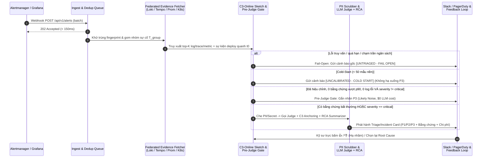

# 04 — Đặc tả Yêu cầu Sản phẩm (PRD): Hệ thống Phân loại Cảnh báo & Chẩn đoán Sự cố AIOps cấp Production

> **Bản thiết kế sản phẩm độc lập (cập nhật 2026-11-24).**
> Tài liệu này đặc tả toàn bộ **Yêu cầu Nghiệp vụ, Yêu cầu Tính năng (FR) và Yêu cầu Phi tính năng (NFR)** để phát triển lõi nghiên cứu `CTAV + RCA Agent` thành sản phẩm thương mại cấp Production (tên mã: `alert-triage`).
> Tài liệu này tách biệt hoàn toàn với phạm vi quyển luận văn.

---

## 1. Tầm nhìn Sản phẩm & Bài toán Thực tế

### 1.1 Nỗi đau của thị trường (The On-Call Fatigue Crisis)
Trong các hệ thống Microservices (10–200+ services), một lỗi nghẽn mạng hoặc nghẽn cơ sở dữ liệu ở tầng dưới có thể kích hoạt hàng loạt cảnh báo dây chuyền ở các dịch vụ gọi nó (*collateral alerts*).
- **Hiện trạng 1 (Luật tĩnh & Alertmanager tự vận hành):** Kỹ sư SRE phải tự duy trì nhiều luật `group_by`, `inhibit_rules` và ngưỡng tĩnh. Khi lưu lượng hoặc kiến trúc thay đổi, luật tĩnh dễ sinh ra lượng lớn báo động giả hoặc cảnh báo trùng lặp, gây quá tải ca trực (*alert fatigue*).
- **Hiện trạng 2 (Rủi ro khi áp dụng LLM/AIOps thiếu hiệu chỉnh):** Các thực nghiệm trong luận văn GĐ2 đã chỉ ra 3 thách thức cốt lõi khi đưa LLM vào thẩm định cảnh báo:
  1. **Thiên lệch xác nhận (*Confirmation Bias*):** Thí nghiệm can thiệp `H1` trên tập `val` (M5, QĐ-028) chứng minh rằng sự xuất hiện của trace cục bộ sát thời điểm cảnh báo ($t_0$) đẩy tỷ lệ Judge trả `TRUE_ALERT` trên cửa sổ bình thường lên tới `60,8%` (so với `18,1%` khi chỉ có log cục bộ).
  2. **Rủi ro hạ nhầm sự cố thật (*False Downgrade / Under-Prioritization*):** Trên tập `test` Nezha, khi thiếu ngưỡng nền `dev` ở `32/42` service, bộ neo `C3` đã hạ trọn `67/67` TP của `C1`; ngoài ra các lỗi truyền tải như `network_delay` thường không để lại log lỗi hay dấu vết rõ rệt tại nút cục bộ. Nếu để hệ thống tự động xóa cảnh báo hoặc hạ toàn bộ xuống mức ưu tiên thấp mà không có chốt chặn, người trực vẫn sẽ bỏ lỡ sự cố thật.
  3. **Chi phí API & Rò rỉ dữ liệu:** Gọi LLM cho mọi cảnh báo trong một cơn bão cảnh báo (*alert storm*) làm chi phí API tăng đột biến và tiềm ẩn nguy cơ gửi thông tin nhạy cảm (PII/Secret) trong log ra ngoài.

### 1.2 Giải pháp Định vị: Non-Suppressing, Evidence-Anchored Alert Triage
`alert-triage` là **lớp phân loại cảnh báo không chặn (Non-Suppressing Triage Layer)** đặt giữa công cụ phát cảnh báo (Alertmanager, Grafana, Datadog) và kênh thông báo trực (Slack, MS Teams, PagerDuty):
- **Không bao giờ tự động xóa cảnh báo:** Mọi cảnh báo đều được chuyển tiếp, nhưng được **phân tầng ưu tiên (`P1 - Critical Action` / `P2 - Needs Check` / `P3 - Likely Noise`)**, gom theo sự cố và đính kèm **bằng chứng đã đối chiếu ngưỡng nền (`C3-Online`)**.
- **Phân biệt rõ hai lớp an toàn:**
  1. **An toàn vận chuyển (`Fail-Open`):** Khi LLM lỗi, quá hạn, mất kết nối telemetry hoặc chạm trần ngân sách $\rightarrow$ cảnh báo gốc đi thẳng tới người trực kèm nhãn `[UNTRIAGED - FAIL OPEN]`.
  2. **An toàn phân loại (`False Downgrade Protection`):** Bảo vệ cảnh báo khỏi bị hạ nhầm xuống `P3` trong hai trường hợp: khi service đang ở pha khởi động lạnh (`Cold-Start`), hoặc khi cảnh báo nguồn có mức độ nghiêm trọng cao (`severity = critical / page` chỉ được hạ tối đa xuống `P2`, không bao giờ xuống `P3`).

---

## 2. Chân dung Người dùng (User Personas) & Luồng Trải nghiệm

| Chân dung | Vai trò & Mục tiêu | Nỗi sợ lớn nhất | Giá trị sản phẩm mang lại |
|---|---|---|---|
| **1. Kỹ sư Trực ca (On-Call SRE / DevOps)** | Xử lý cảnh báo trong ca trực; cần biết ngay: *"Cảnh báo này có cần xử lý khẩn không, và lỗi gốc nằm ở service nào?"* | AI hạ ưu tiên nhầm một sự cố thật xuống `P3` làm lỡ SLA, hoặc AI bịa ra bằng chứng giả (*hallucination*). | Thẻ Slack hiện sẵn các span/log vượt ngưỡng $p_{90}$ kèm link mở thẳng Grafana Tempo/Loki, sơ đồ 1–2 hop chỉ ra service gốc và giữ nguyên cảnh báo `critical` ở mức $\ge \text{P2}$. |
| **2. Trưởng nhóm Hạ tầng (Platform / SRE Lead)** | Giảm số lần gọi khẩn không cần thiết (*noisy pages/shift*), rút ngắn MTTA/MTTR mà không phải thay đổi bộ stack OpenTelemetry/Grafana sẵn có. | Tốn nhiều tuần cấu hình, phải nhân bản kho lưu trữ log/trace, hoặc bị khóa chặt vào một vendor (*vendor lock-in*). | Cài đặt bằng 1 lệnh `docker compose`/Helm, kết nối chỉ-đọc vào Loki/Tempo/Prometheus hiện hữu, chạy thử *Shadow Mode* 14 ngày không rủi ro. |
| **3. Giám đốc Kỹ thuật / Bảo mật (VP Eng / CISO / FinOps)** | Kiểm soát ngân sách đám mây/AI và đảm bảo tuân thủ bảo mật dữ liệu (GDPR, ISO 27001, PCI-DSS). | Rò rỉ token/PII của khách hàng lên API LLM công cộng; hóa đơn LLM tăng vọt khi có bão cảnh báo. | Bộ lọc PII/Secret tại biên trước khi gọi API; phễu khử trùng + cổng tất định giảm số lượt gọi LLM; trần ngân sách cứng theo ngày (*Hard Spend Cap*). |

### Luồng nghiệp vụ chuẩn (End-to-End Triage Flow)

---

## 3. Đặc tả Yêu cầu Tính năng (Functional Requirements — FR)

Mỗi yêu cầu được gắn mức ưu tiên phát hành: **P0 (Bắt buộc cho MVP `v0.1`)**, **P1 (Bản `v0.2`)**, **P2 (Bản Enterprise `v0.3`)**.

### Phân hệ 1: Tiếp nhận, Khử trùng & Ánh xạ Cảnh báo (Ingestion & Entity Resolution)

| Mã | Tên yêu cầu | Mô tả chi tiết & Tiêu chí nghiệm thu (Acceptance Criteria) | Ưu tiên |
|---|---|---|---|
| **FR-01** | **Webhook Ingest đa nguồn** | Cung cấp endpoint tiếp nhận payload chuẩn của Prometheus Alertmanager (`v2`), Grafana Unified Alerting, và Generic Webhook JSON. Đưa vào hàng đợi xử lý bất đồng bộ và trả về HTTP `202 Accepted` trong $< 150\text{ ms}$. Hỗ trợ cả trạng thái `firing` và `resolved`. | **P0** |
| **FR-02** | **Khử trùng theo Fingerprint & Cooldown** | Cảnh báo có cùng `fingerprint` đang ở trạng thái `firing` trong cửa sổ cooldown (mặc định `300s`) không kích hoạt thẩm định LLM mới, mà chỉ cập nhật bộ đếm lặp (`repeat_count`) trên thẻ hiện tại. | **P0** |
| **FR-03** | **Ánh xạ thực thể (`Service Resolver`)** | Ánh xạ linh hoạt từ nhãn cảnh báo (`service`, `app`, `job`, `k8s_deployment`, `container`) sang định danh nút trên đồ thị phụ thuộc thông qua quy tắc regex/priority trong file cấu hình. Nếu không khớp nút nào, chạy ở chế độ `local-only` và đánh dấu trên thẻ. | **P0** |

### Phân hệ 2: Kết nối Dữ liệu Liên bang & Đồ thị Động (Federated Telemetry & Dynamic Graph)

| Mã | Tên yêu cầu | Mô tả chi tiết & Tiêu chí nghiệm thu (Acceptance Criteria) | Ưu tiên |
|---|---|---|---|
| **FR-04** | **Connectors chỉ-đọc cho bộ LGTM / OTel** | Truy vấn trực tiếp trong khoảng `[t0 - W_pre, t0 + W_post]` tới: • **Prometheus / VictoriaMetrics / Mimir** (PromQL) • **Grafana Loki / OpenSearch** (LogQL / DSL) • **Grafana Tempo / Jaeger** (TraceQL / OTel Span API) Mọi truy vấn đều có timeout cứng (mặc định `3s`). | **P0** |
| **FR-05** | **Đồ thị phụ thuộc dịch vụ động (`Dynamic Topology`)** | Tự động dựng và cập nhật đồ thị có hướng $G = (V, E)$ từ quan hệ `parent_span_id -> span_id` của Tempo/Jaeger hoặc metric `traces_service_graph_request_total` theo cửa sổ trượt 60 phút. Lưu kèm trọng số tốc độ gọi và tỷ lệ lỗi trên từng cạnh. | **P0** |
| **FR-06** | **Truy xuất Fusion `C1` có tiền lọc bất thường** | Kết hợp điểm từ khóa BM25, độ gần thời gian $\Delta t$, khoảng cách đồ thị $1 / (1 + d_G)$ với $d_G \le 2$, và **hệ số khuếch đại bất thường** (ưu tiên span có `status = ERROR/WARN` hoặc `duration_ms > p90`) để hạn chế hiện tượng top-$K$ bị lấp đầy bởi các span bình thường (*Hạn chế 4* Chương 8). | **P0** |
| **FR-07** | **Thu nhận sự kiện thay đổi (`Change Events`)** | Nhận webhook từ GitHub Actions, GitLab CI, ArgoCD hoặc theo dõi sự kiện Kubernetes Deployment Rollout. Tự động gắn sự kiện thay đổi vào ngữ cảnh nếu xảy ra trong vòng `30 phút` trước thời điểm cảnh báo trên cùng service hoặc callee 1-hop. | **P1** |

### Phân hệ 3: Động cơ Hiệu chỉnh `C3-Online`, Cổng Tiết kiệm & Judge LLM

| Mã | Tên yêu cầu | Mô tả chi tiết & Tiêu chí nghiệm thu (Acceptance Criteria) | Ưu tiên |
|---|---|---|---|
| **FR-08** | **Ước lượng ngưỡng nền trực tuyến (`C3-Online`)** | Duy trì phân phối độ trễ ($p_{50}, p_{90}, p_{95}, p_{99}$) theo từng cặp `(service, operation)` trên **cửa sổ trượt 60 phút gần nhất (trừ 5 phút sát thời điểm cảnh báo) kết hợp tham chiếu cùng khung giờ của 7 ngày trước (`SameHour_7d`)**. | **P0** |
| **FR-09** | **Bảo vệ Khởi động lạnh (`Cold-Start Guard`)** | Nếu cặp `(service, operation)` có số mẫu trong cửa sổ trượt $< N_{\min}$ (mặc định `50` spans), đánh dấu trạng thái `COLD_START` và **cấm hạ mức ưu tiên cảnh báo xuống `P3`**. | **P0** |
| **FR-10** | **Cổng tất định bỏ qua LLM (`Pre-Judge Gate`) & Luật bảo vệ `Severity Bypass`** | *(Tính năng gắn với giả thuyết H8 sẽ kiểm định ở GĐ3):* Khi service đã qua giai đoạn `COLD_START`, độ phủ truy vấn telemetry đạt yêu cầu và **nhãn nguồn `severity` không phải `critical / page`**: nếu trong cửa sổ cảnh báo có `0` log `ERROR/WARN/FATAL`, `0` span lỗi và `0` span cục bộ vượt ngưỡng $p_{90}$, hệ thống xếp hạng `P3 (Likely Noise — Deterministic Gate)` với **0 lần gọi LLM (`$0.0000`)**. Cảnh báo có `severity = critical / page` bắt buộc bỏ qua cổng này để đi tiếp. | **P0** |
| **FR-11** | **Thử nghiệm nhúng phân vị nền vào Prompt (`Baseline-Contextualized Prompt` — Cờ bật/tắt)** | *(Giả thuyết thiết kế mới cho sản phẩm, chưa kiểm định trong H1 GĐ2):* Cho phép bật cờ cấu hình để in kèm phân vị nền ngay bên cạnh mỗi trace span trong prompt (ví dụ: `duration=420ms [baseline p50=45ms, p90=110ms]`). Tính năng này phải được đánh giá A/B trên tập `val` trước khi bật mặc định; cơ chế chặn báo động giả chính thức vẫn là bộ neo hậu kiểm tất định `C3` (`services/judge/policy.py::decide`). | **P1** |
| **FR-12** | **Neo bằng chứng đa điều kiện hậu kiểm (`Multi-Span C3`) & Trần hạ cấp `Critical`** | Để một phán quyết `TRUE_ALERT` của LLM được giữ ở mức `P1`, bằng chứng tại `s0` phải thỏa ít nhất một điều kiện: (a) Có log `ERROR/FATAL` khớp thời gian; (b) Có $\ge 2$ span vượt $p_{90}$; hoặc (c) Có $\ge 1$ span vượt $p_{99}$ (hoặc $\ge 3\times p_{90}$) hay mang trạng thái `ERROR/WARN`. **Trần hạ cấp an toàn:** Nếu không thỏa điều kiện neo `C3`, cảnh báo thông thường bị hạ xuống `P3`, nhưng cảnh báo có nhãn nguồn `severity = critical / page` chỉ được hạ tối đa xuống **`P2 (Needs Check — No Local Anchor)`** để tránh bỏ sót lỗi mạng/hạ tầng không có dấu vết cục bộ. | **P0** |

### Phân hệ 4: Gom nhóm Sự cố, Định vị RCA Đa bước & Tóm tắt có Kiểm duyệt

| Mã | Tên yêu cầu | Mô tả chi tiết & Tiêu chí nghiệm thu (Acceptance Criteria) | Ưu tiên |
|---|---|---|---|
| **FR-13** | **Gom nhóm sự cố trực tuyến (`Streaming Incident Grouping`)** | Gom các cảnh báo xảy ra gần nhau theo cửa sổ trượt `T_group` (mặc định `180s`) và có đường nối trên đồ thị phụ thuộc vào cùng một `Incident` đang mở, giúp gộp nhiều cảnh báo dây chuyền thành **1 thẻ sự cố duy nhất**. | **P1** |
| **FR-14** | **Định vị RCA kết hợp cảnh báo & tín hiệu trace lân cận** | Khi xếp hạng dịch vụ gốc (`Root Cause Ranking`), ngoài phiếu bầu từ các dịch vụ đã phát cảnh báo, thuật toán kiểm tra thêm độ tăng vọt độ trễ/lỗi trên các nút callee 1–2 hop từ dữ liệu trace để bắt được dịch vụ gốc ngay cả khi dịch vụ đó chưa kịp phát cảnh báo riêng (*Hạn chế 5* Chương 8). | **P1** |
| **FR-15** | **Bộ tóm tắt chẩn đoán kế thừa Validator 5 quy tắc + Cổng tiền lọc `P3`** | • **Kế thừa nguyên vẹn 5 quy tắc của `services/rca_agent/summarizer.py:7-13`:** (1) Từ chối `invalid_json` (thiếu/sai kiểu trường); (2) Từ chối `confidence_out_of_range` ngoài $[0, 1]$; (3) Từ chối `executable_action` (chặn câu lệnh thực thi shell/CLI trong `suggested_actions`); (4) Từ chối `no_evidence` theo `require_evidence` (kèm tự động lọc bỏ các `evidence_id` do LLM tự bịa); (5) Giữ xuất bản nhưng gắn cờ `suspicious = True` nếu `root_cause_service` không nằm trong đồ thị phụ thuộc. • **Quy tắc mở rộng thứ 6 (mới cho bản sản phẩm):** Nếu một nhóm sự cố chỉ gồm toàn các cảnh báo mức `P3 (Likely Noise)`, không gọi LLM Summarizer để ép gán nhãn lỗi (`cpu_contention` / `network_delay`), mà phát hành thẳng tóm tắt tĩnh `noise_only_group`. | **P0** |

### Phân hệ 5: Phân phối Thẻ Triage, Vòng lặp Phản hồi & Quản trị FinOps

| Mã | Tên yêu cầu | Mô tả chi tiết & Tiêu chí nghiệm thu (Acceptance Criteria) | Ưu tiên |
|---|---|---|---|
| **FR-16** | **Triage Card tương tác trên Slack / MS Teams** | Gửi thẻ thông báo định dạng rõ ràng (Block Kit trên Slack, dùng Socket Mode): hiển thị mức ưu tiên `P1/P2/P3`, chuỗi bước chính sách (tương tự hàm hiển thị `policySteps()` ở `services/web/src/lib/util.ts` mô phỏng `policy.py::decide`), 3 bằng chứng có deep-link sang Grafana, chi phí token, và nút bấm phản hồi. | **P0** |
| **FR-17** | **Tích hợp điều chỉnh mức độ khẩn PagerDuty / Opsgenie** | Cho phép đồng bộ mức ưu tiên `P1/P2/P3` sang mức độ thông báo của PagerDuty (ví dụ: `P1/P2` giữ nguyên high-urgency page; `P3` chuyển thành low-urgency notification khi khách hàng bật chế độ active, tuyệt đối không xóa sự cố). | **P2** |
| **FR-18** | **Vòng lặp phản hồi & Đo tỷ lệ hạ ưu tiên nhầm (`False Downgrade Rate`)** | Lưu phản hồi `👍 Chính xác` / `👎 Hạ nhầm sự cố thật` / `🎯 Chọn lại service gốc` từ kỹ sư trực vào PostgreSQL. Báo cáo tuần bắt buộc hiển thị rõ **Tỷ lệ sự cố thật bị hạ nhầm xuống `P3` (`False Downgrade Rate`)** bên cạnh Precision và tỷ lệ giảm tiếng ồn. | **P0** |
| **FR-19** | **Chế độ Chạy Bóng (`Shadow Mode`) cho POC** | Cho phép bật cờ `SHADOW_MODE=true`: hệ thống không can thiệp vào kênh trực chính thức mà gửi thẻ phân loại vào một kênh Slack riêng (`#aiops-shadow-poc`) và xuất báo cáo đối chiếu định lượng hàng tuần từ phản hồi của kỹ sư. | **P0** |
| **FR-20** | **Quản trị Ngân sách LLM (`FinOps Spend Cap`)** | Cho phép đặt hạn mức chi tiêu theo ngày/tháng (USD hoặc số token) cho toàn hệ thống hoặc từng nhóm dịch vụ. Tự động gửi cảnh báo khi chạm 80% và tự động chuyển sang chế độ `Deterministic + Fail-open` khi chạm 100%. | **P0** |

---

## 4. Đặc tả Yêu cầu Phi tính năng (Non-Functional Requirements — NFR)

Đây là các chỉ tiêu mục tiêu (Design Targets / SLOs) để vận hành ở quy mô doanh nghiệp:

### 4.1 Độ tin cậy & An toàn Vận hành (Reliability & Fail-Safe)
- **NFR-01 (`Fail-Open Delivery Guarantee`):** Tỷ lệ cảnh báo bị rơi/mất trên đường truyền do lỗi kỹ thuật của `alert-triage` phải bằng **`0.00%`**. Mọi ngoại lệ chưa xử lý, lỗi kết nối LLM, lỗi kết nối Loki/Tempo hay quá thời gian chờ (`timeout`) đều phải kích hoạt nhánh `Fail-Open` đẩy cảnh báo gốc tới kênh trực trong vòng $\le 2\text{ giây}$. *(Lưu ý: `Fail-Open` bảo vệ chống mất gói tin khi lỗi kỹ thuật; còn rủi ro phân loại sai `False Downgrade` được kiểm soát riêng bởi `FR-09`, `FR-12` và đo lường ở `FR-18`).*
- **NFR-02 (`Availability`):** Độ sẵn sàng mục tiêu của luồng Ingest & Fail-open đạt $\ge 99{,}9\%$ (hỗ trợ chạy Active-Passive hoặc 2 replica không trạng thái phía trước hàng đợi).

### 4.2 Hiệu năng, Độ trễ & Khả năng chịu tải (Performance & Scalability)
- **NFR-03 (`Ingestion Latency`):** Thời gian phản hồi HTTP `202 Accepted` của Webhook Ingest đạt mục tiêu **$p_{99} < 150\text{ ms}$** (đồng bộ với `02-mvp-product.md` §4).
- **NFR-04 (`End-to-End Triage Latency`):**
  - Với cảnh báo đi qua Cổng tất định (`Pre-Judge Gate`): mục tiêu **$p_{95} < 1{,}5\text{ giây}$**.
  - Với cảnh báo có gọi LLM Judge / RCA Summarizer: mục tiêu **$p_{95} < 8\text{ giây}$**, timeout cứng ở **`12 giây`** (quá 12s tự động `Fail-Open`).
- **NFR-05 (`Alert Storm Throughput`):** Mục tiêu chịu được tải đột biến **$\ge 200$ cảnh báo/phút** mà không làm tràn bộ nhớ (OOM) nhờ cơ chế khử trùng `fingerprint`, gom nhóm `T_group` và giới hạn đồng thời (`concurrency limiter / token bucket`) trước tầng LLM.

### 4.3 Bảo mật, Quyền riêng tư & Tuân thủ (Security, Privacy & Compliance)
- **NFR-06 (`Zero-PII & Secret Egress`):** Mọi đoạn văn bản log/trace trước khi đưa vào prompt gửi ra API LLM bên ngoài bắt buộc phải đi qua tầng **`PII & Secret Redaction`** (che địa chỉ IPv4/IPv6, email, số điện thoại, thẻ tín dụng, Bearer/JWT token, AWS/GCP key, chuỗi mật khẩu). Độ trễ mục tiêu của bước lọc **$p_{99} < 10\text{ ms}$/cảnh báo**.
- **NFR-07 (`Data Minimization & No Raw Log Storage`):** Hệ thống không sao chép toàn bộ kho log/trace của khách hàng; chỉ lưu siêu dữ liệu sự kiện và tối đa top-$K$ đoạn bằng chứng đã che PII phục vụ kiểm toán, kèm chính sách tự động xóa theo thời hạn (**TTL**, mặc định 30–90 ngày trong ClickHouse).
- **NFR-08 (`Access Control & Multi-Tenancy` — cho bản `v0.3`):** Hỗ trợ xác thực OIDC/SSO (Okta, Google Workspace, Azure AD), phân quyền RBAC (`Viewer`, `Responder`, `Admin`), mã hóa khóa API LLM bằng AES-256-GCM và cô lập dữ liệu theo `tenant_id`.

### 4.4 Kiểm toán, Quan sát nội tại & Khả năng bảo trì (Auditability & Maintainability)
- **NFR-09 (`100% Decision Audit Trail`):** Mọi thẻ phân loại phát hành phải truy vết ngược được về một bản ghi kiểm toán bất biến gồm: `alert_id`, tập bằng chứng đầu vào, giá trị ngưỡng nền $p_{90}$ tại thời điểm phán quyết, tên model LLM, mã băm phiên bản prompt (`prompt_hash`), `raw_verdict`, bước policy đã áp dụng, số token vào/ra, chi phí USD ước tính và độ trễ từng chặng.
- **NFR-10 (`Self-Observability`):** Bản thân sản phẩm phải xuất chuẩn OpenTelemetry và endpoint Prometheus `/metrics` (`triage_requests_total`, `triage_fail_open_total`, `triage_gate_bypassed_total`, `triage_false_downgrade_feedback_total`, `triage_llm_cost_usd_total`, `triage_e2e_duration_seconds`).
- **NFR-11 (`Frictionless Deployment`):** Triển khai bản tự host (`Self-Hosted`) trong **$< 30\text{ phút}$** chỉ với 1 file `docker-compose.yml` (hoặc Helm Chart) và 1 file cấu hình `config.yaml` được kiểm tra kiểu bằng Pydantic khi khởi động.
- **NFR-12 (`Core Parity & Regression Safety`):** Mọi bản cập nhật của gói lõi thuật toán (`core-v*`) phải vượt qua bộ kiểm thử hồi quy tự động trước khi phát hành cho sản phẩm.
